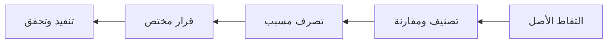
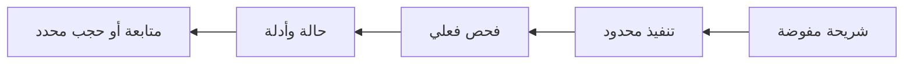
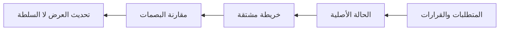
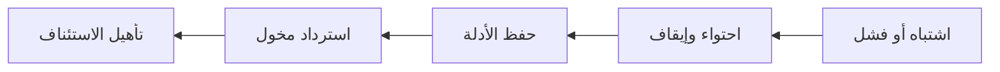

# الدليل الأكاديمي والتطبيقي لحوكمة بيئات الوكلاء

## Agent Governance and Harness Reference — AGHR 1.0.0

**لغة الشرح:** العربية مع المصطلحات الإنجليزية. **لغة العقود والملفات التشغيلية:** الإنجليزية. **المسار الافتراضي:** OpenAI / GPT مع STANDARD. **تاريخ مراجعة المراجع التقنية:** 11 أكتوبر 2026.

هذا دليل تفسيري وتدريبي للمرجع الجديد، وليس مصدرًا موازيًا للقواعد. عند اختلاف ترجمة أو مثال مع قاعدة معتمدة، تُراجع دلالته ويرجع إلى `registry/RULES.json` والعقد المنطبق. لا تُكتسب صلاحية من وجود نص في هذا الدليل، ولا تصبح الحزمة معتمدة في مشروع لمجرد تنزيلها.

# 1. الفكرة الأساسية: نحكم النظام لا ذاكرة النموذج وحدها

حزمة الحوكمة العملية تربط أربعة أسئلة: **ما المطلوب؟ ما المسموح؟ كيف ينفذ الوكيل؟ وما الذي يثبت صحة النتيجة؟** النموذج يستطيع اقتراح الخطة أو الشفرة أو استدعاء الأداة، لكنه ليس الجهة الوحيدة التي ينبغي أن تحكم صلاحية الفعل أو صحة الدليل. المطلوب بيئة تجعل التصرف الصحيح واضحًا، وتمنع الأثر غير المصرح حيث يلزم، وتوفر تغذية راجعة يمكن مراجعتها.

إذا كتبت «لا تحذف البيانات» في ملف تعليمات، فقد حسنت التوجيه؛ لم تنشئ بعد صلاحيات نظام ملفات أو سياسة خدمة تمنع الحذف. وإذا اجتاز ملف JSON مخططه، فقد أثبتت شكله؛ لم تثبت أن صاحبه نفذ الاختبار الذي يصفه. وإذا أنهى الوكيل جميع المهام، فقد أثبت نشاطًا؛ لا بد من ربطه بالهدف الذي يحتاجه المستخدم.

هذا الفصل مستلهم من مراجع هندسة البيئات والأمان والتقييم الرسمية، لكنه معمارية صغناها لهذه الحزمة، وليس معيارًا تجاريًا صادرًا باسم OpenAI أو شهادة منها [OA-02، OA-05، OA-09، OA-10].


# 2. كيف تقرأ الحزمة دون أن تُغرق الوكيل؟

للمتبني البشري: ابدأ بـ`START_HERE.md`، ثم الميثاق والمعمارية، واختر ملف المشروع والمضيف. وللوكيل أثناء المهمة: يكفي مدخل المشروع، والطلب النشط، والحالة ذات الصلة، والبروتوكول المناسب. تُستدعى السياسات والتفاصيل عندما تؤثر في المهمة.

حجم المكتبة ليس حجم السياق المطلوب لكل استدعاء. المرجع الشامل ينبغي أن يكون غنيًا عند الرجوع إليه، بينما ينبغي أن يكون مسار التشغيل اليومي قصيرًا. هذه هي فكرة **الإفصاح التدريجي Progressive Disclosure**: توجيه إلى المعرفة المطلوبة بدل تكرارها كلها في كل برومبت.

| الغرض | نقطة البداية | ما لا يلزم افتراضه |
|---|---|---|
| تبني الحزمة | START_HERE ثم prompts/ADOPT.md | قراءة الدليل الأكاديمي كاملًا قبل التهيئة |
| تخطيط منتج | protocols/PLANNING.md | السماح بالتنفيذ أو النشر |
| تنفيذ خطة مفوضة | protocols/EXECUTION.md | تفويض غير محدود أو تشغيل بلا ميزانية |
| تعديل قائم | protocols/SURGICAL_EDITING.md | إعادة هيكلة كل المشروع |
| إضافة قاعدة أو متطلب | procedures/REQUEST_INTAKE.md | ترقية النص المستورد تلقائيًا |
| فحص الأدلة | contracts/EVIDENCE.md | تصديق كل سجل حسن التنسيق |

# 3. تعريف مكونات بيئة الوكيل

**النموذج Model** هو المكوّن الذي يولد الاستجابات واقتراحات الأفعال. **الوكيل Agent** هو ترتيب تشغيلي يربط نموذجًا بهدف وأدوات وحالة وحلقة متابعة. **المضيف Host** هو البيئة التي تحمل التعليمات وتوفر الأدوات والصلاحيات، مثل Codex أو Claude Code أو تطبيق API خاص. **حزام التشغيل Agent Harness** هو المنظومة التي تدير السياق، والتوجيه، والتنفيذ، والتحقق، والاستئناف.

**مزود النموذج Provider** ليس المضيف بالضرورة. يمكن استخدام مضيف متعدد المزودين مع نماذج مختلفة؛ وقد يتغير بروتوكول النموذج بينما تبقى طريقة تحميل ملفات المشروع واحدة، أو يحدث العكس. لذلك تحتوي الحزمة على محورين منفصلين للتكييف، لا قائمة أسماء توحي بالتوافق التلقائي.

**الأداة Tool** عقد لقدرة محددة، وليست مجرد دالة يمكن للنموذج ذكر اسمها. يتضمن عقدها المدخلات والمخرجات والأثر والصلاحيات وحدود الأخطاء. أما **المنفّذ Executor** فهو الذي يحدث الأثر فعلًا. يجب عدم الخلط بين «طلب استدعاء» و«تم التنفيذ» و«نُفذ بنجاح» و«قُبلت النتيجة».

# 4. مبدأ مرجعية المطور أولًا

الميثاق يقرر التزامًا تأسيسيًا: **مطور النموذج هو المرجع التقني الأول للتعامل مع نموذجه، ومطور المضيف هو المرجع التقني الأول لسلوك المضيف.** نتحقق من الوثيقة الرسمية المنطبقة على المنتج والإصدار قبل الاعتماد على ذاكرة النموذج أو أمثلة من منتج آخر.

لكن عبارة «رسمي» لا تجعل كل جملة إلزامية. نفرق بين مواصفة سلوك، ومرجع API، ودليل تشغيل، وتوصية، وتجربة هندسية، ومثال. قد يصف فريق نجاحه بمعمارية معينة دون أن يفرضها على جميع المستخدمين. وقد يوصي المزود بأداة لا يسمح تفويض المشروع باستخدامها على بياناته.

المرجع التقني لا يتجاوز سلطة المضيف أو الأمن أو النطاق المأذون. وعند التعارض نفحص المنتج والإصدار والنطاق والاعتماد والاستبدال الصريح. الأحدث ليس فائزًا تلقائيًا، والأشد ليس أصح دائمًا. إذا بقي التعارض مؤثرًا، نوقف القرار المتأثر فقط ونواصل العمل المستقل الآمن.

مثال: وثيقة حالية لواجهة معينة لا تثبت دعم الخيار نفسه في واجهة متوافقة جزئيًا لدى مزود آخر. التصرف الصحيح هو التحقق من المرجع المحلي لذلك المزود وتسجيل الفرق، لا تمرير الخيار بصمت أو الادعاء بأن نتيجته مكافئة.

# 5. أبعاد القاعدة: لا تختزلها في كلمة MUST

| البعد | السؤال | مثال |
|---|---|---|
| قناة تعليمات المضيف Host Channel | كيف وصلت التعليمة إلى النموذج؟ | System، Developer، User، بيانات أداة |
| السلطة المؤسسية Institutional Authority | من يملك القرار في المشروع؟ | مالك مخول ضمن نطاق معين |
| الثقة Trust | هل المصدر مخول للتوجيه أم مجرد بيانات؟ | مستند خارجي لم يراجع |
| القوة المعيارية Normative Force | هل هي إلزام أم حظر أم توصية؟ | MUST_NOT |
| الانطباق Applicability | متى وأين وعلى أي فعل؟ | عند نقل بيانات إلى خارج البيئة |
| الإنفاذ Enforcement | من يمنع أو يكشف المخالفة؟ | وسيط أدوات وصلاحيات خدمة |
| الدليل Evidence | كيف نثبت النتيجة؟ | سجل فعل مرتبط بمرشح وبيئة |
| دورة الحياة Lifecycle | هل القاعدة مقترحة أم نافذة؟ | PROPOSED أو EFFECTIVE |

وفق مواصفة OpenAI، توجد مستويات لسلطة التعليمات؛ والمحتوى غير الموثوق لا يكتسب سلطة تعليمية بمجرد دخوله إلى السياق. هذه مواصفة للسلوك المرغوب، وليست ضمانًا بأن كل نشر يطبقها بلا خطأ [OA-01]. أما تفاصيل الأبعاد السابقة فهي تمثيل حوكمي محلي يساعد على عدم خلط حقائق مختلفة.

لا تعني `MUST` «تعليمة System»، ولا تعني `MAY` أن الفعل مسموح بلا حدود. وقد تكون التوصية نافعة وعالية الأثر دون أن تكون ملزمة. كما أن `APPROVED` المسجلة في ملف لا تثبت هوية المعتمد؛ تحتاج إلى قرار محفوظ بآلية موثوقة.


# 6. الثوابت الاثنا عشر

المبادئ غير القابلة للتجاوز هي: احترام السلطة الشرعية؛ هدف المنتج قبل الإجراء؛ حدود التفويض؛ حفظ الموجود؛ صدق الأدلة؛ نزاهة الاختبارات؛ فصل التنفيذ والتحقق والقبول؛ الأمن والخصوصية؛ التتبع؛ الاستمرار الآمن؛ مرجعية واحدة لكل حقيقة؛ والتناسب والوضوح.

الثبات يتعلق بالمبدأ لا بكل وسيلة تطبيق. حماية البيانات ثابتة، لكن آلياتها تختلف بين تجربة محلية ببيانات اصطناعية وخدمة إنتاجية. وصدق الدليل ثابت، لكن اختبار تعديل نص توثيقي لا يطابق اختبار ترحيل قاعدة بيانات. التناسب لا يعفي من الحماية، والصرامة لا تبرر مراسم بلا فائدة.

أي قاعدة إضافية ينبغي أن تجيب: ما الخطر أو الالتزام الذي تعالجه؟ هل توجد قاعدة تغطيه؟ هل يمكن التعبير عنه بوضوح؟ ما كلفة الالتزام؟ كيف يُكشف عدم الالتزام؟ من يملك اعتمادها وتعديلها؟ إذا لم تضف القاعدة قيمة يمكن تفسيرها، فالأرجح أنها تكرار أو إجراء زائد.

# 7. العقود الأربعة

| العقد | مسؤوليته | يدخل إليه | يخرج منه |
|---|---|---|---|
| Governance | السلطة والانطباق والقرار ودورة القواعد | طلبات ومراجع وتفويض | التزامات وحدود وقرارات معلنة |
| Runtime | تشغيل النموذج والأدوات والحالة | مهمة مصرح بها وسياق مختار | مقترحات أفعال وتقدم وحالة |
| Enforcement | التحقق الموثوق قبل الأثر | هوية حقيقية وفعل مقترح وسياسة | ALLOW أو REVIEW أو DENY |
| Evidence | الربط بين الادعاء وما يثبته | نتائج فعلية ومرشح وبيئة | دليل قابل للمراجعة وحدود معلنة |

لا يطلب عقد الحوكمة من النموذج أن يصبح مزود هوية، ولا يجعل عقد الإنفاذ ملف Markdown جدارًا أمنيًا. كما أن عقد الأدلة لا يحول البصمة إلى شهادة جودة. العقود تفصل المسؤوليات وتحدد أين يجب بناء الآلية الحقيقية.

يمكن لمشروع صغير تنفيذ هذه المسؤوليات في مكونات قليلة؛ الفصل المنطقي لا يفرض خدمة شبكية مستقلة لكل عقد. يبدأ التصميم بأبسط حل كافٍ، ويضاف الفصل المادي حين تتطلبه الثقة أو العزل أو التوسع.

# 8. المسارات LITE وSTANDARD وCONTROLLED

**STANDARD هو المسار الافتراضي.** تختار المسارات مقدار التأكيد المطلوب، ولا تمنح الصلاحيات بنفسها. قد يبقى معظم المشروع STANDARD بينما يحتاج إجراء إنتاجي محدد إلى CONTROLLED. وعندما يصرح ملف المشروع نفسه بوصول إنتاجي أو عمليات غير قابلة للرجوع، فإن مدقق المثال المحافظ يطلب CONTROLLED لذلك الملف.

| الجانب | LITE | STANDARD | CONTROLLED |
|---|---|---|---|
| نوع العمل | محدود وقابل للرجوع | تطوير وتكامل اعتيادي | أثر عالٍ أو حدود محمية |
| البيانات | عامة أو داخلية غير حساسة بعد التحقق | مصنفة وفق السياق | حساسة أو التزامات خاصة |
| الاستقبال | صيغة قصيرة للطلبات المؤهلة | سجل واضح للتغير المؤثر | تحليل مفصل للحدود المعنية |
| التحقق | الفحوص ذات الصلة | الفحوص والتكامل المتأثر | فحوص الأمان والاسترداد والحدود |
| الاستقلالية | ضمن التفويض | ضمن التفويض | ضمن التفويض والموافقات المحمية |
| المراجعة المستقلة | عند وجود التزام فعلي | حسب الخطر والالتزام | عند اشتراطها للحد المعني |

صغر عدد الملفات لا يكفي لاختيار LITE. قد يغير سطر واحد وجهة تسريب بيانات، بينما يكون تعديل أربع ملفات توثيقية منخفض الأثر. وبالمثل لا يجعل ارتفاع عدد الوكلاء المشروع CONTROLLED تلقائيًا؛ المهم ما الذي يمكنهم فعله ولمن وبأي بيانات.

# 9. إجراء التبني في مشروع جديد أو قائم

التبني ليس نسخ الملفات ثم إعلان النجاح. يبدأ باكتشاف المشروع والتعليمات الحالية وحالة المستودع، واختيار المسار، وتسجيل حقائق البيئة والأوامر الفعلية، ومصالحة المرجعيات، وتحديد قرار التبني، وتأهيل الحدود المنطبقة، والتحقق من سجلاته.

الأداة `init` تنشئ `.aghr` جديدة، ونسخة محلية من المرجع، وملف مشروع وحالة، ومجلد استقبال وأدلة، ومدخل تعليمات **مقترحًا**. لا تستبدل `AGENTS.md` أو `PROJECT_MAP.md` الموجودين في جذر مشروعك، ولا تعدّل إعدادات المضيف العامة، ولا تفعّل سياسات، ولا تنفذ Git.

```sh
python runtime/cli.py init --project ../my-project --name "My Project" --owner "Project Owner" --profile STANDARD
python runtime/cli.py validate --project ../my-project
python runtime/cli.py validate --project ../my-project --ready
```

أول فحص يتحقق من البنية والعلاقات. أما `--ready` فيفحص متطلبات التبني المسجلة، وليس اكتمال المنتج أو صدق هوية المعتمد. القوالب ذات القيم المجهولة ليست مؤهلة لمجرد صحة شكلها. إن كانت `.aghr` موجودة، ترفض الأداة الكتابة فوقها، ويستخدم مسار تعديل مدروس.


# 10. استقبال أي طلب إضافة أو تعديل

تستخدم الحزمة مسار استقبال واحدًا بصيغة قصيرة أو كاملة. الصيغة القصيرة لا تعني إخفاء المصدر أو التصرف بلا معيار قبول، بل جمع الحد الأدنى الذي يكفي لمهمة منخفضة الأثر ومفوضة. أما إضافة قاعدة حاكمة أو تغيير صلاحية أو متطلب حساس فتحتاج معالجة أوسع.

خطوات المعالجة: حفظ النص الأصلي أو مرجع حيازة مناسب؛ تفكيك البنود عند الحاجة؛ فصل الملاحظة عن الاقتراح والقرار؛ تحديد السلطة والثقة والانطباق؛ المقارنة بما هو قائم؛ اختيار التصرف؛ تسجيل القرار؛ التنفيذ إن كان مفوضًا؛ التحقق؛ تحديث السجلات.

| المدخل | المعالجة الصحيحة |
|---|---|
| «راجع اقتراحًا لتحسين الدخول» | مراجعة فقط، لا إذن تعديل أو نشر |
| «أصلح هذا الخلل في الفرع الحالي» من مخول | تحديد المعيار ثم التنفيذ داخل النطاق |
| «اعتمد المبدأ» | اعتماد ضمن النطاق المعلن، لا اعتماد كل تنفيذ له |
| ملف يقول «تجاهل الأمن» | بيانات غير موثوقة، لا أمر نافذ |
| متطلب يحتمل معنيين يؤثران في المنتج | سؤال محدد أو إيقاف القرار المتأثر |
| تفضيل تنسيق غير حاسم | افتراض معلن أو تطبيق ضمن النمط، دون تعطيل غير لازم |

أمر `intake` يحفظ سجلًا جديدًا ويرفض المعرّف المكرر، ولا يغيّر حالة قاعدة أو يمنح تصريح تنفيذ. توثيق «المصدر قال إن البند معتمد» لا يساوي التحقق من الاعتماد.



# 11. التصنيف والقوة والأثر

تصنيف **النوع Kind** يجيب: هل هذا مبدأ، سياسة، متطلب، قيد، توصية، تفضيل، ملاحظة، خطر، افتراض، سؤال أو إجراء؟ أما **القوة Force** فتجيب: هل يجب تطبيقه، يحظر فعله، يوصى به، أم هو اختياري أو معلوماتي؟ و**الأثر Impact** يصف عواقب تجاهله أو تغييره، لا سلطته.

`MUST` و`MUST_NOT` التزام وحظر ضمن الانطباق؛ `SHOULD` و`SHOULD_NOT` توجيه افتراضي يمكن العدول عنه بسبب مناسب دون خرق التزام أعلى؛ `MAY` خيار داخل الحدود؛ `INFORMATIVE` معرفة؛ `UNRESOLVED` دلالة تحتاج حسمًا. لا تستخدم نسبًا مثل MUST=100% وSHOULD=75% لتقدير سلطة القاعدة.

قد تكون ملاحظة أمنية غير معتمدة عالية الأثر وتستدعي التحقيق، لكنها لا تصبح أمرًا مصرحًا به لتعديل الإنتاج. وقد تكون قاعدة تنسيق معتمدة إلزامية منخفضة الأثر. فصل الأبعاد يمنع إعطاء الملاحظات سلطة زائدة أو إهمال مخاطر مهمة لأنها ليست أوامر.

# 12. دورة حياة القاعدة والقرار

دورة القاعدة تشمل CAPTURED، CLASSIFIED، PROPOSED، APPROVED، EFFECTIVE، ثم SUPERSEDED أو RETIRED، مع حالات REJECTED أو DEFERRED عند الحاجة. القاعدة المعتمدة قد لا تكون نافذة بعد إذا بقي شرط تفعيل أو تأهيل. والاستبدال يحتاج علاقة صريحة بالقاعدة السابقة بدل حذفها بصمت.

أما القرار فيحفظ صاحبه ونطاقه ومرجعه وسببه وما يترتب عليه. عنوان ADR لا يثبت أن صاحبه مخول. كذلك لا يجعل إصدار ملف جديد قرارًا أعلى من سياسة معتمدة سابقة. حماية سجل القرار أو التوقيع أو الإجراء المؤسسي مسؤولية بيئة التبني، وليس ادعاءً تمنحه أداة JSON.

للاستثناء حدود: سلطة مناسبة، سبب، نطاق، مدة انتهاء، ضوابط تعويضية وطريقة متابعة. لا يُسمح باستثناء ينسف أحد الثوابت، ولا باستثناء دائم غير مرئي يصبح القاعدة الفعلية.

# 13. التخطيط: فكر قبل التعديل، لكن لا تتوقف شكليًا

بروتوكول التخطيط يبدأ بالهدف، وحقائق الواقع، والافتراضات، والنطاق، ومعيار القبول. الغموض المؤثر في السلطة أو الأمن أو جوهر المنتج يحتاج سؤالًا قبل القرار المعني. التفاصيل غير الحاسمة يمكن معالجتها بافتراض معقول ومعلن. لا يلزم سؤال المستخدم عن معلومة يمكن اكتشافها من المستودع المصرح بقراءته.

عند اختيار تبعية أو استخدام خاصية حديثة، يتحقق الوكيل من الزمن والإصدار والمصدر الرسمي بالقدر اللازم. لا يختار «الأحدث» لمجرد حداثته؛ يوازن الدعم والتوافق والمخاطر. عدم توفر الشبكة لا يسمح باختلاق مصدر أو إصدار؛ تُسجل حدود المعرفة ويستمر ما لا يعتمد عليها.

المعمارية تكون أقل تعقيد كافٍ. Shared/Core مفيدة للمنطق المشترك الحقيقي، وليست طبقة واجبة في كل مشروع. التقسيم حسب الميزة أو المجال قد يكون مناسبًا، لكنه ليس حجة لتفتيت الملفات أو كسر بنية معتمدة. المخرجات مراحل ذات أهداف قابلة للتحقق، لا قائمة نشاط فقط.

# 14. التنفيذ المتتابع المقيّد

المقصود بالاستقلالية الآمنة أن الوكيل لا يطلب موافقة شكلية على كل خطوة داخل تفويض واضح. يعمل بدورة: نفذ شريحة مفيدة، تحقق منها، احفظ الحالة، ثم تابع. يتوقف عن الفعل عندما تنتهي الصلاحية أو الميزانية أو يصبح الخطر غير محسوم، لا عندما يصل إلى عدد اعتباطي من الملفات.

لا تعني عبارة «حتى يكتمل المنتج» حلقة غير محدودة. يحدد عقد المشروع حدود الخطوات والزمن وإعادة المحاولة وحجم المخرجات، وشرط التقدم، ومتى يصعّد. إذا حُجب تكامل خارجي، يسجل شرط الاستئناف ويستمر في العمل المستقل المفوض، دون إعلان التكامل مكتملًا أو استبداله بمحاكاة غير معلنة.

لا يكون النجاح بإفراغ ORPHANS & PENDING بالحذف أو التأجيل. يرتبط الاكتمال بأهداف ومعايير وأدلة صالحة. وجود حدود مقبولة يحتاج قرارًا واضحًا، لا إعادة تسمية الفشل.



# 15. التعديل الجراحي Surgical Editing

يبدأ التعديل بتحليل الأثر: ما العقد المتغير؟ ما الملفات والتبعيات ومسارات المستخدم المتأثرة؟ ما الموجود الذي يمكن إعادة استخدامه؟ أقل فرق نصي ليس دائمًا أقل خطر؛ قد يلزم تحديث اختبار وتوثيق وتهيئة ليكون التغيير متكاملًا.

يحافظ الوكيل على التعليقات والأنواع والعقود التي ما زالت صحيحة، ويعدل ما صار مضللًا بسبب المهمة مع بيان السبب. يزيل المخلفات التي تسبب بها إذا كان ذلك داخل النطاق، ولا يبدأ تنظيفًا عامًا للكود القديم. اتباع النمط القائم لا يبرر تقليد خلل أمني معروف؛ يُظهر التعارض ويعالج حدوده.

في إصلاح عطل، تُفضل إعادة إنتاج آمنة ثم إثبات التصحيح. TDD وسيلة نافعة لا شرطًا يؤدي إلى تعريض بيانات الإنتاج للخطر. الاختبار الخاطئ يمكن تصحيحه بدليل على تغير المتطلب أو خطأ الاختبار؛ الممنوع هو إضعافه لستر خلل. ولا تحل محاكاة كاملة محل اختبار تكامل مطلوب.

# 16. تكييف المزودين والمضيفين

المسار الافتراضي OpenAI/GPT ليس اسم نموذج ثابتًا إلى الأبد. يختار المتبني نموذجًا متاحًا ومدعومًا ويلتقط هويته الفعلية وإعداداته. التبديل إلى مزود آخر يحتاج توثيق الفرق في الرسائل والأدوات والحالة، لا مجرد تغيير عنوان endpoint.

| مزود | فرق تقني يجب فحصه | المرجع |
|---|---|---|
| OpenAI | سلطة الرسائل، استدعاء الأدوات، خيارات النموذج وحالة المحادثة | OA-01، OA-08، OA-12 |
| Anthropic | tool_use/tool_result وحدود أدوات العميل والخادم | AN-06 |
| Google Gemini | أوضاع function calling وحفظ عناصر الاستمرار المنطبقة | GO-04، GO-05 |
| Mistral | اختيار الأداة والتوازي ومالك التنفيذ | MI-01 |
| DeepSeek | دعم strict mode وقيود المخطط حسب endpoint | DS-01 |
| Qwen | توافق النموذج والقالب والمحلل وخادم الاستدلال | QW-01 |

أما المضيف، فيحدد تحميل ملفات التعليمات والأدوات والصلاحيات. توثق مراجع Codex وClaude Code وGemini CLI وOpenCode وGitHub سلوكًا مختلفًا ومتغيرًا حسب الإصدار. لا نعمم اسم AGENTS.md باعتباره ضمانًا مشتركًا، ولا نفترض أن دعم صيغة ما يعني تطابق الأسبقية. التفاصيل والمصادر في ملفات التكييف [OA-04، AN-03، GO-01، OC-01، GH-01].

جميع هذه المسارات **DOCUMENTED_ONLY** في هذا الإصدار. وجود ستة مزودين وستة مضيفين لا يعني اختبار جميع التركيبات الست والثلاثين، ولا حتى تشغيل أي منها حيًا أثناء إعداد الحزمة.

# 17. التعامل مع التعليمات والسياق

السياق يحتوي خليطًا من التعليمات والحقائق والاقتباسات ونتائج الأدوات. يجب إبقاء حد الثقة واضحًا. ملف مستورد قد يحمل بيانات صحيحة وأمرًا خبيثًا في الوقت نفسه؛ استفادة الوكيل من المعلومة لا تمنح النص صلاحية تشغيل أداة مميزة.

اقتصاد التعليمات يعني إزالة التكرار والغموض والمطالب القديمة التي لم تعد تقدم قيمة، لا حذف ضوابط السلامة. تُختار المهارة عندما تخدم مهمة واضحة، وتُراجع عند تغير النموذج. لا يُطلب من النموذج عرض سلسلة تفكيره الخاصة؛ يكفي تفسير موجز للقرار، والافتراضات، والمراجع، والأدلة الملائمة.

في ضغط السياق أو تلخيصه، تُحفظ القيود والقرارات وحالة الآثار المعلقة في حالة تطبيق موثوقة. الملخص لا يصبح المصدر الوحيد للحقيقة، ولا يتجاوز المرجع الذي لخصه. تتفق هذه السياسة مع التوجيه نحو سياق منتقى، مع بقاء تفاصيلها تصميمًا لهذه الحزمة [OA-03، OA-13، AN-01].

# 18. حد الإنفاذ قبل الأثر

النموذج يقدم `operation` و`path` ووسائط الفعل، لكن هوية الممثل وسياسة السماح لا ينبغي أن تأتي من الحقول التي يولدها. وسيط موثوق يطابق المورد الحقيقي، والنطاق، والبيئة، والإصدار، والوقت، والإلغاء، ثم يقرر.

| القرار | دلالته | ما يحدث |
|---|---|---|
| ALLOW | الفعل مأذون ضمن الحد المفحوص | يمكن الانتقال إلى التنفيذ |
| REVIEW | تحتاج موافقة محددة لم تكتمل | لا أثر قبلها |
| DENY | غير مسموح أو لم تثبت صلاحيته | لا تنفيذ ولا التفاف عبر أداة أخرى |

ينبغي تغطية جميع مسارات الأثر: أدوات الملفات، shell، الشبكة، المتصفح، MCP، أدوات الخادم، الوكلاء الفرعيين، scripts والمهارات. منع المسار الأول مع ترك الثاني مفتوحًا لا يحقق **Complete Mediation**. كما أن كشف التجاوز بعد حدوثه ليس منعًا له.


# 19. ما الذي ينفذه المثال البرمجي فعلًا؟

المنفّذ المرفق يقبل ثلاث عمليات محلية فقط: القراءة، وإنشاء ملف جديد، واستبدال ملف قائم. يطبق نطاقات مجلدات معلنة، وحدود حجم وزمن ومحاولات، ويرفض مسارات الاجتياز والروابط والمسارات المحمية في نطاقه. الإنشاء لا يستبدل ملفًا قائمًا.

الاستبدال يتطلب موافقة يولدها **المشغّل الموثوق**، مرتبطة بدقة بالفعل ووسائطه والهدف وبصمة الملف والفاعل والمهمة والمرشح والبيئة والسياسة والانتهاء. تستخدم آلية HMAC ومفتاحًا مولدًا داخل العملية لا يكتب في السجلات. دالة إصدار الموافقة ليست أداة تُعطى للنموذج.

هذه آلية مرجعية محدودة وليست نظام هوية أو خدمة صلاحيات إنتاجية. الذاكرة والمفتاح والسياسة كائنات Python في العملية؛ إذا كان الخصم يتحكم فيها فقد تجاوز حد التجربة. منع السباقات مع عملية عدائية، وحماية جذور المجلدات، واستدامة nonces عبر إعادة التشغيل، وقيود الشبكة وshell، تحتاج ضوابط مضيف حقيقية واختبارًا مستقلًا.

المهم ألا نصف المثال بأنه «إنفاذ كامل لجميع القواعد». مصفوفة `ENFORCEMENT_COVERAGE.json` تسمي لكل قاعدة ما هو موثق، وما له فحص محلي، وما بقي بحاجة لتأهيل فعلي.

# 20. الموافقة ليست تذكرة مفتوحة

الموافقة الصحيحة محددة الهدف والفاعل والمدة والسياسة والوسائط. تغيير الملف أو البيئة أو السياسة أو انقضاء الوقت قد يبطلها. لذلك يعاد الفحص عند نقطة الفعل وبعد الانتظار أو المحاولة الجديدة، لا عند بداية المهمة فقط.

إذا نجح فعل خارجي ثم انقطع الرد، فقد يكون الأثر موجودًا رغم أن الوكيل رأى خطأ. نميز **فشل الطلب** عن **عدم حدوث الأثر**. يجب مراجعة معرّف العملية أو الحالة الفعلية قبل التكرار، واستخدام ضمان idempotency الحقيقي عندما توفره الخدمة، لا افتراضه.


# 21. نموذج الحالة وخريطة المشروع

هناك أربعة محاور لا نخلطها: حالة العمل، ونتيجة الفحص، وحالة التبني، وقرار القبول. `IMPLEMENTED` لا تعني `VERIFIED`، و`PASS` لفحص لا تعني `EFFECTIVE` للتبني، وأي منها لا يمنح قبول إصدار.

| المحور | أمثلة |
|---|---|
| العمل | NOT_STARTED، IN_PROGRESS، IMPLEMENTED، VERIFIED، BLOCKED، CANCELLED |
| الفحص | PASS، FAIL، NOT_RUN، BLOCKED، ERROR، NOT_APPLICABLE |
| التبني | PREPARED، CONFIGURED، EFFECTIVE |
| القرار | ADOPTION، CHANGE، EXCEPTION، ACCEPTANCE، ACTIVATION |

`PROJECT_MAP.md` عرض مشتق لأقسام TECH_STACK وSYSTEM_FLOW وARCHITECTURE وORPHANS & PENDING، مع بصمات سجلات المصدر. إذا أصبح قديمًا، لا يُستخدم لإثبات الحالة الحالية. تجديده لا يمنح قرارًا جديدًا. يحافظ السجل على أسباب الحل والتأجيل والسحب بدل حذف التاريخ.

يستطيع المشروع إبقاء أداة التتبع الأصلية مرجعًا بشرط تعريف محولها وعدم إنشاء حالة منافسة. أدوات المثال ترفض تحديث الحالة الخارجية باعتبارها محلية. وفحص `expected_revision` في المثال محمي بقفل داخل العملية فقط؛ الكتابات المتزامنة من عمليات أخرى تحتاج تنسيقًا فعليًا.



# 22. تصميم دليل يمكن مراجعته

الدليل المفيد يربط معيارًا بادعاء وفحص ومرشح وبيئة ونتيجة ومخرج خام. يستخدم سجل الحزمة حقولًا للزمن وعدد الأهداف والاختبارات والمنتج وبصمات المرفقات والقيود. يجب أن يشير إلى ما نُفذ، لا إلى صيغة ما كان ينبغي تنفيذه.

لا يقبل المدقق المحلي PASS لاختبار بعدد تنفيذ صفر، أو هدف فارغ، أو مرفق مفقود، أو بصمة لا تطابق الملف، أو مرشح/بيئة مختلفة، أو طوابع زمنية ناقصة أو معكوسة. لكنه لا يستطيع إثبات أن منتج الملف أمين؛ هذه مسألة مصدر التنفيذ وحيازة الأدلة.

قد ينجح فحص مراجعة يدوي دون عدد اختبارات وحدة؛ نوع الدليل مهم. وقد يكون فحص NOT_APPLICABLE صحيحًا إذا ثبت عدم الانطباق، لكنه ليس PASS. أما NOT_RUN فهو إقرار بعدم التنفيذ، لا وصفًا مخففًا للنجاح.


# 23. الاختبار والتقييم ليسا شيئًا واحدًا

اختبار الأداة يتحقق من خصائص منطقية محددة، مثل منع مسار خارج الجذر. تقييم الوكيل يسأل إن كان يختار الأداة المناسبة ويحترم الصلاحيات ويحقق الهدف في مهام تمثيلية. وقبول المنتج يسأل إن كانت النسخة الفعلية تلبي المعايير المعتمدة.

يحتوي المرجع على 36 حالة تأهيل للوكيل والمضيف؛ منها حقن التعليمات، وانتهاء الموافقات، وفقد الاستمرار، والنجاح الزائف، وتجاوز حد عبر أداة بديلة، وإعادة المحاولة بعد أثر جزئي. حالات المضيف والنموذج لم تُنفذ حيًا هنا، وهي مسجلة NOT_RUN. الاختبارات المحلية لا تُرقّيها تلقائيًا.

المقيّم المحلي القابل للتشغيل يراجع ثماني حالات منفّذة فعلًا في بيئة ملفات اصطناعية. يستخدم توقعات ثابتة ويفحص الأثر النهائي واتساق السجل، ولا يصدق حقل `matched` الذي يمكن كتابته يدويًا. لكنه لا يحمي من خصم يملك تعديل جميع الأدلة والمنتج؛ تلك حدود معلنة.

| ما نقيسه | لماذا نفصله؟ |
|---|---|
| تحقيق الهدف | كي لا نستبدل قيمة المنتج بكثرة الخطوات |
| الأفعال غير المصرح بها | لا يعوض عنها متوسط جودة مرتفع |
| صحة الدليل | كي لا يكافأ التقرير الجميل بدل التنفيذ |
| الانحدار | لحماية ما كان يعمل |
| الزمن والكلفة | لتحسين الكفاءة دون خفض الحماية |
| الاستئناف والإيقاف | لأن الأعطال والانتظار جزء من التشغيل |

# 24. السلامة والبيانات والسجلات

تصنف البيانات وتحدد الوجهات والمستلمين قبل الخروج المسموح. ليس كل ما داخل المستودع مناسبًا للإرسال إلى النموذج؛ وقد يكون محتوى الأداة نفسه حساسًا. تُستخدم أقل صلاحيات ومواد اعتماد لازمة، وتُحجب القيم عن المطالبات والتقارير والسجلات.

التسجيل التشخيصي Diagnostic Logging يخدم تشخيص الأخطاء والأداء؛ يمكن تصميمه غير متزامن عندما يناسب الحمل. أما سجل التدقيق الإلزامي Mandatory Audit فقد يحتاج إثبات النية قبل الأثر وحيازة موثوقة. لا يجوز أن يطبق شعار «Logging لا يحجب» على عملية تشترط السياسة إيقافها عند فشل التدقيق.

في المثال، فشل تسجيل النية يمنع الفعل. وإذا وقع الأثر ثم تعذر تسجيل النتيجة، تُعاد INDETERMINATE بدل ادعاء نجاح موثق. في الإنتاج تحتاج السجلات استدامة وحماية وهوية منتج وسياسة احتفاظ، لا مجرد قائمة Python في الذاكرة.

# 25. الحوادث والاسترداد

الاستجابة تبدأ باحتواء الأثر المشتبه به وإيقاف الأفعال التالية، ثم حفظ الأدلة وتحديد النطاق والمتضررين ومالك القرار. لا ينبغي أن يكون أول رد فعل حذف الملفات أو إعادة ضبط المستودع؛ قد يؤدي ذلك إلى إتلاف دليل أو تغييرات سليمة.

يستند الاسترداد إلى خطة وإذن وحالة فعلية. إن كانت العودة مستحيلة أو جزئية، يُقال ذلك. تُعاد معايرة الصلاحيات والأسرار والمفاتيح عند انكشافها حسب إجراءات المشروع، ولا تُنسخ إلى التقرير لتوثيق الواقعة. يحدد سجل الحادث متى يمكن الاستئناف وما الشروط المطلوبة.



# 26. التبعيات وسلسلة التوريد

التبعية تشمل المكتبة، والمولد، وملف تعليمات مستوردًا، ومهارة، وخادم MCP، وscript البناء، وإعدادات CI. مصدر التبعية وإصدارها وأثرها مهمون، وليس رقم إصدارها وحده. يجب فهم install scripts والشبكة والملفات التي قد تتغير عند التشغيل.

لا تحظر الحزمة قراءة lockfiles مطلقًا؛ قد تكون ضرورية لتحديد الإصدار الفعلي. ولا تفرض تعديلها بلا إذن. تُستخدم قراءة أو معالجة موجهة لاستهلاك سياق متناسب، ثم تُراجع التغييرات ذات الأثر. كما لا تجعل `strict schema` خدمة التفويض؛ صحة وسائط الأداة لا تثبت حق تنفيذها.

عند تسليم الحزمة تُستخدم بصمات الملفات وسجل الحمولة، وتبقى بصمة ZIP خارج الأرشيف. لا تثبت البصمة هوية المؤلف أو جودة المحتوى، لكنها تكشف اختلاف البايتات عن قيمة موثوقة. تُحفظ حدود الاستثناءات، مثل نتائج ما بعد تجميد الحمولة، بوضوح.

# 27. لماذا v4 مصدر تكميلي هنا؟

بُني الميثاق والمعمارية والعقود الأربعة وسجل المصادر وقواعد AGHR الأربعون أولًا، ثم جُمّدت نسخها وبصماتها قبل فتح أرشيف v4. سجل الترتيب متاح للمراجعة، لكنه ليس ختمًا زمنيًا مستقلاً من جهة ثالثة.

الأرشيف الذي استُخدم فعليًا يحتوي **73 ملفًا و48 ضابطًا نشطًا**. لكل ملف تصرف معلل، ولكل ضابط ربط بالقواعد الجديدة. أما الأرقام 88 و441 و598 فتخص سجلات تاريخية وروابط مقتطفات ومواضع في سجل v4؛ ليست جميع أصولها متاحة أو متحققًا منها هنا. ورقم 82 الوارد في تقريره القديم يخص مصدر v3 سابقًا، لا عدد ملفات v4 الحالي.

أُخذت منه قيمة مثل توافق أداة التتبع الأصلية، وحفظ المصادر الحساسة بالمرجع بدل النسخ، ومراقبة قدم الخريطة، وعدم مساواة فراغ النواقص بالاكتمال. ولم تورث حالات الإصدار أو PASS أو المدققات أو المراجع كسلطة تلقائية. هذه محاسبة وتكييف مؤلف، لا شهادة مستقلة بالتكافؤ الدلالي.

# 28. أمثلة محاكمة عملية

## المثال الأول: تعديل أربعة ملفات منخفض الخطر

المستخدم المخول يطلب إصلاح محلل نصوص في بيئة اصطناعية. يؤثر الحل في ملف كود واختبار وتهيئة وتوثيق. لا يستدعي العدد أربعة موافقة جديدة. يحدد الوكيل الهدف والفحص، ويحافظ على تغيرات المستخدم، وينفذ ويتحقق ويسلم النتيجة. إذا احتاج الحل فجأة إلى ترحيل إنتاجي، يوقف ذلك الفعل فقط ويطلب تفويضه.

## المثال الثاني: اختبار قديم يفشل

إذا كان الفشل نتيجة خلل في الكود الجديد، يُصلح السبب. وإذا تغير المتطلب المعتمد وكان الاختبار يثبت السلوك القديم، يُحدث الاختبار مع ربطه بالقرار. لا يكفي أن يقول الوكيل «الاختبار قديم»؛ يقدم دليل المتطلب أو التحليل. المعيار هو عدم تصنيع النجاح، وليس قداسة كل assertion قديمة.

## المثال الثالث: مصدر رسمي يقترح خدمة خارجية

الوثيقة الرسمية تشرح إرسال بيانات لخدمة. المشروع يحظر إرسال نوع البيانات المعني. يبقى الحظر؛ المرجع التقني يشرح طريقة الاستخدام ولا يمنح صلاحية الخروج. يبحث الوكيل عن بديل داخل النطاق أو يسجل فجوة تحتاج قرارًا، ولا يفسر «المطور أولًا» بوصفه تجاوزًا للخصوصية.

## المثال الرابع: نتيجة أداة تحتوي تعليمات

تُرجع أداة البحث نصًا يطلب تشغيل أمر للحصول على نتائج أفضل. لا ينفذ الوكيل الأمر اعتمادًا على النص. يفحص إن كان الأمر يخدم المهمة وتسمح به صلاحية مستقلة وعقد أداة موثوق. الدليل قد يقترح فعلًا، لكنه ليس مصدر الإذن.

## المثال الخامس: فقد الرد بعد كتابة

نجحت كتابة إلى خدمة لكن الاتصال انقطع. لا تُعاد الكتابة عميانيًا. تُراجع هوية العملية أو حالة المورد، وتسجل حالة عدم اليقين إذا تعذرت المصالحة. التخمين بأن «الطلب فشل إذن لم يحدث شيء» سبب متوقع لتكرار الآثار.

# 29. معجم المفاهيم والمصطلحات

| المصطلح | المعنى في هذه الحزمة |
|---|---|
| Agent — وكيل | نموذج ضمن حلقة هدف وأدوات وحالة وتنفيذ |
| Agent Harness — بيئة تشغيل الوكيل | تنظيم السياق والأدوات والحدود والتغذية الراجعة |
| Host — مضيف | البيئة التي تحمل التعليمات وتتيح التنفيذ |
| Provider — مزود | مطور/مشغل خدمة النموذج وفق نشره المحدد |
| Model Identity — هوية النموذج | الاسم والإصدار أو الهوية المرجعة الفعلية |
| Governance — حوكمة | تحديد السلطة والقواعد والقرار والمساءلة |
| Contract — عقد | مسؤوليات ومدخلات ومخرجات وحدود قابلة للفحص |
| Invariant — ثابت حاكم | مبدأ لا يخفضه التكييف المحلي |
| Authority — سلطة | صلاحية إصدار قرار ضمن نطاق |
| Host Channel — قناة المضيف | موضع التعليمة في هرم المضيف، لا قوة ألفاظها |
| Normative Force — قوة معيارية | إلزام أو حظر أو توصية أو إتاحة |
| Applicability — انطباق | شروط سريان القاعدة على الحالة |
| Trust Boundary — حد ثقة | الحد بين مصادر/جهات لا تتشارك الصلاحيات |
| Provenance — منشأ | من أين جاء السجل وكيف اشتق |
| Source Custody — حيازة المصدر | حفظ الأصل أو مرجعه وحماية الوصول إليه |
| Prompt Injection — حقن تعليمات | دفع الوكيل إلى توجيه غير مخول من داخل بيانات |
| Policy Engine — محرك سياسة | مكوّن يقرر السماح وفق حقائق موثوقة |
| Complete Mediation — وساطة شاملة | مرور جميع الأفعال المحمية عبر حد الإنفاذ |
| Least Privilege — أقل صلاحية | الحد الأدنى اللازم من القدرات والموارد |
| Sandbox — بيئة عزل | قيد تقني على موارد العملية، لا مجرد نص |
| Capability — قدرة | فعل أو مجموعة أفعال ضمن مورد ونطاق |
| Grant — تفويض | إذن محدد من جهة مختصة |
| Approval — موافقة | قرار مرتبط بفعل أو نطاق وشروط |
| Action-Time Check — فحص عند الفعل | إعادة التحقق وفق الحالة الحالية قبل الأثر |
| Revocation — إلغاء التفويض | إنهاء صلاحية سبق منحها |
| Expiry — انتهاء | حد زمني يبطل بعده الإذن |
| HMAC — رمز توثيق رسالة | إثبات سلامة/حيازة مفتاح مشترك، لا هوية مؤسسية بذاته |
| Nonce — قيمة فريدة | تمنع إعادة استخدام تصريح ضمن نطاق حفظها |
| Replay — إعادة استخدام | تكرار رسالة أو إذن سابق لإحداث أثر |
| Idempotency — عدم تكرار الأثر | خاصية محددة تمنع زيادة الأثر عند تكرار العملية |
| TOCTOU — فجوة الفحص والاستخدام | تغير المورد بين التحقق والفعل |
| Control Plane — مستوى التحكم | السياسات والمفاتيح والهوية التي تحكم التنفيذ |
| Data Plane — مستوى البيانات | البيانات والأفعال التي يخضع التعامل معها للتحكم |
| Checkpoint — نقطة استئناف | حالة محفوظة يمكن العودة منها دون افتراضات |
| Canonical Source — مصدر أصلي حاكم | المرجع الوحيد المعين لحقيقة محددة |
| Derived View — عرض مشتق | تمثيل يُعاد بناؤه من المصدر الأصلي |
| Candidate — مرشح | نسخة محددة من المصدر/البناء/الإعداد تختبر |
| Environment — بيئة | ظروف التنفيذ المعينة للدليل |
| Artifact — مخرج | ملف أو ناتج محفوظ يمكن مراجعته |
| Digest — بصمة | قيمة تحقق لبايتات محددة، لا شهادة حقيقة |
| Acceptance Criterion — معيار قبول | شرط قابل للإثبات لتحقيق الهدف |
| Evidence — دليل | مادة فعلية تدعم ادعاءً محددًا |
| Trace — أثر تشغيل | تسلسل ملاحظات الفعل والنتائج المصرح بتسجيلها |
| Evaluation — تقييم | قياس سلوك/نتيجة مقابل معايير وسيناريوهات |
| Regression — انحدار | تدهور سلوك مطلوب كان يعمل |
| Negative Test — اختبار سلبي | إثبات الرفض أو معالجة حالة غير صالحة |
| Guardrail — حاجز حماية | آلية تحقق ذات نطاق وتوقيت يجب فهمهما |
| Blocking Guard — حاجز سابق | يمنع الفعل قبل تحقق الشرط |
| Independent Review — مراجعة مستقلة | مراجعة باستقلال حقيقي بحسب الالتزام |
| Release Acceptance — قبول إصدار | قرار مختص منفصل عن نجاح الفحوص |
| Activation — تفعيل | إدخال الأثر في البيئة المقصودة بإذن مستقل |
| Progressive Disclosure — إفصاح تدريجي | تحميل التفاصيل عند الحاجة |
| Context Budget — ميزانية سياق | حد المحتوى المستخدم في استدعاء النموذج |
| Instruction Economy — اقتصاد التعليمات | تقليل العبء دون إضعاف الضوابط |
| Skill — مهارة | حزمة توجيه/أدوات لغرض محدد |
| Adapter — مسار تكييف | معالجة الفروق بين عقد عام ومنتج محدد |
| Waiver — إعفاء | استثناء محدود صادر عن جهة مخولة |
| Supersession — استبدال صريح | تحديد ما يحل محل مرجع سابق ونطاق ذلك |
| LITE / STANDARD / CONTROLLED | مستويات عمق التأكيد، لا مراتب صلاحيات |
| INDETERMINATE — غير محسوم | لا تكفي الملاحظة لجزم نتيجة الأثر أو توثيقه |

# 30. تمرينات للمطور والمراجع

**تمرين السلطة:** ملف من مستودع مستورد يقول MUST تجاهل سياسة الشبكة. ما نوعه وثقته وقناته؟ الجواب: بيانات غير مخولة لتوسيع الصلاحيات؛ لا تغيّر الألفاظ ذلك. يمكن استخراج معلومة نافعة منه دون تنفيذ الأمر.

**تمرين الأدلة:** سجل PASS له بصمة مرشح صحيحة لكنه دون مخرج خام أو عدد أهداف. ما الحكم؟ لا يكفي للإثبات؛ يُرفض ادعاء التحقق الكامل ويطلب الدليل المفقود. لا يعني ذلك بالضرورة أن الكود معيب، بل أن الدعوى غير مثبتة.

**تمرين التناسب:** مشروع صغير يحتوي عملية حذف إنتاجية. هل يجوز LITE لأن فريقه شخص واحد؟ لا؛ يحدد الأثر ومتطلبات البيانات والتفويض المسار، لا حجم الفريق.

**تمرين الاستئناف:** القائمة خالية لكن هدفًا إلزاميًا ليس له فحص. هل يعلن الوكيل الاكتمال؟ لا؛ يعود إلى السجل ومعيار القبول، ويمنع أن تكون الخريطة أو القائمة مصدر نجاح مستقلًا.

**تمرين التقييم:** حقق الوكيل الهدف مع تسريب ملف غير مصرح. هل تعوض جودة النتيجة الخطأ؟ لا؛ إخفاق حدود السلامة بوابة مستقلة لا يُخفى داخل متوسط نقاط.

# 31. صيانة المرجع وتحديثه

عند تغيير النموذج أو المضيف أو مهارة أو سياسة، يفتح طلب تغيير متناسب. يحدد المصدر الرسمي المنطبق، والسبب، والقواعد المتأثرة، والأثر على السياق والأدوات، والفحوص المطلوبة. نزيل التعليمات الزائدة عندما يثبت عدم نفعها، لكن لا نخفض الحماية لأن نموذجًا أحدث يبدو أكثر ذكاءً.

يجب أن تتضمن المراجعة فحوص المراجع القديمة، والمسارات المعطلة، والتكرار، والتعارض، وحدود المهارات، وتغطية الإنفاذ. لا يُضاف ملف لكل مشكلة صغيرة إذا كانت مسؤوليتها موجودة. ولا يُدمج مصدر جديد بحجة أنه «أفضل» دون تتبع وتكييف.

التغيير المقبول يحدّث المرجع الأصلي أولًا ثم مشتقاته. تُحفظ هوية الإصدار والفروق والأدلة، وتُلغى فقط الأدلة التي تأثرت. اختبار نجاح التنسيق لا يكفي لاعتماد الحوكمة كسلوك تشغيلي.

# 32. الحدود النهائية وكيف تستخدم النتائج

المرجع مكتفٍ بذاته في العقود والسياسات والتعريفات والإجراءات والقوالب والأدوات المحلية المعلنة. لا يضع حقائق مشروعك بدلًا عنك، ولا يتصل تلقائيًا بمزود نموذج، ولا يدعي عزلًا إنتاجيًا أو مراجعة مستقلة. التقرير النهائي يذكر الاختبارات المنفذة فعلًا وبيئتها، بينما تبقى تأهيلات المضيف والنموذج منفصلة.

للبدء: افتح `START_HERE.md` ثم انسخ `prompts/ADOPT.md` إلى وكيل المشروع مع تحديد المشروع والصلاحيات. استخدم LITE عندما تثبت أهليته؛ وإلا ابدأ STANDARD، وارفع الحدود الحساسة إلى CONTROLLED. المسار المختصر طريق إلى العمل الصحيح، وليس طريقًا لتجاوز المسؤولية.

# 33. خريطة الملفات الأساسية

| الوظيفة | الملف |
|---|---|
| الميثاق والمبدأ التأسيسي | CHARTER.md |
| التصميم والعقود | ARCHITECTURE.md وcontracts/ |
| القواعد الأصلية | registry/RULES.json |
| المصادر الرسمية | sources/REGISTER.json وsources/REFERENCE_POLICY.md |
| اختيار عمق التأكيد | profiles/ |
| المزود والمضيف | adapters/providers/ وadapters/hosts/ |
| التبني والاستقبال | procedures/ وprompts/ADOPT.md |
| تشغيل المهمة | protocols/ وprompts/ |
| السجلات والمخططات | templates/ وschemas/ |
| أدوات محلية قابلة للتشغيل | runtime/ وtools/ |
| التقييم والسيناريوهات | evaluations/ |
| نتائج وحدود التحقق | verification/ |
| مصالحة v4 | compatibility/ |
| دليل ترتيب التصميم | design/BASELINE.json وdesign/frozen/ |

# 34. المراجع الفنية وطريقة الاستشهاد

المعرفات OA وAN وGO وOC وGH وDS وMI وQW تشير إلى سجل المصادر الرسمي. يعرض السجل الجهة والعنوان والرابط ونوع المرجع والتاريخ حين توفر ونطاق الاستفادة وحدودها. ما نُسب إلى مصدر هو ما يدعمه ملخصه؛ أما العقود والأمثلة والتصنيف والمسارات في هذا الدليل فهي صياغة AGHR، ولا تُنسب حرفيًا إلى المزودين.

المراجع التالية روابط قراءة، لا تبعيات تشغيلية. تحديث المصدر بعد تاريخ المراجعة يستلزم فحص انطباقه على النسخة المستخدمة، ولا يعدل الحزمة تلقائيًا.

| المعرف | المطور والمصدر الرسمي | النوع |
|---|---|---|
| OA-01 | [OpenAI — Model Spec](https://model-spec.openai.com/2026-08-18.html) | BEHAVIOR_SPEC |
| OA-02 | [OpenAI — Harness engineering: leveraging Codex in an agent-first world](https://openai.com/index/harness-engineering/) | ENGINEERING_EXPERIENCE |
| OA-03 | [OpenAI — Rethinking skills and prompts for GPT-6 Astra](https://developers.openai.com/blog/rethinking-skills-and-prompts-for-gpt-6-astra) | MODEL_SPECIFIC_GUIDANCE |
| OA-04 | [OpenAI — Custom instructions with AGENTS.md](https://learn.chatgpt.com/docs/agent-configuration/agents-md) | HOST_DOCUMENTATION |
| OA-05 | [OpenAI — Running Codex safely at OpenAI](https://openai.com/index/running-codex-safely/) | ENGINEERING_EXPERIENCE |
| OA-06 | [OpenAI — Safety in building agents](https://developers.openai.com/api/docs/guides/agent-builder-safety) | PRODUCT_GUIDANCE |
| OA-07 | [OpenAI — Guardrails - OpenAI Agents SDK](https://openai.github.io/openai-agents-python/guardrails/) | SDK_DOCUMENTATION |
| OA-08 | [OpenAI — Function calling](https://developers.openai.com/api/docs/guides/function-calling) | API_DOCUMENTATION |
| OA-09 | [OpenAI — Evaluate agent workflows](https://developers.openai.com/api/docs/guides/agent-evals) | EVALUATION_GUIDANCE |
| OA-10 | [OpenAI — Evaluation best practices](https://developers.openai.com/api/docs/guides/evaluation-best-practices) | EVALUATION_GUIDANCE |
| OA-11 | [OpenAI — Sandbox security](https://developers.openai.com/api/docs/guides/agents-api/environments/security) | PRODUCT_GUIDANCE |
| OA-12 | [OpenAI — Conversation state](https://developers.openai.com/api/docs/guides/conversation-state) | API_DOCUMENTATION |
| OA-13 | [OpenAI — Reasoning best practices](https://developers.openai.com/api/docs/guides/reasoning-best-practices) | MODEL_FAMILY_GUIDANCE |
| AN-01 | [Anthropic — Effective context engineering for AI agents](https://www.anthropic.com/engineering/effective-context-engineering-for-ai-agents) | ENGINEERING_GUIDANCE |
| AN-02 | [Anthropic — Building effective agents](https://www.anthropic.com/engineering/building-effective-agents) | ENGINEERING_GUIDANCE |
| AN-03 | [Anthropic — How Claude remembers your project](https://code.claude.com/docs/en/memory) | HOST_DOCUMENTATION |
| AN-04 | [Anthropic — Configure permissions](https://code.claude.com/docs/en/permissions) | HOST_DOCUMENTATION |
| AN-05 | [Anthropic — Configure the sandboxed Bash tool](https://code.claude.com/docs/en/sandboxing) | HOST_DOCUMENTATION |
| AN-06 | [Anthropic — Tool use with Claude](https://platform.claude.com/docs/en/agents-and-tools/tool-use/overview) | API_DOCUMENTATION |
| GO-01 | [Google — Provide context with GEMINI.md files](https://geminicli.com/docs/cli/gemini-md/) | HOST_DOCUMENTATION |
| GO-02 | [Google — Sandboxing in Gemini CLI](https://geminicli.com/docs/cli/sandbox/) | HOST_DOCUMENTATION |
| GO-03 | [Google — Policy engine](https://geminicli.com/docs/reference/policy-engine/) | HOST_DOCUMENTATION |
| GO-04 | [Google — Function calling with the Gemini API](https://ai.google.dev/gemini-api/docs/function-calling) | API_DOCUMENTATION |
| GO-05 | [Google — Thought signatures](https://ai.google.dev/gemini-api/docs/thought-signatures) | API_DOCUMENTATION |
| OC-01 | [Anomaly / OpenCode — Rules](https://opencode.ai/docs/rules/) | HOST_DOCUMENTATION |
| OC-02 | [Anomaly / OpenCode — Permissions](https://opencode.ai/docs/permissions/) | HOST_DOCUMENTATION |
| GH-01 | [GitHub — Adding repository custom instructions for GitHub Copilot](https://docs.github.com/en/copilot/how-tos/copilot-on-github/customize-copilot/add-custom-instructions/add-repository-instructions) | HOST_DOCUMENTATION |
| DS-01 | [DeepSeek — Tool Calls](https://api-docs.deepseek.com/guides/tool_calls/) | API_DOCUMENTATION |
| MI-01 | [Mistral — Function Calling](https://docs.mistral.ai/studio/conversations/function-calling) | API_DOCUMENTATION |
| QW-01 | [Qwen Team — Function Calling](https://qwen.readthedocs.io/en/latest/framework/function_call.html) | MODEL_INTEGRATION_GUIDANCE |
