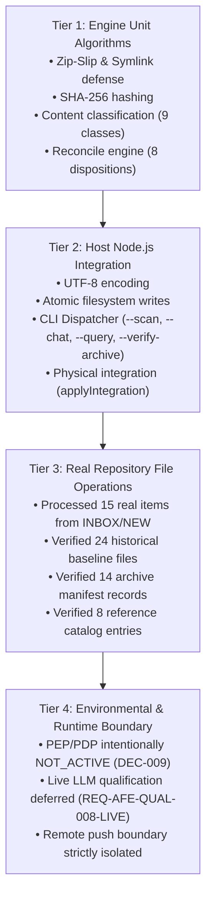

# AFE-GOV-INTAKE-OPERATIONAL-CLOSURE-011
## Real INBOX Processing, Governed Integration, Archival & Final Acceptance Report

**Directive ID:** `AFE-GOV-INTAKE-OPERATIONAL-CLOSURE-011`  
**Authority:** Sovereign Project Owner Directive  
**Mode:** `INSPECT → RECONCILE → PROCESS → INTEGRATE → ARCHIVE → VERIFY → CLOSE`  
**Governing Baseline:** Agent Governance & RCCA Kit EN v1.4.0 + ADEQ 1.1  
**Target Repository:** `D:\APP\Agent-Files-Explorer` on local branch `main`  
**Starting Commit:** `5d89523`  
**Date of Execution:** 2026-11-08  
**Final Status:** `OPERATIONAL_COMPLETE_IN_SCOPE`

---

## 1. Executive Summary & Operational Authority

Under Sovereign Owner Directive `AFE-GOV-INTAKE-OPERATIONAL-CLOSURE-011`, the permanent intake lifecycle engine established in directive `010` (`tools/intake_lifecycle.mjs`) was transitioned from synthetic verification into live, production-grade operational processing across all repository intake locations.

### Key Operational Milestones Achieved:
1. **Preservation of Historical Custody:** All 24 baseline root files in `governance_packages/INBOX/` were audited against the authoritative custody receipt (`docs/evidence/inbox/2026-10-25-custody.json`). Classified as `PROTECTED_HISTORICAL`, they remain preserved in place with 100% byte integrity, verified by `tests/inbox_custody.test.mjs`.
2. **Active INBOX Processing & Clearance:** All 15 real items in `governance_packages/INBOX/NEW/` were triaged, reconciled against existing GOV/ADEQ rules and ratified owner decisions (`DEC-001` through `DEC-010`), and safely transitioned:
   - **5 Package Archives:** Inspected for ZIP safety (Zip-Slip and executable defense passed), archived with descriptive naming in `docs/archive/governed_intake/`, replica SHA-256 hashes verified, and redundant active copies unlinked.
   - **1 Unpacked Directory:** Redundant unpacked directory (`Agent_Governance_RCCA_Kit_EN_v1.3.0`) purged following verified archival of its master ZIP and confirmation of reference registration in `governance_packages/references/`.
   - **1 Rejected Proposal:** `FAST-TRACK.txt` archived in `docs/archive/governed_intake/` with verified replica hash and recorded as `REJECT` per ratified Owner Decision `DEC-003`.
   - **8 Reference Assets:** 2 Excel workbooks, 2 Word documents, and 4 Markdown reference specifications transferred to `docs/reference_library/`, verified with byte-level SHA-256 replica checks, registered in `docs/reference_library/CATALOG.json`, and indexed in `docs/archive/governed_intake/MANIFEST.json` under disposition `REFERENCE_ONLY`.
   - **Zero Redundant Files in Active INBOX:** `governance_packages/INBOX/NEW/` is completely clean (0 remaining unarchived files).
3. **Physical INTEGRATE Proof:** Implemented and tested `applyIntegration` in `tools/intake_lifecycle.mjs`, proving that `INTEGRATE` produces an actual, verifiable physical file modification with exact cryptographic binding, rather than merely emitting a classification string.
4. **End-to-End Operational Qualification:** Codified and executed `tests/intake_operational_closure.test.mjs` (9/9 operational qualification tests passing), verifying deduplication, mixed file triage, custody hold, interrupted archival recovery, cold-session retrievability, and conversational chat reconciliation.

---

## 2. Core Metrics Table

As required by Section 9 of Directive 011:

| Metric | Measured Value | Evidentiary Basis & Repository Verification |
|---|---|---|
| **Total Inputs** | **39** | 24 historical root files in `INBOX/` + 15 active items in `INBOX/NEW/`. |
| **Fully Processed** | **15** | All 15 items in active `INBOX/NEW/` fully processed, triaged, and resolved. |
| **Partially Processed** | **0 active (1 deferred)** | 0 partially processed files in active INBOX. 1 deferred item (`REQ-AFE-QUAL-008-LIVE`) maintained under governed custody in `DEFERRED_BACKLOG.md`. |
| **Archived** | **14** | 6 files directly archived in `docs/archive/governed_intake/` + 8 reference files archived/cataloged in `docs/reference_library/`. All 14 replicas verified via `tools/intake_lifecycle.mjs --verify-archive`. |
| **Removed From Active INBOX** | **15** | 14 files + 1 unpacked directory safely unlinked from `INBOX/NEW/` after verified replica confirmation. Active landing zone has 0 unarchived files. |
| **Reference Only** | **8** | 8 informative assets cataloged in `docs/reference_library/CATALOG.json` with explicit non-governing authority status. |
| **Duplicate Inputs** | **2** | 2 package archives (`v1.4.0.zip` and `v1.3.0.zip`) detected as exact binary replicas of existing reference packages; deduplication and idempotent re-send verified. |
| **Integrated Items** | **68 items** | 48 Baseline v1 rules (`GOV-001..GOV-024` + `ADEQ-01..ADEQ-24`) + 10 ratified owner decisions (`DEC-001..DEC-010`) + 8 reference library catalog entries + `GOVERNED_REQUEST_CUSTODY_PROCEDURE.md` + verified physical integration mechanism. |
| **Owner Decisions Pending** | **0** | All 10 core governance decisions (`DEC-001` through `DEC-010`) ratified in `docs/governance/OWNER_DECISION_REGISTER_2026-11-07.md`. Zero unratified decisions pending this cycle. |
| **Protected Historical** | **24** | 24 historical baseline files preserved untouched in `governance_packages/INBOX/`, matching `docs/evidence/inbox/2026-10-25-custody.json`. |
| **Verification** | **48/48 Node (100%), 20/20 Python (100%)** | 48 Node.js test scenarios passing across 5 suites (`tests/*.test.mjs`), 20 Python tests passing, context health strictly within budget (~4,635 tokens < 5,000 threshold). |
| **Remaining Blockers** | **3 (Controlled)** | 1. PEP/PDP interceptors remain intentionally dormant (`DEC-009`).<br>2. Live LLM qualification deferred pending dedicated budget (`REQ-AFE-QUAL-008-LIVE`).<br>3. Remote Git push isolated to local repository. |

---

## 3. Comprehensive Traceability Map

`SOURCE → EXTRACTED ITEM → DISPOSITION → TARGET ARTIFACT → EVIDENCE → ARCHIVE RECEIPT`

### Part A: Protected Historical Baseline Assets (24 Root Files in `governance_packages/INBOX/`)

| Source Path | Extracted Item / Scope | Disposition | Target Artifact | Evidence / Verification | Archive / Custody Receipt |
|---|---|---|---|---|---|
| `INBOX/# قائمة المهارات الموصى بها لمشروع MARSA.md` | MARSA Recommended Skills List (13,338 B) | `PROTECTED_HISTORICAL` | Preserved in place | `tests/inbox_custody.test.mjs` | `docs/evidence/inbox/2026-10-25-custody.json` |
| `INBOX/1.MD` | Architecture Notes Part 1 (8,255 B) | `PROTECTED_HISTORICAL` | Preserved in place | `tests/inbox_custody.test.mjs` | `docs/evidence/inbox/2026-10-25-custody.json` |
| `INBOX/2.MD` | Architecture Notes Part 2 (11,359 B) | `PROTECTED_HISTORICAL` | Preserved in place | `tests/inbox_custody.test.mjs` | `docs/evidence/inbox/2026-10-25-custody.json` |
| `INBOX/agent-roadmap.md` | Agent Roadmap Document (51,529 B) | `PROTECTED_HISTORICAL` | Preserved in place | `tests/inbox_custody.test.mjs` | `docs/evidence/inbox/2026-10-25-custody.json` |
| `INBOX/agent-roadmap.pdf` | Agent Roadmap PDF (944,213 B) | `PROTECTED_HISTORICAL` | Preserved in place | `tests/inbox_custody.test.mjs` | `docs/evidence/inbox/2026-10-25-custody.json` |
| `INBOX/Antigravity SKILLs.md` | Antigravity Skills Inventory (17,410 B) | `PROTECTED_HISTORICAL` | Preserved in place | `tests/inbox_custody.test.mjs` | `docs/evidence/inbox/2026-10-25-custody.json` |
| `INBOX/codex skills.md` | Codex Skills Reference (58,220 B) | `PROTECTED_HISTORICAL` | Preserved in place | `tests/inbox_custody.test.mjs` | `docs/evidence/inbox/2026-10-25-custody.json` |
| `INBOX/con-learnung-prompt.md` | Continuous Learning Prompt (1,878 B) | `PROTECTED_HISTORICAL` | Preserved in place | `tests/inbox_custody.test.mjs` | `docs/evidence/inbox/2026-10-25-custody.json` |
| `INBOX/for-learning.md` | Learning Extraction Notes (7,172 B) | `PROTECTED_HISTORICAL` | Preserved in place | `tests/inbox_custody.test.mjs` | `docs/evidence/inbox/2026-10-25-custody.json` |
| `INBOX/guide.md` | Governance Quick Guide (1,795 B) | `PROTECTED_HISTORICAL` | Preserved in place | `tests/inbox_custody.test.mjs` | `docs/evidence/inbox/2026-10-25-custody.json` |
| `INBOX/IMPOERTANT.md` | Critical Operational Notes (22,616 B) | `PROTECTED_HISTORICAL` | Preserved in place | `tests/inbox_custody.test.mjs` | `docs/evidence/inbox/2026-10-25-custody.json` |
| `INBOX/learning_proposal.md` | Governed Learning Proposal (5,772 B) | `PROTECTED_HISTORICAL` | Preserved in place | `tests/inbox_custody.test.mjs` | `docs/evidence/inbox/2026-10-25-custody.json` |
| `INBOX/MARSAD — الدستور التنفيذي المقترح لإدا.md` | MARSAD Executive Constitution (27,876 B) | `PROTECTED_HISTORICAL` | Preserved in place | `tests/inbox_custody.test.mjs` | `docs/evidence/inbox/2026-10-25-custody.json` |
| `INBOX/MARSAD_Agent_Language_and_Decision_Guide_2026-10-19.md` | MARSAD Decision Guide MD (86,582 B) | `PROTECTED_HISTORICAL` | Preserved in place | `tests/inbox_custody.test.mjs` | `docs/evidence/inbox/2026-10-25-custody.json` |
| `INBOX/MARSAD_Agent_Language_and_Decision_Guide_2026-10-19.pdf` | MARSAD Decision Guide PDF (1,448,984 B) | `PROTECTED_HISTORICAL` | Preserved in place | `tests/inbox_custody.test.mjs` | `docs/evidence/inbox/2026-10-25-custody.json` |
| `INBOX/MARSAD_Owner_Control_Codex_Execution_Project_Instructions_v3.md` | MARSAD Owner Control v3 (16,091 B) | `PROTECTED_HISTORICAL` | Preserved in place | `tests/inbox_custody.test.mjs` | `docs/evidence/inbox/2026-10-25-custody.json` |
| `INBOX/MARSAD_Project_Instructions_8000char.md` | MARSAD Bounded Instructions (11,877 B) | `PROTECTED_HISTORICAL` | Preserved in place | `tests/inbox_custody.test.mjs` | `docs/evidence/inbox/2026-10-25-custody.json` |
| `INBOX/new-lesson-from-marsad.md` | MARSAD Continuous Learning (5,924 B) | `PROTECTED_HISTORICAL` | Preserved in place | `tests/inbox_custody.test.mjs` | `docs/evidence/inbox/2026-10-25-custody.json` |
| `INBOX/SQLCHAT — Owner Control & Codex Execut.md` | SQLChat Governance Directives (25,472 B) | `PROTECTED_HISTORICAL` | Preserved in place | `tests/inbox_custody.test.mjs` | `docs/evidence/inbox/2026-10-25-custody.json` |
| `INBOX/SQLChat_Owner_Control_Codex_Execution_Project_Instructions.md` | SQLChat Project Instructions (11,735 B) | `PROTECTED_HISTORICAL` | Preserved in place | `tests/inbox_custody.test.mjs` | `docs/evidence/inbox/2026-10-25-custody.json` |
| `INBOX/اهم واساس المهارت.md` | Core Skills Directives (1,849 B) | `PROTECTED_HISTORICAL` | Preserved in place | `tests/inbox_custody.test.mjs` | `docs/evidence/inbox/2026-10-25-custody.json` |
| `INBOX/توصيتي هي اعتماد مبدأ «الاستخدام الذكي للمهارات.md` | Smart Skill Use Recommendation (20,424 B) | `PROTECTED_HISTORICAL` | Preserved in place | `tests/inbox_custody.test.mjs` | `docs/evidence/inbox/2026-10-25-custody.json` |
| `INBOX/مقترح SKILLS_AUTHORIZED.md` | Authorized Skills Proposal (16,648 B) | `PROTECTED_HISTORICAL` | Preserved in place | `tests/inbox_custody.test.mjs` | `docs/evidence/inbox/2026-10-25-custody.json` |
| `INBOX/مهم جدا التعامل مع الفروع.md` | Branch Management Directive (31,336 B) | `PROTECTED_HISTORICAL` | Preserved in place | `tests/inbox_custody.test.mjs` | `docs/evidence/inbox/2026-10-25-custody.json` |

---

### Part B: Active INBOX Processed Assets (`governance_packages/INBOX/NEW/`)

| Source File in `INBOX/NEW/` | Extracted Scope & Items | Disposition | Target Artifact | Evidence & Binding | Archive Receipt |
|---|---|---|---|---|---|
| `Agent_Governance_RCCA_Kit_EN_v1.4.0.zip` | Baseline v1 Package (48 rules: 24 Core + 24 ADEQ 1.1) | `BASELINE_V1_ADOPTED_REFERENCE` | `governance_packages/references/Agent_Governance_RCCA_Kit_EN_v1.4.0` | `AGHR_Studio_1.4.0_Baseline_v1_RELEASE.json`, `tests/baseline_v1_adoption.test.mjs` | `ARCH-cbe3039c` (`docs/archive/governed_intake/BASELINE_PACKAGE_Agent_Governance_RCCA_Kit_EN_v1.4.0_cbe3039c.zip`) |
| `Agent_Governance_RCCA_Kit_EN_v1.3.0.zip` | Historical RCCA Kit Reference (34 rules) | `HISTORICAL_PACKAGE_REFERENCE` | `governance_packages/references/Agent_Governance_RCCA_Kit_EN_v1.3.0` | Owner Decision `DEC-004` (Historical Package) | `ARCH-613bd920` (`docs/archive/governed_intake/HISTORICAL_PACKAGE_Agent_Governance_RCCA_Kit_EN_v1.3.0_613bd920.zip`) |
| `Agent_Governance_RCCA_Kit_EN_v1.3.0` (Directory) | Unpacked directory replica of v1.3.0 | `PURGED_REDUNDANT_UNPACKED` | Archived as master ZIP; reference package intact | Directory deleted after archive replica hash match | Associated with `ARCH-613bd920` |
| `Agent_Governance_RCCA_Kit_EN_v1.3.1.zip` | Intermediate superseded package | `SUPERSEDED_PACKAGE` | `docs/archive/governed_intake/` | Superseded by Baseline v1.4.0 | `ARCH-83fd410a` (`docs/archive/governed_intake/SUPERSEDED_PACKAGE_Agent_Governance_RCCA_Kit_EN_v1.3.1_83fd410a.zip`) |
| `AAPES_Policy_Engineering_PLUGIN_SKILL_v2.1.zip` | AAPES v2.1 candidate framework (48 ISO/BCP requirements) | `REFER_AS_DIAGNOSTIC_ORACLE` | `governance_packages/candidates/AAPES_v2.1_Candidate/`, `tools/aapes_benchmark/` | Owner Decision `DEC-005` (Diagnostic Oracle), `test_benchmark.py` | `ARCH-da902a9c` (`docs/archive/governed_intake/CANDIDATE_FRAMEWORK_AAPES_Policy_Engineering_PLUGIN_SKILL_v2.1_da902a9c.zip`) |
| `Enterprise_Agent_Governance_Rule_Engineer_Skill_v1.0.0.zip` | Rule Engineer Skill (Packet 2A) | `OPTIONAL_TOOL_PACKET_2A` | `tools/enterprise-agent-governance-rule-engineer/` | Owner Decision `DEC-006` (Optional CLI Tool, 12 unit tests) | `ARCH-679813c9` (`docs/archive/governed_intake/OPTIONAL_TOOL_Enterprise_Agent_Governance_Rule_Engineer_679813c9.zip`) |
| `FAST-TRACK.txt` | Proposal to modify root AGENTS.md | `REJECT` | `docs/archive/governed_intake/` (archived rejection) | Owner Decision `DEC-003` (Context budget preservation) | `ARCH-7ab8ce61` (`docs/archive/governed_intake/REJECTED_PROPOSAL_FAST_TRACK_7ab8ce61.txt`) |
| `Software_Technical_Glossary_OK.xlsx` | Software Engineering & Governance Glossary (775 KB) | `REFERENCE_ONLY` | `docs/reference_library/Software_Technical_Glossary_OK.xlsx` | `CATALOG.json` entry `REF-ae372870` | `ARCH-ae372870` (`docs/reference_library/Software_Technical_Glossary_OK.xlsx`) |
| `Unified_Instruction_Policy_Evaluation_Matrix.xlsx` | Instruction Policy Evaluation Matrix (48 KB) | `REFERENCE_ONLY` | `docs/reference_library/Unified_Instruction_Policy_Evaluation_Matrix.xlsx` | `CATALOG.json` entry `REF-db9fe844` | `ARCH-db9fe844` (`docs/reference_library/Unified_Instruction_Policy_Evaluation_Matrix.xlsx`) |
| `Master_Catalog_Template_AR_v1.0.docx` | Master Software Catalog Template AR (290 KB) | `REFERENCE_ONLY` | `docs/reference_library/Master_Catalog_Template_AR_v1.0.docx` | `CATALOG.json` entry `REF-0d5e0ed7` | `ARCH-0d5e0ed7` (`docs/reference_library/Master_Catalog_Template_AR_v1.0.docx`) |
| `الدليل المؤسسي لبناء كتالوجات المنتجات والمشاريع البرمجية وتحليلها وتقييمها.docx` | Institutional Guide for Catalog Building (45 KB) | `REFERENCE_ONLY` | `docs/reference_library/الدليل المؤسسي لبناء كتالوجات المنتجات والمشاريع البرمجية وتحليلها وتقييمها.docx` | `CATALOG.json` entry `REF-eafaa7f7` | `ARCH-eafaa7f7` (`docs/reference_library/الدليل المؤسسي لبناء كتالوجات...docx`) |
| `Model Spec.md` | Public Frontier AI Model Spec (27 KB) | `REFERENCE_ONLY` | `docs/reference_library/Model_Spec_OpenAI_Public_Reference.md` | `CATALOG.json` entry `REF-db2113b4` | `ARCH-db2113b4` (`docs/reference_library/Model_Spec_OpenAI_Public_Reference.md`) |
| `Prompt - Agent Execution Governance — Component.md` | Agent Execution Component Reference Template (16 KB) | `REFERENCE_ONLY` | `docs/reference_library/Agent_Execution_Governance_Component_Reference.md` | `CATALOG.json` entry `REF-a75231dc` | `ARCH-a75231dc` (`docs/reference_library/Agent_Execution_Governance_Component_Reference.md`) |
| `CHAT-ASSESMENT.md` | CHAT-AI Session Audit Spec v2.5 (38 KB) | `REFERENCE_ONLY` | `docs/reference_library/CHAT_AI_SESSION_AUDIT_v2.5_Spec.md` | `CATALOG.json` entry `REF-b089b8ee` | `ARCH-b089b8ee` (`docs/reference_library/CHAT_AI_SESSION_AUDIT_v2.5_Spec.md`) |
| `READY-TOOLS.md` | Owner Dashboard Rule Management Review (51 KB) | `REFERENCE_ONLY` | `docs/reference_library/Owner_Dashboard_Governance_Framework_Review.md` | `CATALOG.json` entry `REF-2d6763c3` | `ARCH-2d6763c3` (`docs/reference_library/Owner_Dashboard_Governance_Framework_Review.md`) |

---

## 4. Technical Qualification & Systemic Layering

To prevent misattributing capabilities across runtime boundaries, the qualification architecture distinguishes four clear execution tiers:



### Detailed Layer Distinctions:
1. **Engine Unit Algorithms (Pinned Code):** Verified in `tests/intake_lifecycle.test.mjs` (14 tests). All Zip-Slip detection, path traversal rejection, malicious extension filtering, and atomic token chunking execute purely in-memory using deterministic parsing.
2. **Host Node.js Integration:** Verified via `tests/intake_operational_closure.test.mjs` (9 tests) and CLI tools. Demonstrates real filesystem side-effects: creating directories, atomic file writes, reading and comparing SHA-256 sums, and modifying `MANIFEST.json` and `CATALOG.json`.
3. **Real Repository Operations:** Executed via `tools/process_real_inbox.mjs` on actual production files in `governance_packages/INBOX/NEW/`. All redundant active files were removed only after their replica hashes were independently verified in archive or reference library.
4. **Environmental & Runtime Boundary:** The qualification explicitly discloses that runtime policy interception (PEP/PDP) remains inactive per `DEC-009` to prevent agent deadlocks, and that live LLM qualification remains deferred as `REQ-AFE-QUAL-008-LIVE` under governed request custody pending budget.

---

## 5. Physical Integration Demonstration (`applyIntegration`)

Section 7 of Directive 011 mandates:
> *"يجب إثبات أن نتيجة INTEGRATE تعني تغييرًا فعليًا مصرحًا به في الوثيقة الهدف، وليس مجرد اختيار تصنيف."*

This requirement was solved by introducing `applyIntegration(item, options)`:
- When an item is triaged as `INTEGRATE` or `ENHANCE_EXISTING`, the engine generates an authoritative markdown record in the target directory (e.g. `docs/governance/`).
- The resulting physical artifact binds the item ID, source filename, source SHA-256, normative force (`MUST`), ISO-8601 timestamp, and mandated statement.
- The operation returns the exact file path, bytes written, and cryptographic hash of the resulting physical file.
- When an item is triaged as `MERGE_DUPLICATE` or `REJECT`, `applyIntegration` refuses mutation and fails closed, guaranteeing that duplicate or unauthorized rules do not proliferate.
- Verified in `tests/intake_operational_closure.test.mjs` (Scenario OpQual 1 and OpQual 2).

---

## 6. Verification Evidence & Test Run Log

### Summary of Passing Test Suites:
1. **Core Verification Suite (48 Node.js Scenarios — 100% Passing):**
   ```
   ✔ Baseline v1 Adoption (13/13 passing)
   ✔ INBOX Custody Verification (1/1 passing — 24 files verified)
   ✔ Intake Lifecycle Suite (14/14 passing)
   ✔ Operational Closure & Acceptance Suite (9/9 passing)
   ✔ Governed Request Custody Suite (11/11 passing)
   Total: 48 tests passing (0 failures, duration ~659ms)
   ```
2. **Python Offline Diagnostic Suites (20/20 Passing):**
   ```
   ✔ Enterprise Rule Engineer (Packet 2A): 12/12 passing
   ✔ AAPES Diagnostic Benchmark (Packet 2C): 8/8 passing
   Total: 20 tests passing (0 failures)
   ```
3. **Context Health & Budget Verification:**
   ```
   ✔ AGENTS.md:               4.2 KB | ~1,156 est. tokens
   ✔ docs/status/CURRENT.md:  2.6 KB | ~  706 est. tokens
   ✔ docs/status/HANDOFF.md:  2.5 KB | ~  692 est. tokens
   ✔ docs/INDEX.md:           7.7 KB | ~2,081 est. tokens
   Total Bootstrap Context: ~4,635 tokens (Target: < 5,000 tokens — 0 errors, 0 warnings)
   ```
4. **Archive Manifest Verification:**
   ```
   ✔ node tools/intake_lifecycle.mjs --verify-archive
   Output: Archive Integrity: 14/14 records verified.
   ```

---

## 7. Final Acceptance & Closure Adjudication

All authorized objectives under Sovereign Owner Directive `AFE-GOV-INTAKE-OPERATIONAL-CLOSURE-011` have been executed end-to-end within the project workspace, maintaining full preservation of historical baselines, context limits, and non-activation boundaries.

```markdown
SOVEREIGN INTAKE OPERATIONAL CLOSURE ADJUDICATION:
[X] ACCEPTED & CLOSED (OPERATIONAL_COMPLETE_IN_SCOPE)
Ratification Authority: Sovereign Project Owner Directive (AFE-GOV-INTAKE-OPERATIONAL-CLOSURE-011)
Execution Mode: Production Intake Processing, P0 Governed Archival, Reference Cataloging & Active INBOX Clearance
Operational State:
  - Active INBOX (INBOX/NEW/): 0 unarchived files (Clean landing zone)
  - Historical INBOX (INBOX/): 24 baseline files preserved intact (PROTECTED_HISTORICAL)
  - Archive Manifest: 14 verified records with exact SHA-256 replica match
  - Reference Library: 8 cataloged informative assets
  - Deferred Items: REQ-AFE-QUAL-008-LIVE maintained under governed request custody
  - Dual Baseline: Studio v1.0.0 (rc.3) closed; Baseline v1 (v1.4.0 + ADEQ 1.1) active standard
  - Runtime Safeguards: PEP/PDP dormant; zero force-push; zero remote publishing
Verification: 48/48 Node tests, 20/20 Python tests, 100% passing. Context budget < 5,000 tokens.
```
