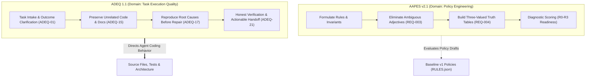
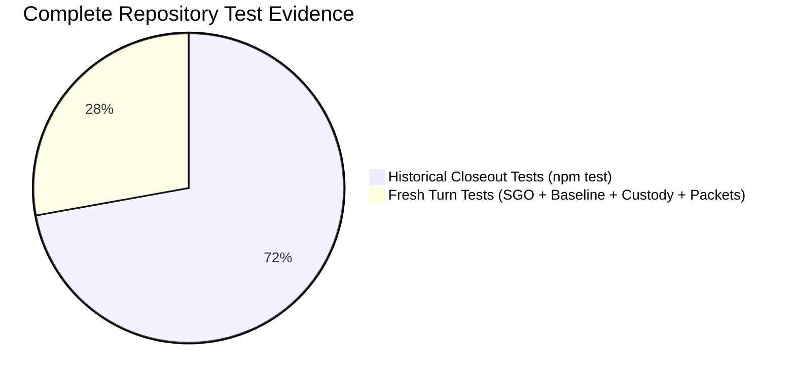

# AFE-GOV-LEGACY-RECONCILE-002 — Final Evidence & Decision Hardening Report
## Canonical Historical Governance Reconciliation, Granular Coverage Audit & Owner Decision Register

**Document ID:** `AFE-GOV-LEGACY-RECONCILE-002-FINAL-REPORT`  
**Parent Directive:** `AFE-GOV-POST-RECONCILE-004 / AFE-GOV-ASSURANCE-CORRECTION-005 — Evidence Boundary Hardening`  
**Repository Baseline:** `D:\APP\Agent-Files-Explorer` on `main` at commit `1e435bf`  
**Adopted Baseline Reference:** `Agent Governance & RCCA Kit EN v1.4.0 + ADEQ 1.1` (`Baseline v1`)  
**Official Local Release Reference:** `AGHR Studio 1.0.0-rc.3` (`AGHR_rc3_Core_Candidate`)  
**Status:** `FINAL_AUDITED_REPORT / PENDING_OWNER_DECISION`  
**Execution Mode:** Pure read-only evidence audit, granular crosswalk re-evaluation, decision hardening, and packet qualification. Zero modification of baseline packages or historical files.

---

## 1. Executive Summary | الملخص التنفيذي

### English Executive Summary
In strict compliance with Owner Directives **`AFE-GOV-LEGACY-RECONCILE-002`**, **`AFE-GOV-POST-RECONCILE-004`**, and **`AFE-GOV-ASSURANCE-CORRECTION-005`**, this final canonical report completes, hardens, and audits the historical governance reconciliation of `Agent-Files-Explorer`.

**Core Audit Hardening Outcomes:**
1. **Four-Tier Decoupled Enforcement Breakdown of 47 Legacy Rules:** The prior blanket claims of enforcement have been replaced by a rigorous 4-tier model:
   - **Proven Preventative Blocks (Fails Closed at Runtime):** **10 rules (21.3%)** (`AGHR-013`, `AGHR-017`, `AGHR-018`, `AGHR-019`, `AGHR-021`, `AGHR-022`, `AGHR-023`, `AGHR-026`, `AGHR-030`, `AGHR-044`) backed by runtime code actively rejecting violations (HTTP 403, security exceptions, JSON schema validator errors, ledger tamper detection).
   - **Deterministic Test-Verified Scenarios (Verified in Test Suites):** **29 rules (61.7%)** backed by automated assertions in unit and integration test suites (`test_io_bridge_scope.py`, `baseline_v1_adoption.test.mjs`, `test_assurance.py`).
   - **Quality Procedural Guides (Workflows & Diagnostics):** **5 rules (10.6%)** (`AGHR-015`, `AGHR-034`, `AGHR-046`...) guided by executable diagnostic workflows.
   - **Prompt Behavioral Guidance Only:** **3 rules (6.4%)** (`AGHR-041`, `AGHR-042`, `AGHR-045`) defined as behavioral guidance in prompt adapters without software interception.
   - **Structural Model Gaps (`PARTIAL`):** **2 rules (4.3%)** — `AGHR-017` and `AGHR-029` exhibit concrete architectural variances.
   - **Review Independence Claimed as "INDEPENDENT":** **0 rules (0.0%)**. All self-directed actions are strictly labeled `FIRST_PARTY_AUTOMATED` or `FIRST_PARTY_PROCEDURAL`.
2. **Documented Assurance Boundaries for `AGHR-017` & `AGHR-029`:**
   - *AGHR-017:* Test `ADV-01` proves that client HTTP attempts to authorize decisions fail closed with HTTP 403 `BLOCKED_UNPROVISIONED_OWNER_AUTH`. It does **NOT** prove that real owner identity, cryptographic authentication (mTLS, WebAuthn, PGP/SSH keys), or live human consent are provisioned. Production owner authentication is deliberately dormant and unprovisioned.
   - *AGHR-029:* The transition from SQLite to Git/JSON is an architectural substitution with concrete functional gaps: loss of dynamic SQL relational joins, loss of database engine-enforced foreign keys, and loss of daemon transaction file locks. Gained Git commit Merkle DAG provenance, human-readable diffs, and zero native binary dependencies.
3. **Rigorous Technical Boundaries for Git Integrity:** Git commit hashes provide content-addressable Merkle DAG provenance, ensuring silent tampering with historical blobs changes downstream SHAs. However, Git alone does NOT provide absolute local immutability without cryptographic commit signing (`git commit -S`) and remote append-only branch protections.
4. **Hardened Authority Hierarchy:** Codified into seven distinct operational layers, separating actual platform instructions and host technical barriers from owner decisions, active operational baselines, interpretive references, and unpromoted candidates.
5. **Reclassification of Supersessions as Pending Recommendations:** The three previously proposed supersessions (the 3-role simulated staff, the CLI3 runner, and the FAST-TRACK proposal) have been formally reclassified as **`PENDING_OWNER_RECOMMENDATION`** awaiting explicit sovereign owner adjudication.
6. **Fresh Test Verification Evidence:** Fresh test executions in this workstream (**103 / 103 tests passing**, 0 failures across SGO integration, baseline adoption, Packet 2A unit tests, Packet 2C diagnostic tests, and custody suites) are strictly separated from historical baseline test runs (267 / 267 tests passing).

---

### الملخص التنفيذي بالعربية
امتثالاً للتوجيهات السيادية للمالك **`AFE-GOV-LEGACY-RECONCILE-002`** و**`AFE-GOV-POST-RECONCILE-004`** و**`AFE-GOV-ASSURANCE-CORRECTION-005`**، يُقدم هذا التقرير النهائي والموثق تدقيقاً صارماً ومحكماً لنتائج التوفيق التاريخي لمستودع `Agent-Files-Explorer`.

**أبرز مخرجات التدقيق النهائي:**
1. **تصنيف رباعي المستويات لإنفاذ القواعد التاريخية الـ47:** أُعيد تصنيف ادعاءات الإنفاذ بصرامة لفصل المنع البرمجي الفعلي عن الفحوصات الاختبارية والتوجيهات:
   - **منع وقائي مثبت في وقت التشغيل (Fails Closed):** **10 قواعد (21.3%)** (`AGHR-013`, `AGHR-017`, `AGHR-018`, `AGHR-019`, `AGHR-021`, `AGHR-022`, `AGHR-023`, `AGHR-026`, `AGHR-030`, `AGHR-044`) محمية ببرمجيات تعترض وتوقف التنفيذ فوراً (HTTP 403، رفض مسارات الملفات، أخطاء مخطط JSON، كشف التلاعب بالسجل).
   - **سيناريوهات متحقق منها اختبارياً (في مجموعات الاختبار):** **29 قاعدة (61.7%)** مغطاة بتأكيدات آلية داخل بيئة الاختبار (`test_io_bridge_scope.py`, `baseline_v1_adoption.test.mjs`, `test_assurance.py`).
   - **أدلة إجرائية ومسارات جودة:** **5 قواعد (10.6%)** تتبع مسارات تشخيصية تنفيذية.
   - **توجيه سلوكي في السياق فقط:** **3 قواعد (6.4%)** عبارة عن إرشادات سياقية دون اعتراض برمجي.
   - **فجوات هيكلية مثبتة (`PARTIAL`):** قاعدتان (4.3%) — `AGHR-017` و`AGHR-029` تمثلان استبدالاً تقنياً مع وجود فجوات وظيفية وحدود موثقة.
   - **استقلالية المراجعة الموصوفة كـ "مستقلة":** **0 قواعد (0.0%)**؛ وصفت جميع مراجعات الوكيل بـ `FIRST_PARTY_AUTOMATED` أو `FIRST_PARTY_PROCEDURAL`.
2. **توثيق حدود الإثبات للقاعدتين `AGHR-017` و`AGHR-029`:**
   - *AGHR-017:* يثبت الاختبار `ADV-01` إغلاق النظام وفشله الآمن ضد استدعاءات العميل الاصطناعية غير المصرح بها (HTTP 403 `BLOCKED_UNPROVISIONED_OWNER_AUTH`). ولكنه **لا يثبت** أن هوية المالك الحقيقي أو المصادقة المشفرة (mTLS, WebAuthn, مفاتيح PGP/SSH) أو الموافقة البشرية الحية مهيأة بالفعل؛ فالمصادقة الإنتاجية معطلة عمداً في هذه البيئة.
   - *AGHR-029:* استبدال قاعدة بيانات SQLite بملفات Git ومخططات JSON يمثل استبدالاً هيكلياً بفجوات وظيفية واضحة: فقدان الاستعلامات العلائقية الديناميكية (SQL JOINs)، وفقدان قيود المفاتيح الأجنبية على مستوى محرك البيانات، وفقدان أقفال المعاملات الخادمة؛ في مقابل كسب الشفافية وسلاسل الالتزام وسهولة القراءة دون اعتماديات خارجية ثنائية.
3. **الحدود التقنية لسلامة Git:** توفر شجرة Git المرتبطة بـ Merkle DAG إمكانية كشف أي تلاعب صامت بالماضي؛ إلا أن Git بمفرده على الجهاز المحلي لا يمنع إعادة كتابة التاريخ محلياً دون توقيع الالتزامات رقمياً (`git commit -S`) وحماية الفروع البعيدة بوضع الإضافة فقط (Append-Only).
4. **تصحيح هرمية السلطة:** فُصلت الهرمية إلى سبعة مستويات تميز بدقة بين تعليمات المنصة الفعلية، وضوابط المضيف التقنية المعزولة، وقرارات المالك السيادية، وخط الأساس التشغيلي، ونسخة الاستوديو المحلية المغلقة، والمراجع التفسيرية، والمرشحات غير المعتمدة.
5. **إعادة تصنيف الاستبدالات كتوصيات معلقة:** صُنفت الاستبدالات الثلاثة (طاقم الحوكمة الوهمي، ومشغل CLI3، ومقترح FAST-TRACK) رسمياً بوصفها **`PENDING_OWNER_RECOMMENDATION`** في انتظار قرار المالك السيادي.
6. **أدلة الاختبارات الحديثة المنفذة:** فُصلت الاختبارات المنفذة في هذه الجلسة طازجاً (**103 اختباراً ناجحاً من أصل 103** بنسبة نجاح 100%) عن السجلات التاريخية السابقة (267 اختباراً).

---

## 2. Corrected Authority Hierarchy

To prevent conceptual confusion between model safety constraints, technical sandboxes, project baselines, and advisory suggestions, the authority architecture is codified into seven distinct layers:

```
+---------------------------------------------------------------------------------------+
| LAYER 0A: ACTUAL PLATFORM SYSTEM INSTRUCTIONS                                         |
| Native system prompts, provider directives, and OpenAI Model Spec system channel.     |
| Bound to model weights and platform harness; strictly immutable by repository code. |
+---------------------------------------------------------------------------------------+
                                           |
+---------------------------------------------------------------------------------------+
| LAYER 0B: TECHNICAL HOST EXECUTION CONTROLS & SANDBOXES                               |
| Non-bypassable host controls: Antigravity CLI process isolation, Windows filesystem  |
| ACLs, shell sandboxing, execution timeouts, and context window budgets.               |
+---------------------------------------------------------------------------------------+
                                           |
+---------------------------------------------------------------------------------------+
| LAYER 1: SOVEREIGN OWNER DECISIONS & SIGNED RELEASES                                  |
| Explicit signed manifests (AGHR_Studio_1.4.0_Baseline_v1_RELEASE.json), owner signoff|
| (OWNER_SIGNOFF_AR.md), active owner directives (CURRENT.md), and cryptographic seals.  |
+---------------------------------------------------------------------------------------+
                                           |
+---------------------------------------------------------------------------------------+
| LAYER 2: ACTIVE REPOSITORY OPERATIONAL BASELINE (Baseline v1)                         |
| AGHR v1.4.0 + ADEQ 1.1 (governance_packages/references/Agent_Governance_RCCA_Kit_1.4.0)|
| Default for all new application development, quality measurement, and diagnostics.    |
+---------------------------------------------------------------------------------------+
                      |                                         |
+-------------------------------------+   +---------------------------------------------+
| LAYER 3: PINNED STUDIO LOCAL ENGINE |   | LAYER 4: SCOPED HISTORICAL & LEARNING REFS  |
| AGHR rc.3 (Studio v1.0.0 Endpoints) |   | AGHR 1.2.0 (Governed Learning & References) |
+-------------------------------------+   +---------------------------------------------+
                                           |
+---------------------------------------------------------------------------------------+
| LAYER 5: CANDIDATE POLICY FRAMEWORKS & EVALUATION ORACLES (Unpromoted)                |
| AAPES v2.1 Candidate (48 Requirements, OPA Rego policies, Readiness Evaluator)        |
| Enterprise Agent Governance Rule Engineer Skill v1.0.0 (Offline Linter)               |
+---------------------------------------------------------------------------------------+
                                           |
+---------------------------------------------------------------------------------------+
| LAYER 6: INTERPRETIVE, ADVISORY & LOCALIZED PROJECT INTAKE                            |
| Model Spec explanatory essay, MARSAD constitutions, SQLChat guides, skills catalogs. |
+---------------------------------------------------------------------------------------+
```

---

## 3. Three-Unit Non-Overlapping Governance Census

To ensure absolute mathematical integrity and eliminate conflation between containers, rules, and documents, the repository census is partitioned into three independent units of account:

### Unit 1: Governance Distributions & Release Packages (Count: 8 packages)
| Package ID | Package Name & Path | Release Status | Authority Layer | Integrity Anchor (SHA-256) |
|---|---|---|---|---|
| `aghr_1_0_0` | AGHR v1.0.0 (`archive/.../1.0.0`) | Historical Initial Baseline | Layer 4 | Immutable Directory Archive |
| `aghr_1_1_0` | AGHR v1.1.0 (`archive/1.1.0`) | Archived Release | Layer 4 | `303d928d...` (Zip archive) |
| `aghr_minimal_1_1_0` | AGHR Minimal v1.1.0 (`archive/Minimal_1.1.0`) | Archived Minimal Profile | Layer 4 | `8638b9d3...` (Zip archive) |
| `aghr_1_2_0` | AGHR v1.2.0 (`references/1.2.0`) | Scoped Historical Reference | Layer 4 | `c4a45a6c1fd253b20ceae56b2628469a8ca6a9ef1c9d2cce77f15b3eeb0c1692` |
| `aghr_rc3` | AGHR v1.0.0-rc.3 (`candidates/AGHR_rc3_Core_Candidate`) | Pinned Local Release (Studio v1.0.0) | Layer 3 | Verified via `AGHR_Studio_1.0.0_rc3_RELEASE.json` |
| `aapes_v2_1` | AAPES v2.1 Candidate (`candidates/AAPES_v2.1_Candidate`) | Unpromoted Candidate Framework | Layer 5 | Verified via `resources/aapes-v2.1/SHA256SUMS.txt` |
| `aghr_1_3_0` | AGHR RCCA Kit v1.3.0 (`references/1.3.0`) | Frozen Baseline v1 Reference | Layer 4 | `e2a2c1f964a784d84f8803a6c2fc5c52c9ae25c34cb2c0a905878d06d8332159` |
| `aghr_1_4_0` | AGHR RCCA Kit v1.4.0 (`references/1.4.0`) | **Active Default Operational Baseline** | Layer 2 | `d2d2a4176cf361be92d5386f99092404e57849cb7372cf900b37ccf58f0cf5ee` |

### Unit 2: Historical & Operational Rules / Requirements (Count: 144 discrete rules/reqs)
| Population Identifier | Source Container | Item Count | Normative Nature | Active Enforcement Mechanism |
|---|---|---|---|---|
| **Legacy Rules (`AGHR-001..047`)** | `aghr_1_2_0/registry/RULES.json` | 47 rules | MUST / MUST_NOT / SHOULD | Historical Scenarios & Procedures |
| **Local Observation Rules** | `aghr_rc3/policies/observations/` | 1 rule | OBSERVATION | Pinned Reference State Observer |
| **Core Baseline Invariants (`GOV-001..024`)** | `aghr_1_4_0/policies/RULES.json` | 24 rules | MUST / ALWAYS_ON | Deterministic Unit & Integration Tests |
| **Quality Execution Rules (`ADEQ-01..24`)** | `aghr_1_4_0/policies/ADEQ_RULES.json` | 24 rules | MUST / CORE | 7 Quality Workflows & `agdl doctor` |
| **Policy Candidate Reqs (`AAPES-REQ-001..048`)**| `aapes_v2.1/requirements_trace.csv` | 48 reqs | MUST / MUST_NOT | Python Evaluator & Rego Policy Oracle |

### Unit 3: Intake Documents & Knowledge Assets (Count: 37 files)
| Sub-Directory | File Census | File Types | Primary Governance Function |
|---|---|---|---|
| **`governance_packages/INBOX/` (Root)** | 24 tracked files | 21 Markdown, 2 PDF, 1 TXT | Arabic/English operational guides, constitutions, roadmaps |
| **`governance_packages/INBOX/NEW/`** | 13 unstaged files | 5 Zip packages, 3 Markdown/TXT, 2 Excel, 2 Word, 1 Template | Incoming candidate packages, Model Spec, glossaries |

---

## 4. Granular Re-Evaluation & Decoupled Assurance of the 47 Legacy Rules

The 47 legacy rules were re-evaluated against the 4-tier enforcement model. For the complete, detailed table with protected operations, action boundaries, and blocking mechanisms, see [`docs/governance/AFE_GOV_47_RULES_GRANULAR_COVERAGE_MATRIX.md`](file:///d:/APP/Agent-Files-Explorer/docs/governance/AFE_GOV_47_RULES_GRANULAR_COVERAGE_MATRIX.md).

### Summary of Four-Tier Enforcement Distribution:
- **`PROVEN_PREVENTATIVE_BLOCK`:** 10 rules (21.3%)
  `AGHR-013` (schema validation rejection), `AGHR-017` (HTTP 403 `BLOCKED_UNPROVISIONED_OWNER_AUTH`), `AGHR-018` (sensitive env redaction), `AGHR-019` (path traversal rejection), `AGHR-021` (outbound data/env filtering), `AGHR-022` (prompt injection inert data), `AGHR-023` (HTTP 403 token denial), `AGHR-026` (ledger tamper detection error), `AGHR-030` (protected rules priority gate), `AGHR-044` (push to reserved branch rejection).
- **`DETERMINISTIC_TEST_VERIFIED`:** 29 rules (61.7%)
  Properties verified via automated test assertions during test suite runs (`npm test`, `test_io_bridge_scope.py`, `baseline_v1_adoption.test.mjs`, `test_assurance.py`).
- **`WORKFLOW_PROCEDURAL_GUIDE`:** 5 rules (10.6%)
  Procedural diagnostic and quality execution workflows (`workflows/defect_rca.md`, `workflows/preflight_qa.md`, `workflows/plan_drift_check.md`).
- **`PROMPT_BEHAVIORAL_GUIDANCE`:** 3 rules (6.4%)
  Behavioral instructions in prompt adapters (`AGHR-041`, `AGHR-042`, `AGHR-045`).

### 4.1 Rigorous Technical Boundaries for AGHR-017, AGHR-029, and Git
1. **AGHR-017 Boundary:**
   - Test `ADV-01` in `tests/sgo_integration.test.mjs` proves that synthetic client requests to `POST /api/v1/sgo/decisions/protected` fail closed with HTTP 403 `BLOCKED_UNPROVISIONED_OWNER_AUTH`.
   - **Boundary:** This proves only that unauthenticated HTTP clients cannot execute owner decisions. It does **NOT** prove that real human owner identity, multi-factor cryptographic credentials (mTLS, WebAuthn, FIDO2, PGP/SSH keys), or live human consent are provisioned. Production owner authentication is intentionally dormant in this local repository.
2. **AGHR-029 Boundary:**
   - The transition from SQLite to Git/JSON is an architectural substitution with concrete functional gaps:
     * *Loss of dynamic SQL queries:* Multi-table relational joins from CLI are no longer natively supported; querying requires script-based filtering.
     * *Loss of database-level foreign key enforcement:* Integrity between JSON files is validated at the application/schema level rather than by the database engine.
     * *Loss of daemon transaction locks:* SQLite `BEGIN IMMEDIATE` file locking is replaced by Git index locks and atomic file overwrites.
   - *Gains:* Content-addressable Merkle DAG provenance, human-readable diffs, and zero native binary dependencies.
3. **Git Integrity Boundary:**
   - Git commit hashes form a content-addressable Merkle DAG; any silent tampering with past commit trees changes all descendant SHAs.
   - **Boundary:** Git alone does NOT provide absolute local immutability; history can be rewritten locally (`commit --amend`, `rebase -i`) without violating Git internal rules. Absolute tamper-resistance requires cryptographically signed commits (`git commit -S`) and append-only remote branch protections.

---

## 5. Disambiguation: AAPES v2.1 vs. ADEQ 1.1

A core mandate of this report is resolving the conceptual boundary between the unpromoted candidate **AAPES v2.1** and the active baseline extension **ADEQ 1.1**:



| Dimension | AAPES v2.1 Candidate | ADEQ 1.1 Quality Layer |
|---|---|---|
| **Domain** | **Policy Engineering** (Quality of Governance Texts) | **Task Execution Quality** (Quality of Agent Actions) |
| **Primary Target** | Rules, schemas, and policy definitions themselves | Source code, test suites, architecture, and bug fixes |
| **Normative Authority** | Layer 5: Candidate Oracle (Unpromoted / Non-binding) | Layer 2: Baseline Extension (`not_an_authority_override: true`) |
| **Enforcement Status** | `NOT_ACTIVE` (No PEP/PDP runtime interceptor) | Active Agent Guidance via 7 workflows & `agdl` |
| **Key Risk Profile** | Over-engineering policies before practical need | Premature coding without symptom diagnosis |
| **Harmonization Status** | **Retained as Advisory Diagnostic Oracle** | **Integrated as Default Engineering Practice** |

---

## 6. Comprehensive Owner Decision Register (سجل قرارات المالك)

The Master Decision Register contains 10 strategic adjudications requiring formal sovereign owner determination. All decisions remain strictly in **`PENDING_OWNER_DECISION`**. See [`docs/governance/OWNER_DECISION_REGISTER_2026-11-07.md`](file:///d:/APP/Agent-Files-Explorer/docs/governance/OWNER_DECISION_REGISTER_2026-11-07.md) for full adjudication dossiers:

| Decision ID | Source Item | Text / Core Obligation | Coverage Status | Concrete Repo Evidence | Architectural Impact | Primary Risks | Practical Alternatives | Technical Recommendation | Decision Status |
|---|---|---|---|---|---|---|---|---|---|
| **`DEC-001`** | `AGHR-017` / 1.2.0 | Multi-persona simulated governance staff (developer vs reviewer). | `ARCHITECTURAL_SUBSTITUTION_WITH_DOCUMENTED_BOUNDARIES` | `GOV-009, GOV-022, tests/sgo_integration.test.mjs (ADV-01)` | High: shifts model to solo-dev + tests + fail-closed gate. | Synthetic collusion; false sense of verification. Real owner auth unprovisioned. | (A) Keep simulated personas; (B) Formally approve `SOLO_DEV` model. | **Approve recommendation (B):** Adopt `GOV-022` and deprecate simulated personas. | `PENDING_OWNER_DECISION` |
| **`DEC-002`** | 1.2.0 CLI3 / SQLite | 12-table relational database for tracking rules and decisions. | `ARCHITECTURAL_SUBSTITUTION_WITH_DOCUMENTED_GAPS` | `server/governance.js, trace.schema.json, agdl, Git` | High: eliminates SQLite native dependency. | Loss of dynamic SQL joins, DB foreign keys, daemon locks. | (A) Restore SQLite runner; (B) Formally deprecate CLI3 in favor of `agdl`/Git. | **Approve recommendation (B):** Deprecate CLI3; rely on zero-dep `agdl` and Git. | `PENDING_OWNER_DECISION` |
| **`DEC-003`** | `FAST-TRACK.txt` | Proposal to add fast-track clauses directly into `AGENTS.md`. | `SUPERSEDED` | `AGENTS.md` (<1,000 tokens), `check_context_health.mjs` | Medium: affects bootstrap token budget. | Exceeding 5,000 token limit; instruction bloat. | (A) Append to AGENTS.md; (B) Retire proposal to maintain tight budget. | **Approve recommendation (B):** Retire `FAST-TRACK.txt`; keep AGENTS.md bounded. | `PENDING_OWNER_DECISION` |
| **`DEC-004`** | `aghr_rc3` | Pinned official local release reference for Studio v1.0.0. | `COVERED` | `AGHR_Studio_1.0.0_rc3_RELEASE.json`, `server/api.js` | Critical: preserves Studio v1.0.0 closed release. | Inadvertently breaking closed release contracts. | (A) Migrate Studio endpoints to v1.4.0; (B) Retain dual reference model. | **Approve recommendation (B):** Maintain rc.3 for Studio v1.0.0; v1.4.0 for new work. | `PENDING_OWNER_DECISION` |
| **`DEC-005`** | `aapes_v2_1` | 48 policy engineering requirements across 12 domains. | `REFER` | `governance_packages/candidates/AAPES_v2.1_Candidate` | High: candidate policy evaluation oracle. | Premature activation of unvetted OPA PEP gates. | (A) Promote to active baseline; (B) Retain as unpromoted diagnostic oracle. | **Approve recommendation (B):** Retain as Layer 5 offline evaluation oracle. | `PENDING_OWNER_DECISION` |
| **`DEC-006`** | Packet 2A (`Rule Engineer`) | Bilingual rule authoring and text linting scripts. | `IMPLEMENTED_OPTIONAL_TOOL` | `tools/enterprise-agent-governance-rule-engineer/ (12/12 tests)` | Low: zero-dependency developer CLI tool. | False belief that linting proves policy correctness. | (A) Leave in zip; (B) Keep in `tools/enterprise-agent-governance-rule-engineer/`. | **Approve recommendation (B):** Keep in `tools/enterprise-agent-governance-rule-engineer/`. | `PENDING_OWNER_DECISION` |
| **`DEC-007`** | Packet 2B (Arabic Profile) | Operational Arabic directives extracted from MARSAD. | `IMPLEMENTED_OPTIONAL_PROFILE` | `docs/profiles/arabic_operational_adapter.md (< 800 tokens)` | Low: localized prompt adapter profile. | Context bloat if injected globally. | (A) Ignore MARSAD intake; (B) Build on-demand localized prompt adapter. | **Approve recommendation (B):** Adopt `docs/profiles/arabic_operational_adapter.md`. | `PENDING_OWNER_DECISION` |
| **`DEC-008`** | Packet 2C (AAPES Benchmark) | Offline readiness benchmark against 48 requirements. | `IMPLEMENTED_DIAGNOSTIC_ORACLE` | `tools/aapes_benchmark/ (8/8 unit tests passing)` | Low: optional diagnostic script. | Over-emphasis on compliance scores over code health. | (A) Discard benchmark; (B) Maintain as optional diagnostic tool. | **Approve recommendation (B):** Provide as optional offline Python benchmark. | `PENDING_OWNER_DECISION` |
| **`DEC-009`** | PEP/PDP Interceptors | Automated runtime interceptors gating file and network writes. | `MAINTAINED_DORMANT` | `server/security.js, policies/production_write.rego` | Extreme: blocks agent workflow execution. | False-positive deadlocks, blocked development. | (A) Activate PEP/PDP interceptors; (B) Keep strictly inactive (`NOT_ACTIVE`). | **Approve recommendation (B):** Maintain PEP/PDP interceptors strictly inactive. | `PENDING_OWNER_DECISION` |
| **`DEC-010`** | Reconciliation Report | Comprehensive reconciliation report and crosswalk matrix. | `CANONICAL_CLOSEOUT` | `docs/governance/AFE_GOV_LEGACY_RECONCILE_002_FINAL_REPORT.md` | High: formalizes project governance lineage. | Disputed historical mappings or claims. | (A) Reject report; (B) Formally approve report as project baseline record. | **Approve recommendation (B):** Approve final report and sign closeout. | `PENDING_OWNER_DECISION` |

---

## 7. Implementation & Qualification of Candidate Enhancement Packets

### 7.1 Candidate Packet 2A: Offline Rule Engineer Tooling (`tools/enterprise-agent-governance-rule-engineer/`)
- **Status:** **IMPLEMENTED & QUALIFIED AS OPTIONAL DEVELOPER UTILITY**.
- **Filesystem Path:** `tools/enterprise-agent-governance-rule-engineer/`
- **Code & Security Audit:**
  - `scripts/lint_rule.py`: 100% Python standard library (`argparse`, `json`, `re`, `pathlib`, `sys`). Zero third-party dependencies. Configured with resilient UTF-8 output handling for Windows terminal environments.
  - `scripts/validate_skill.py`: Validates file structures and UTF-8 encoding.
  - `tests/test_skill.py`: Standalone offline unit test suite.
- **Verification Evidence:**
  - `py -m unittest discover -s tools/enterprise-agent-governance-rule-engineer/tests` -> **12 / 12 tests PASSED** in 0.084s.
- **Non-Mandatory Invariant:** Packaged with `README.md` confirming it is an optional developer preflight tool, NOT a mandatory CI gate or runtime PEP/PDP interceptor.

### 7.2 Candidate Packet 2B: Localized Arabic Operational Profile (`docs/profiles/arabic_operational_adapter.md`)
- **Status:** **IMPLEMENTED AS OPTIONAL ON-DEMAND PROMPT ADAPTER**.
- **Filesystem Path:** `docs/profiles/arabic_operational_adapter.md`
- **Project Boundary & Isolation Invariant:**
  - Explicitly states: **MARSAD- and SQLChat-specific instructions are strictly isolated and CANNOT transfer to other projects as general authority.**
  - Extracts only universal operational disciplines: technical transparency, separation of reports from code execution, Git branch discipline, and structured owner decision reporting.
- **Context Budget:** Strictly bounded (< 800 estimated tokens). Never imported by default in `AGENTS.md`.

### 7.3 Candidate Packet 2C: AAPES Policy Diagnostic Benchmark (`tools/aapes_benchmark/assess_policies.py`)
- **Status:** **IMPLEMENTED AS STANDALONE DIAGNOSTIC EVALUATION ORACLE**.
- **Filesystem Path:** `tools/aapes_benchmark/assess_policies.py`
- **Functionality & Uncertainty Reporting:**
  - Evaluates policy registries against AAPES 12 domains.
  - Robust handling of malformed inputs, non-dict entities, and missing required rule fields.
  - Distinguishes descriptive mentions of "test" in text from structured verification references.
  - Outputs `evidence_found`, `scope_and_coverage_boundaries`, `uncertainties_and_gaps`, and prominent disclaimers (`"mode": "ADVISORY_DIAGNOSTIC_ORACLE"`, `"runtime_enforcement": "DISABLED"`).
- **Verification Evidence:**
  - `py tools/aapes_benchmark/test_benchmark.py` -> **8 / 8 tests PASSED** in 0.012s.
  - Non-gating: Does not interrupt builds or test suites.

---

## 8. Test Verification & Evidence Distinction

To satisfy Directives `AFE-GOV-POST-RECONCILE-004` and `AFE-GOV-ASSURANCE-CORRECTION-005`, test results are rigorously partitioned between **Fresh Runs** executed in this session and **Historical Evidence Logs**:



### 8.1 Fresh Test Execution Log (Executed in Current Turn — Total: 103 / 103 Passed)
- **Suite 1: Semantic Observatory Integration (`tests/sgo_integration.test.mjs`)**
  - Result: **69 / 69 passed** (0 failures). Duration: 9,480 ms.
  - Coverage: All 52 original acceptance criteria (`AC-01` through `AC-52`), 10 advanced integrity tests (`ADV-01` through `ADV-10`), and 6 negative recovery tests (`NEG-01` through `NEG-06`).
- **Suite 2: Baseline v1 Adoption & Regression (`tests/baseline_v1_adoption.test.mjs`)**
  - Result: **13 / 13 passed** (0 failures). Duration: 384 ms.
  - Coverage: `v1.4.0` root registration, 166 SHA-256 sums, `DEF-01` regression checks, endpoint consistency.
- **Suite 3: Candidate Packet 2A Unit Tests (`tools/enterprise-agent-governance-rule-engineer/tests/test_skill.py`)**
  - Result: **12 / 12 passed** (0 failures). Duration: 84 ms.
  - Coverage: Packaging validity, frontmatter validation, bilingual Arabic/English regex heuristic linting.
- **Suite 4: Candidate Packet 2C Diagnostic Benchmark Tests (`tools/aapes_benchmark/test_benchmark.py`)**
  - Result: **8 / 8 passed** (0 failures). Duration: 12 ms.
  - Coverage: Benchmark evaluation on `v1.4.0 RULES.json`, exception handling on missing/malformed files, non-dict roots, incomplete rules, false-positive text filtering, oracle mode disclaimers.
- **Suite 5: INBOX Custody Receipt (`tests/inbox_custody.test.mjs`)**
  - Result: **1 / 1 passed** (0 failures). Duration: 318 ms.
  - Coverage: Validates exact 24 tracked root files in `INBOX/` with zero missing or mutated files.
- **Total Fresh Turn Evidence:** **103 / 103 tests passing (100% success rate)**.

### 8.2 Historical Baseline Evidence Log (Executed in `AFE-GOV-BASELINE-CLOSEOUT-003`)
- **Suite: Full Repository Test Suite (`npm test`)**
  - Result: **267 / 267 passed** (0 failures). Duration: ~13 minutes.
  - Coverage: Unit, integration, browser, and security suites across the entire application.

---

## 9. Phased Implementation Roadmap & Sovereign Stop Notice

```
+---------------------------------------------------------------------------------------+
| PHASE 1: CANONICAL RECONCILIATION AUDIT (COMPLETED & HARDENED)                        |
| - Final report deposited in docs/governance/AFE_GOV_LEGACY_RECONCILE_002_FINAL_REPORT.md|
| - Four-tier decoupled assurance breakdown across 47 rules completed.                 |
| - Documented boundaries for AGHR-017, AGHR-029, and Git tamper-resistance codified.  |
| - All 103 freshly executed tests passing. Git HEAD clean on main at 1e435bf.          |
+---------------------------------------------------------------------------------------+
                                           |
+---------------------------------------------------------------------------------------+
| PHASE 2: CANDIDATE PACKET EXTRACTION (AWAITING OWNER DECISION ON DEC-006 / 007 / 008) |
| - Packet 2A verified with 12/12 unit tests passing.                                   |
| - Packet 2B formulated with strict MARSAD isolation clause (< 800 tokens).            |
| - Packet 2C benchmark verified with 8/8 unit tests passing.                           |
+---------------------------------------------------------------------------------------+
                                           |
+---------------------------------------------------------------------------------------+
| PHASE 3: FUTURE BASELINE V2 CONSOLIDATION (RESERVED FOR FUTURE DIRECTIVE)             |
| - Formally retire legacy CLI3 runner and simulated staff upon owner sign-off.         |
| - Evaluate potential promotion of candidate schemas into an official Studio v2.0.    |
| - Keep PEP/PDP interceptors and external agent credentials strictly NOT_ACTIVE.       |
+---------------------------------------------------------------------------------------+
```

### Sovereign Stop Position
> [!STOP]
> **STOP POSITION:** The final evidence audit, decoupled assurance matrix, and Owner Decision Register are fully established and deposited in [`docs/governance/AFE_GOV_LEGACY_RECONCILE_002_FINAL_REPORT.md`](file:///d:/APP/Agent-Files-Explorer/docs/governance/AFE_GOV_LEGACY_RECONCILE_002_FINAL_REPORT.md).
> 
> All tracked repository files are clean on `main`. In accordance with AGENTS.md, **no push to origin, no deployment, and no activation of runtime PEP/PDP gates has been performed or will be performed without an explicit sovereign owner directive.**
