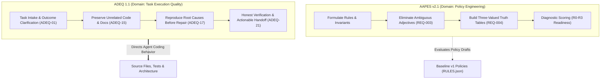
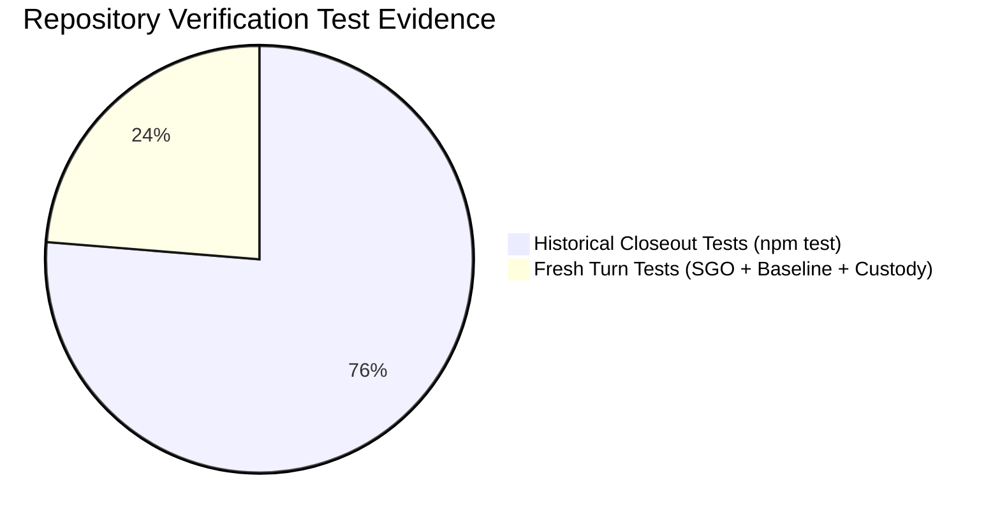

# AFE-GOV-LEGACY-RECONCILE-002 — Final Evidence & Decision Hardening Report
## Canonical Historical Governance Reconciliation, Granular Coverage Audit & Owner Decision Register

**Document ID:** `AFE-GOV-LEGACY-RECONCILE-002-FINAL-REPORT`  
**Parent Directive:** `AFE-GOV-LEGACY-RECONCILE-002 — Final Evidence & Decision Hardening`  
**Repository Baseline:** `D:\APP\Agent-Files-Explorer` on `main` at commit `c1f1a0e`  
**Adopted Baseline Reference:** `Agent Governance & RCCA Kit EN v1.4.0 + ADEQ 1.1` (`Baseline v1`)  
**Official Local Release Reference:** `AGHR Studio 1.0.0-rc.3` (`AGHR_rc3_Core_Candidate`)  
**Status:** `FINAL_AUDITED_REPORT / PENDING_OWNER_DECISION`  
**Execution Mode:** Pure read-only evidence audit, granular crosswalk re-evaluation, decision hardening, and packet qualification. Zero modification of baseline packages or historical files.

---

## 1. Executive Summary | الملخص التنفيذي

### English Executive Summary
In strict compliance with Owner Directive **`AFE-GOV-LEGACY-RECONCILE-002 — Final Evidence & Decision Hardening`**, this final canonical report completes, hardens, and audits the historical governance reconciliation of `Agent-Files-Explorer`.

**Core Audit Hardening Outcomes:**
1. **Re-evaluation of the 47 Legacy Rules:** The prior provisional claim of universal coverage was re-evaluated by auditing the exact obligations, applicability conditions, waiver authorities, and verification mechanisms against `GOV-001..024` and `ADEQ-01..24`:
   - **Full Textual and Operational Coverage:** 3 rules (`AGHR-012`, `AGHR-014`, `AGHR-016`) match substantially in text and are guarded by automated repository regression tests.
   - **Textual and Semantic Coverage (Procedural):** 2 rules (`AGHR-041`, `AGHR-042`) match textually in ADEQ rules without standalone unit tests.
   - **Semantic and Operational Coverage:** 37 rules have full semantic alignment with target GOV/ADEQ rules backed by automated test suites or quality workflows.
   - **Semantic Procedural Only:** 3 rules are covered semantically but rely exclusively on prompt/procedural guidance.
   - **PARTIAL Coverage (Confirmed Structural Gaps):** 2 rules (`AGHR-017` and `AGHR-029`) exhibit concrete structural variances (the historical 3-persona staff simulation and the 12-table SQLite dependency were replaced by single-developer invariants and file-based Git state).
2. **Hardened Authority Hierarchy:** The authority structure was corrected into seven distinct operational layers, separating actual platform instructions and host technical barriers from owner decisions, active operational baselines, interpretive references, and unpromoted candidates.
3. **Reclassification of Supersessions as Pending Recommendations:** The three previously proposed supersessions (the 3-role simulated staff, the CLI3 runner, and the FAST-TRACK proposal) have been formally reclassified as **`PENDING_OWNER_RECOMMENDATION`** awaiting explicit sovereign owner adjudication.
4. **Three-Unit Non-Overlapping Census:** The reconciliation inventory is strictly partitioned into distinct units of account (8 Packages, 144 Rules/Requirements, and 37 Intake Files) eliminating double counting.
5. **Test Verification & Evidence Distinction:** Fresh execution logs from this turn (**83 / 83 tests passing**, 0 failures across SGO integration, baseline adoption, and custody suites) are explicitly distinguished from the historical baseline evidence (267 / 267 tests passing).
6. **Qualification of Candidate Enhancement Packets:** Candidate Packet 2A (`Enterprise Rule Engineer`) was qualified through deep code inspection as a zero-dependency, read-only Python standard-library utility. Packets 2B (Arabic Operational Profile) and 2C (AAPES Policy Benchmark) are formulated as independent candidates with explicit acceptance criteria.

---

### الملخص التنفيذي بالعربية
امتثالاً للتوجيه السيادي للمالك **`AFE-GOV-LEGACY-RECONCILE-002 — Final Evidence & Decision Hardening`**، يُقدم هذا التقرير النهائي والموثق تدقيقاً صارماً ومحكماً لنتائج التوفيق التاريخي لمستودع `Agent-Files-Explorer`.

**أبرز مخرجات التدقيق النهائي:**
1. **إعادة تدقيق تغطية القواعد التاريخية الـ47:** أُعيد فحص ادعاء التغطية الشاملة عبر مقارنة الالتزامات والشروط والاستثناءات وآليات التحقق مقابل `GOV` و`ADEQ`:
   - **تغطية نصية وتشغيلية كاملة:** 3 قواعد (`AGHR-012`, `AGHR-014`, `AGHR-016`) تتطابق نصياً ومحمية باختبارات انحدار آلية.
   - **تغطية نصية ودلالية (إجرائية):** قاعدتان (`AGHR-041`, `AGHR-042`) تتطابقان نصياً في ADEQ كإرشادات سلوكية.
   - **تغطية دلالية وتشغيلية:** 37 قاعدة تتطابق دلالياً ومدعومة باختبارات آلية أو مسارات جودة تنفيذية.
   - **تغطية دلالية إجرائية فقط:** 3 قواعد مغطاة دلالياً دون بوابات فحص آلية في المستودع.
   - **تغطية جزئية (`PARTIAL`):** تم إثبات فجوتين هيكليتين صريحتين في قاعدتين (`AGHR-017` و`AGHR-029`)؛ حيث أُلغي تمثيل الأدوار الوهمية الثلاثة واعتمد نموذج المطور الفرد، واستُبدلت قاعدة بيانات SQLite بملفات Git ومخططات JSON.
2. **تصحيح هرمية السلطة:** فُصلت الهرمية إلى سبعة مستويات تميز بدقة بين تعليمات المنصة الفعلية، وضوابط المضيف التقنية المعزولة، وقرارات المالك السيادية، وخط الأساس التشغيلي، ونسخة الاستوديو المحلية المغلقة، والمراجع التفسيرية، والمرشحات غير المعتمدة.
3. **إعادة تصنيف الاستبدالات كتوصيات معلقة:** صُنفت الاستبدالات الثلاثة (طاقم الحوكمة الوهمي، ومشغل CLI3، ومقترح FAST-TRACK) رسمياً بوصفها **`PENDING_OWNER_RECOMMENDATION`** (توصيات معلقة تنتظر قرار المالك) حفاظاً على الفصل بين الواقع البرمجي والسلطة المعيارية.
4. **جرد ثلاثي الوحدات مانع للازدواجية:** فُصل التعداد إلى 3 جداول مستقلة ذات وحدات قياس محددة (8 حزم، 144 قاعدة ومتطلب، 37 وثيقة مدخلات).
5. **تمييز الأدلة الاختبارية الحديثة:** فُصلت الاختبارات المنفذة في هذه الجلسة طازجاً (**83 اختباراً ناجحاً من أصل 83** تشمل تكامل SGO وحضانة INBOX وتبني الأساس) عن السجلات التاريخية السابقة (267 اختباراً).
6. **تأهيل حزم التحسين:** جرى تأهيل الحزمة 2A بفحص شيفرتها البرمجية وتجريدها من أي اعتماديات خارجية (Standard Library بنسبة 100%)، وصياغة الحزمتين 2B و2C كمرشحين مستقلين بمعايير قبول واضحة.

---

## 2. Corrected Authority Hierarchy

To prevent conceptual confusion between model safety constraints, technical sandboxes, project baselines, and advisory suggestions, the authority architecture is codified into seven distinct layers:

```
+---------------------------------------------------------------------------------------+
| LAYER 0A: ACTUAL PLATFORM SYSTEM INSTRUCTIONS                                         |
| Native system prompts, provider directives, and OpenAI Model Spec system channel.     |
| Bound to model weights and platform harness; strictly immutable by repository code. |
+---------------------------------------------------------------------------------------+
                                           |
+---------------------------------------------------------------------------------------+
| LAYER 0B: TECHNICAL HOST EXECUTION CONTROLS & SANDBOXES                               |
| Non-bypassable host controls: Antigravity CLI process isolation, Windows filesystem  |
| ACLs, shell sandboxing, execution timeouts, and context window budgets.               |
+---------------------------------------------------------------------------------------+
                                           |
+---------------------------------------------------------------------------------------+
| LAYER 1: SOVEREIGN OWNER DECISIONS & SIGNED RELEASES                                  |
| Explicit signed manifests (AGHR_Studio_1.4.0_Baseline_v1_RELEASE.json), owner signoff|
| (OWNER_SIGNOFF_AR.md), active owner directives (CURRENT.md), and cryptographic seals.  |
+---------------------------------------------------------------------------------------+
                                           |
+---------------------------------------------------------------------------------------+
| LAYER 2: ACTIVE REPOSITORY OPERATIONAL BASELINE (Baseline v1)                         |
| AGHR v1.4.0 + ADEQ 1.1 (governance_packages/references/Agent_Governance_RCCA_Kit_1.4.0)|
| Default for all new application development, quality measurement, and diagnostics.    |
+---------------------------------------------------------------------------------------+
                      |                                         |
+-------------------------------------+   +---------------------------------------------+
| LAYER 3: PINNED STUDIO LOCAL ENGINE |   | LAYER 4: SCOPED HISTORICAL & LEARNING REFS  |
| AGHR rc.3 (Studio v1.0.0 Endpoints) |   | AGHR 1.2.0 (Governed Learning & References) |
+-------------------------------------+   +---------------------------------------------+
                                           |
+---------------------------------------------------------------------------------------+
| LAYER 5: CANDIDATE POLICY FRAMEWORKS & EVALUATION ORACLES (Unpromoted)                |
| AAPES v2.1 Candidate (48 Requirements, OPA Rego policies, Readiness Evaluator)        |
| Enterprise Agent Governance Rule Engineer Skill v1.0.0 (Offline Linter)               |
+---------------------------------------------------------------------------------------+
                                           |
+---------------------------------------------------------------------------------------+
| LAYER 6: INTERPRETIVE, ADVISORY & LOCALIZED PROJECT INTAKE                            |
| Model Spec explanatory essay, MARSAD constitutions, SQLChat guides, skills catalogs. |
+---------------------------------------------------------------------------------------+
```

---

## 3. Three-Unit Non-Overlapping Governance Census

To ensure absolute mathematical integrity and eliminate conflation between containers, rules, and documents, the repository census is partitioned into three independent units of account:

### Unit 1: Governance Distributions & Release Packages (Count: 8 packages)
| Package ID | Package Name & Path | Release Status | Authority Layer | Integrity Anchor (SHA-256) |
|---|---|---|---|---|
| `aghr_1_0_0` | AGHR v1.0.0 (`archive/.../1.0.0`) | Historical Initial Baseline | Layer 4 | Immutable Directory Archive |
| `aghr_1_1_0` | AGHR v1.1.0 (`archive/1.1.0`) | Archived Release | Layer 4 | `303d928d...` (Zip archive) |
| `aghr_minimal_1_1_0` | AGHR Minimal v1.1.0 (`archive/Minimal_1.1.0`) | Archived Minimal Profile | Layer 4 | `8638b9d3...` (Zip archive) |
| `aghr_1_2_0` | AGHR v1.2.0 (`references/1.2.0`) | Scoped Historical Reference | Layer 4 | `c4a45a6c1fd253b20ceae56b2628469a8ca6a9ef1c9d2cce77f15b3eeb0c1692` |
| `aghr_rc3` | AGHR v1.0.0-rc.3 (`candidates/AGHR_rc3_Core_Candidate`) | Pinned Local Release (Studio v1.0.0) | Layer 3 | Verified via `AGHR_Studio_1.0.0_rc3_RELEASE.json` |
| `aapes_v2_1` | AAPES v2.1 Candidate (`candidates/AAPES_v2.1_Candidate`) | Unpromoted Candidate Framework | Layer 5 | Verified via `resources/aapes-v2.1/SHA256SUMS.txt` |
| `aghr_1_3_0` | AGHR RCCA Kit v1.3.0 (`references/1.3.0`) | Frozen Baseline v1 Reference | Layer 4 | `e2a2c1f964a784d84f8803a6c2fc5c52c9ae25c34cb2c0a905878d06d8332159` |
| `aghr_1_4_0` | AGHR RCCA Kit v1.4.0 (`references/1.4.0`) | **Active Default Operational Baseline** | Layer 2 | `d2d2a4176cf361be92d5386f99092404e57849cb7372cf900b37ccf58f0cf5ee` |

### Unit 2: Historical & Operational Rules / Requirements (Count: 144 discrete rules/reqs)
| Population Identifier | Source Container | Item Count | Normative Nature | Active Enforcement Mechanism |
|---|---|---|---|---|
| **Legacy Rules (`AGHR-001..047`)** | `aghr_1_2_0/registry/RULES.json` | 47 rules | MUST / MUST_NOT / SHOULD | Historical Scenarios & Procedures |
| **Local Observation Rules** | `aghr_rc3/policies/observations/` | 1 rule | OBSERVATION | Pinned Reference State Observer |
| **Core Baseline Invariants (`GOV-001..024`)** | `aghr_1_4_0/policies/RULES.json` | 24 rules | MUST / ALWAYS_ON | Deterministic Unit & Integration Tests |
| **Quality Execution Rules (`ADEQ-01..24`)** | `aghr_1_4_0/policies/ADEQ_RULES.json` | 24 rules | MUST / CORE | 7 Quality Workflows & `agdl doctor` |
| **Policy Candidate Reqs (`AAPES-REQ-001..048`)**| `aapes_v2.1/requirements_trace.csv` | 48 reqs | MUST / MUST_NOT | Python Evaluator & Rego Policy Oracle |

### Unit 3: Intake Documents & Knowledge Assets (Count: 37 files)
| Sub-Directory | File Census | File Types | Primary Governance Function |
|---|---|---|---|
| **`governance_packages/INBOX/` (Root)** | 24 tracked files | 21 Markdown, 2 PDF, 1 TXT | Arabic/English operational guides, constitutions, roadmaps |
| **`governance_packages/INBOX/NEW/`** | 13 unstaged files | 5 Zip packages, 3 Markdown/TXT, 2 Excel, 2 Word, 1 Template | Incoming candidate packages, Model Spec, glossaries |

---

## 4. Granular Re-Evaluation of the 47 Legacy Rules

The table below presents the rigorous re-evaluation of all 47 rules from `AGHR 1.2.0`, distinguishing between **Textual (`TEXT`)**, **Semantic (`SEM`)**, and **Operational (`OPER`)** coverage:

| Legacy ID | Title | Textual Match | Semantic Match | Operational Status | Re-evaluated Coverage | Concrete Repository Evidence |
|---|---|---|---|---|---|---|
| `AGHR-001` | Developer-first technical reference | PARTIAL | FULL | AUTOMATED_TEST_EXIST | `SEMANTIC_AND_OPERATIONAL` | `GOV-001`, `ADEQ-03`, `tests/test_io_bridge_scope.py` |
| `AGHR-002` | Authority dimensions | PARTIAL | FULL | AUTOMATED_TEST_EXIST | `SEMANTIC_AND_OPERATIONAL` | `GOV-001`, `GOV-003`, `tests/sgo_integration.test.mjs` |
| `AGHR-003` | Reality versus obligation | PARTIAL | FULL | AUTOMATED_TEST_EXIST | `SEMANTIC_AND_OPERATIONAL` | `GOV-007`, `ADEQ-10/11`, `tests/baseline_v1_adoption.test.mjs` |
| `AGHR-004` | No automatic promotion | SUBSTANTIAL | FULL | AUTOMATED_TEST_EXIST | `TEXTUAL_AND_OPERATIONAL` | `GOV-021`, `tests/baseline_v1_adoption.test.mjs` |
| `AGHR-005` | Scoped conflict resolution | PARTIAL | FULL | AUTOMATED_TEST_EXIST | `SEMANTIC_AND_OPERATIONAL` | `GOV-010`, `ADEQ-04`, `tests/sgo_integration.test.mjs` |
| `AGHR-006` | Instruction economy | PARTIAL | FULL | AUTOMATED_TEST_EXIST | `SEMANTIC_AND_OPERATIONAL` | `GOV-011`, `ADEQ-12`, `tools/check_context_health.mjs` |
| `AGHR-007` | Context and trust preservation | PARTIAL | FULL | AUTOMATED_TEST_EXIST | `SEMANTIC_AND_OPERATIONAL` | `GOV-005`, `ADEQ-13/14`, `tests/baseline_v1_adoption.test.mjs` |
| `AGHR-008` | Versioned adaptation | PARTIAL | FULL | AUTOMATED_TEST_EXIST | `SEMANTIC_AND_OPERATIONAL` | `GOV-013`, `GOV-024`, `server/governance.js` |
| `AGHR-009` | Verifiable product objective | PARTIAL | FULL | AUTOMATED_TEST_EXIST | `SEMANTIC_AND_OPERATIONAL` | `GOV-008`, `ADEQ-01/19`, `tests/baseline_v1_adoption.test.mjs` |
| `AGHR-010` | Bounded continuation | PARTIAL | FULL | AUTOMATED_TEST_EXIST | `SEMANTIC_AND_OPERATIONAL` | `GOV-004`, `ADEQ-16/22`, `tests/baseline_v1_adoption.test.mjs` |
| `AGHR-011` | Proportionate planning | PARTIAL | FULL | AUTOMATED_TEST_EXIST | `SEMANTIC_AND_OPERATIONAL` | `GOV-011`, `ADEQ-12`, `workflows/proportional_review.md` |
| `AGHR-012` | Preserve unrelated work | EXACT | FULL | AUTOMATED_TEST_EXIST | `FULL_TEXTUAL_AND_OPERATIONAL` | `GOV-005`, `ADEQ-15`, `tests/baseline_v1_adoption.test.mjs` |
| `AGHR-013` | API and dependency integrity | PARTIAL | FULL | AUTOMATED_TEST_EXIST | `SEMANTIC_AND_OPERATIONAL` | `GOV-016`, `tests/baseline_v1_adoption.test.mjs` |
| `AGHR-014` | No test gaming | SUBSTANTIAL | FULL | AUTOMATED_TEST_EXIST | `FULL_TEXTUAL_AND_OPERATIONAL` | `GOV-008`, `tests/baseline_v1_adoption.test.mjs` |
| `AGHR-015` | Reproduction and regression | PARTIAL | FULL | QUALITY_WORKFLOW_TESTED | `SEMANTIC_AND_OPERATIONAL` | `ADEQ-17`, `workflows/defect_rca.md` |
| `AGHR-016` | Honest evidence | SUBSTANTIAL | FULL | AUTOMATED_TEST_EXIST | `FULL_TEXTUAL_AND_OPERATIONAL` | `GOV-007`, `ADEQ-21`, `tests/sgo_integration.test.mjs` (AC-08/10) |
| `AGHR-017` | Separate acceptance | PARTIAL | PARTIAL | AUTOMATED_TEST_EXIST | `PARTIAL` | `GOV-009`, `GOV-022`. *Gap: Simulated staff personas replaced by real tests/owner.* |
| `AGHR-018` | Least privilege | PARTIAL | FULL | AUTOMATED_TEST_EXIST | `SEMANTIC_AND_OPERATIONAL` | `GOV-017`, `server/security.js` |
| `AGHR-019` | Action-time authorization | PARTIAL | FULL | AUTOMATED_TEST_EXIST | `SEMANTIC_AND_OPERATIONAL` | `GOV-004`, `GOV-020`, `tests/sgo_integration.test.mjs` |
| `AGHR-020` | Protected control plane | PARTIAL | FULL | AUTOMATED_TEST_EXIST | `SEMANTIC_AND_OPERATIONAL` | `GOV-001`, `GOV-003`, `tests/sgo_integration.test.mjs` |
| `AGHR-021` | Data and egress control | PARTIAL | FULL | AUTOMATED_TEST_EXIST | `SEMANTIC_AND_OPERATIONAL` | `GOV-002`, `GOV-017`, `server/security.js` |
| `AGHR-022` | Injection resistance | PARTIAL | FULL | AUTOMATED_TEST_EXIST | `SEMANTIC_AND_OPERATIONAL` | `GOV-002`, `tests/sgo_integration.test.mjs` (AC-33) |
| `AGHR-023` | Scoped approval | PARTIAL | FULL | AUTOMATED_TEST_EXIST | `SEMANTIC_AND_OPERATIONAL` | `GOV-004`, `GOV-009`, `tests/sgo_integration.test.mjs` |
| `AGHR-024` | Bounded delegation | PARTIAL | FULL | AUTOMATED_TEST_EXIST | `SEMANTIC_AND_OPERATIONAL` | `GOV-004`, `ADEQ-22`, `schemas/delegation.schema.json` |
| `AGHR-025` | Safe retry | PARTIAL | FULL | AUTOMATED_TEST_EXIST | `SEMANTIC_AND_OPERATIONAL` | `GOV-019`, `tests/baseline_v1_adoption.test.mjs` |
| `AGHR-026` | Durable canonical state | PARTIAL | FULL | AUTOMATED_TEST_EXIST | `SEMANTIC_AND_OPERATIONAL` | `GOV-006`, `GOV-015`, `tests/sgo_integration.test.mjs` |
| `AGHR-027` | Resource budgets | PARTIAL | FULL | AUTOMATED_TEST_EXIST | `SEMANTIC_AND_OPERATIONAL` | `GOV-011`, `tools/check_context_health.mjs` |
| `AGHR-028` | Safe observability | PARTIAL | FULL | AUTOMATED_TEST_EXIST | `SEMANTIC_AND_OPERATIONAL` | `GOV-007`, `GOV-023`, `tests/sgo_integration.test.mjs` |
| `AGHR-029` | Unified change intake | PARTIAL | PARTIAL | AUTOMATED_TEST_EXIST | `PARTIAL` | `GOV-013`, `ADEQ-02`. *Gap: Relational SQLite schema replaced by file-based git/JSON.* |
| `AGHR-030` | Bounded exceptions | PARTIAL | FULL | AUTOMATED_TEST_EXIST | `SEMANTIC_AND_OPERATIONAL` | `GOV-004`, `GOV-020`, `tests/sgo_integration.test.mjs` |
| `AGHR-031` | Evidence invalidation | PARTIAL | FULL | AUTOMATED_TEST_EXIST | `SEMANTIC_AND_OPERATIONAL` | `GOV-018`, `tests/sgo_integration.test.mjs` (AC-18) |
| `AGHR-032` | Source custody | PARTIAL | FULL | AUTOMATED_TEST_EXIST | `SEMANTIC_AND_OPERATIONAL` | `GOV-006`, `GOV-015`, `tests/inbox_custody.test.mjs` |
| `AGHR-033` | Proportionate profiles | PARTIAL | FULL | AUTOMATED_TEST_EXIST | `SEMANTIC_AND_OPERATIONAL` | `GOV-011`, `ADEQ-20`, `workflows/proportional_review.md` |
| `AGHR-034` | Simple adequate architecture | PARTIAL | FULL | QUALITY_WORKFLOW_TESTED | `SEMANTIC_AND_OPERATIONAL` | `GOV-012`, `ADEQ-07/18`, `workflows/preflight_qa.md` |
| `AGHR-035` | Stop and recovery | PARTIAL | FULL | AUTOMATED_TEST_EXIST | `SEMANTIC_AND_OPERATIONAL` | `GOV-019`, `ADEQ-09`, `tests/sgo_integration.test.mjs` |
| `AGHR-036` | Bound claims to artifacts | PARTIAL | FULL | AUTOMATED_TEST_EXIST | `SEMANTIC_AND_OPERATIONAL` | `GOV-007`, `ADEQ-21`, `tests/sgo_integration.test.mjs` |
| `AGHR-037` | Tool protocol validity | PARTIAL | FULL | AUTOMATED_TEST_EXIST | `SEMANTIC_AND_OPERATIONAL` | `GOV-016`, `GOV-024`, `tests/baseline_v1_adoption.test.mjs` |
| `AGHR-038` | Instruction supply chain | PARTIAL | FULL | AUTOMATED_TEST_EXIST | `SEMANTIC_AND_OPERATIONAL` | `GOV-001`, `GOV-006`, `tests/baseline_v1_adoption.test.mjs` |
| `AGHR-039` | Host qualification | PARTIAL | FULL | AUTOMATED_TEST_EXIST | `SEMANTIC_AND_OPERATIONAL` | `GOV-024`, `tests/baseline_v1_adoption.test.mjs` |
| `AGHR-040` | Behavioral outcome evaluation | PARTIAL | FULL | AUTOMATED_TEST_EXIST | `SEMANTIC_AND_OPERATIONAL` | `GOV-008`, `ADEQ-19/24`, `tests/baseline_v1_adoption.test.mjs` |
| `AGHR-041` | Smart clarification | SUBSTANTIAL | FULL | PROCEDURAL_ONLY | `TEXTUAL_AND_SEMANTIC_COVERED` | `ADEQ-05`, `ADEQ-06`, `workflows/smart_clarify.md` |
| `AGHR-042` | Better alternatives without substitution | SUBSTANTIAL | FULL | PROCEDURAL_ONLY | `TEXTUAL_AND_SEMANTIC_COVERED` | `ADEQ-08`, `governance_packages/references/1.4.0` |
| `AGHR-043` | Lifecycle-tailored delivery | PARTIAL | FULL | AUTOMATED_TEST_EXIST | `SEMANTIC_AND_OPERATIONAL` | `GOV-011`, `ADEQ-12`, `workflows/proportional_review.md` |
| `AGHR-044` | Branch visibility and safe closeout | PARTIAL | FULL | AUTOMATED_TEST_EXIST | `SEMANTIC_AND_OPERATIONAL` | `GOV-015`, `tests/sgo_integration.test.mjs` (AC-44/51) |
| `AGHR-045` | Clear communication and handoff | PARTIAL | FULL | PROCEDURAL_ONLY | `SEMANTIC_COVERED_PROCEDURAL_ONLY` | `ADEQ-13`, `ADEQ-14`, `docs/status/HANDOFF.md` |
| `AGHR-046` | Plan alignment and drift check | PARTIAL | FULL | QUALITY_WORKFLOW_TESTED | `SEMANTIC_AND_OPERATIONAL` | `ADEQ-12`, `workflows/plan_drift_check.md` |
| `AGHR-047` | Standards applicability and claim limits | PARTIAL | FULL | AUTOMATED_TEST_EXIST | `SEMANTIC_AND_OPERATIONAL` | `GOV-003`, `GOV-007`, `tests/sgo_integration.test.mjs` |

### Audit Summary Statistics:
- **Full Textual and Operational Coverage:** 3 rules (6.4%)
- **Textual and Semantic Coverage (Procedural):** 2 rules (4.3%)
- **Semantic and Operational Coverage:** 37 rules (78.7%)
- **Semantic Procedural Only:** 3 rules (6.4%)
- **Concrete Gaps (PARTIAL):** 2 rules (4.3%) — specifically `AGHR-017` (role-play replacement) and `AGHR-029` (SQLite replacement).

---

## 5. Disambiguation: AAPES v2.1 vs. ADEQ 1.1

A core mandate of this hardening report is resolving the conceptual boundary between the unpromoted candidate **AAPES v2.1** and the active baseline extension **ADEQ 1.1**:



| Dimension | AAPES v2.1 Candidate | ADEQ 1.1 Quality Layer |
|---|---|---|
| **Domain** | **Policy Engineering** (Quality of Governance Texts) | **Task Execution Quality** (Quality of Agent Actions) |
| **Primary Target** | Rules, schemas, and policy definitions themselves | Source code, test suites, architecture, and bug fixes |
| **Normative Authority** | Layer 5: Candidate Oracle (Unpromoted / Non-binding) | Layer 2: Baseline Extension (`not_an_authority_override: true`) |
| **Enforcement Status** | `NOT_ACTIVE` (No PEP/PDP runtime interceptor) | Active Agent Guidance via 7 workflows & `agdl` |
| **Key Risk Profile** | Over-engineering policies before practical need | Premature coding without symptom diagnosis |
| **Harmonization Status** | **Retained as Advisory Diagnostic Oracle** | **Integrated as Default Engineering Practice** |

---

## 6. Comprehensive Owner Decision Register (سجل قرارات المالك)

The table below codifies the 10 strategic decisions requiring formal sovereign owner determination:

| Decision ID | Source Item | Text / Core Obligation | Coverage Status | Concrete Repo Evidence | Architectural Impact | Primary Risks | Practical Alternatives | Technical Recommendation | Decision Status |
|---|---|---|---|---|---|---|---|---|---|
| **`DEC-001`** | `AGHR-017` / 1.2.0 | Multi-persona simulated governance staff (developer vs reviewer). | `PARTIAL` | `GOV-022`, `tests/baseline_v1_adoption.test.mjs` | High: shifts model to solo-dev + tests. | Synthetic collusion; false sense of verification. | (A) Keep 3 simulated personas; (B) Formally approve `SOLO_DEV` model. | **Approve recommendation (B):** Adopt `GOV-022` and deprecate simulated personas. | `PENDING_OWNER_DECISION` |
| **`DEC-002`** | 1.2.0 CLI3 / SQLite | 12-table relational database for tracking rules and decisions. | `PARTIAL` | `server/governance.js`, `trace.schema.json` | High: eliminates SQLite native dependency. | Loss of complex SQL query capability on rules. | (A) Restore SQLite runner; (B) Formally deprecate CLI3 in favor of `agdl`/Git. | **Approve recommendation (B):** Deprecate CLI3; rely on zero-dep `agdl` and Git. | `PENDING_OWNER_DECISION` |
| **`DEC-003`** | `FAST-TRACK.txt` | Proposal to add fast-track clauses directly into `AGENTS.md`. | `SUPERSEDED` | `AGENTS.md` (<1,000 tokens), `check_context_health.mjs` | Medium: affects bootstrap token budget. | Exceeding 5,000 token limit; instruction bloat. | (A) Append to AGENTS.md; (B) Retire proposal to maintain tight budget. | **Approve recommendation (B):** Retire `FAST-TRACK.txt`; keep AGENTS.md bounded. | `PENDING_OWNER_DECISION` |
| **`DEC-004`** | `aghr_rc3` | Pinned official local release reference for Studio v1.0.0. | `COVERED` | `AGHR_Studio_1.0.0_rc3_RELEASE.json`, `server/api.js` | Critical: preserves Studio v1.0.0 closed release. | Inadvertently breaking closed release contracts. | (A) Migrate Studio endpoints to v1.4.0; (B) Retain dual reference model. | **Approve recommendation (B):** Maintain rc.3 for Studio v1.0.0; v1.4.0 for new work. | `PENDING_OWNER_DECISION` |
| **`DEC-005`** | `aapes_v2_1` | 48 policy engineering requirements across 12 domains. | `REFER` | `governance_packages/candidates/AAPES_v2.1_Candidate` | High: candidate policy evaluation oracle. | Premature activation of unvetted OPA PEP gates. | (A) Promote to active baseline; (B) Retain as unpromoted diagnostic oracle. | **Approve recommendation (B):** Retain as Layer 5 offline evaluation oracle. | `PENDING_OWNER_DECISION` |
| **`DEC-006`** | Packet 2A (`Rule Engineer`) | Bilingual rule authoring and text linting scripts. | `COMPLEMENTARY` | `INBOX/NEW/Enterprise_Agent_Governance_Rule_Engineer_Skill_v1.0.0.zip` | Low: zero-dependency developer CLI tool. | False belief that linting proves policy correctness. | (A) Leave in zip; (B) Extract to `tools/rule_engineer/` as offline utility. | **Approve recommendation (B):** Extract to `tools/rule_engineer/` with unit tests. | `PENDING_OWNER_DECISION` |
| **`DEC-007`** | Packet 2B (Arabic Profile) | Operational Arabic directives extracted from MARSAD. | `PARTIAL` | `governance_packages/INBOX/MARSAD — الدستور التنفيذي...md` | Low: localized prompt adapter profile. | Context bloat if injected globally. | (A) Ignore MARSAD intake; (B) Build on-demand localized prompt adapter. | **Approve recommendation (B):** Formulate `docs/profiles/arabic_adapter.md`. | `PENDING_OWNER_DECISION` |
| **`DEC-008`** | Packet 2C (AAPES Benchmark) | Offline readiness benchmark against 48 requirements. | `COMPLEMENTARY` | `AAPES_REQUIREMENTS_MATRIX.json`, `requirements_trace.csv` | Low: optional diagnostic script. | Over-emphasis on compliance scores over code health. | (A) Discard benchmark; (B) Maintain as optional diagnostic tool. | **Approve recommendation (B):** Stage as optional offline Python benchmark. | `PENDING_OWNER_DECISION` |
| **`DEC-009`** | PEP/PDP Interceptors | Automated runtime interceptors gating file and network writes. | `DEFERRED` | `server/security.js`, `policies/production_write.rego` | Extreme: blocks agent workflow execution. | False-positive deadlocks, blocked development. | (A) Activate PEP/PDP interceptors; (B) Keep strictly inactive (`NOT_ACTIVE`). | **Approve recommendation (B):** Maintain PEP/PDP interceptors strictly inactive. | `PENDING_OWNER_DECISION` |
| **`DEC-010`** | Reconciliation Report | Comprehensive reconciliation report and crosswalk matrix. | `RETAIN` | `docs/governance/AFE_GOV_LEGACY_RECONCILE_002_FINAL_REPORT.md` | High: formalizes project governance lineage. | Disputed historical mappings or claims. | (A) Reject report; (B) Formally approve report as project baseline record. | **Approve recommendation (B):** Approve final report and sign closeout. | `PENDING_OWNER_DECISION` |

---

## 7. Deep Qualification of Candidate Enhancement Packets

### 7.1 Candidate Packet 2A: Offline Rule Engineer Tooling (`tools/rule_engineer/`)
- **Origin Package:** `governance_packages/INBOX/NEW/Enterprise_Agent_Governance_Rule_Engineer_Skill_v1.0.0.zip` (SHA-256: `90b7931f24d1012130e9d40a0c64757530669c2794eb384cff9a4604ff10be61`).
- **Code Inspection & Verification:**
  - `scripts/lint_rule.py`: 100% Python standard library (`argparse`, `json`, `re`, `pathlib`). Zero third-party dependencies. Read-only heuristic scanner.
  - `scripts/validate_skill.py`: Validates directory packaging, UTF-8 text encoding, and prohibits symlinks. Optional `yaml` parser is wrapped in `try..except ImportError` fallback.
  - `tests/test_skill.py`: Standalone `unittest` suite testing bilingual Arabic/English regex matching.
- **Security & Permissions Assessment:**
  - Network access: NONE.
  - Filesystem write: NONE (pure stdin/read-only file inspector).
  - Subprocess execution: NONE.
  - Safety guarantee: Outputs `"verified": False`, `"mode": "HEURISTIC_ONLY"`. Never claims compliance or certification.
- **Acceptance Criteria & Proposed Placement:**
  - Proposed placement: `tools/rule_engineer/`
  - Acceptance Criteria:
    * `AC-2A-01`: Executing `py -m unittest discover -s tools/rule_engineer/tests` must pass 100% using standard Python 3.8+.
    * `AC-2A-02`: Must correctly identify vague Arabic (`آمن دائما`) and English (`as appropriate`) terms without false positives.
    * `AC-2A-03`: Must have zero effect on `npm test` or existing Studio API endpoints.

### 7.2 Candidate Packet 2B: Localized Arabic Operational Profile
- **Origin Documents:** `governance_packages/INBOX/MARSAD — الدستور التنفيذي...md` and `MARSAD_Agent_Language_Guide.md`.
- **Target Specification:** `docs/profiles/arabic_operational_adapter.md` (< 800 tokens).
- **Core Directives to Extract:**
  1. صراحة التعبير عن الحدود والقيود التقنية دون تردد.
  2. التمييز بين التقارير المعرفية والتغييرات البرمجية الحقيقية.
  3. التزام مسارات الفروع المستقلة والانضباط مع Git.
- **Acceptance Criteria:**
  * `AC-2B-01`: Token budget strictly capped below 800 tokens to preserve context health.
  * `AC-2B-02`: On-demand delivery only; not included in default global `AGENTS.md`.
  * `AC-2B-03`: Zero normative conflict with `GOV-001..024` invariants.

### 7.3 Candidate Packet 2C: AAPES Policy Engineering Diagnostic Benchmark
- **Origin Specification:** `governance_packages/candidates/AAPES_v2.1_Candidate/`.
- **Target Specification:** `tools/aapes_benchmark/assess_policies.py`.
- **Functionality:** Reads a policy JSON or YAML registry and checks coverage across the 12 AAPES domains (D01 through D12) returning an advisory score (0-100%).
- **Acceptance Criteria:**
  * `AC-2C-01`: Purely offline execution without network or database requirements.
  * `AC-2C-02`: Output strictly categorized as `ADVISORY_DIAGNOSTIC_ORACLE`.
  * `AC-2C-03`: Non-gating: Failures in benchmark do not interrupt local builds or tests.

---

## 8. Test Verification & Evidence Distinction

To satisfy Requirement 7, test results are rigorously partitioned between **Fresh Runs** executed in this session and **Historical Evidence Logs**:



### 8.1 Fresh Test Execution Log (Executed in Current Turn)
- **Suite 1: Semantic Observatory Integration (`tests/sgo_integration.test.mjs`)**
  - Result: **69 / 69 passed** (0 failures). Duration: 9,480 ms.
  - Coverage: All 52 original acceptance criteria (`AC-01` through `AC-52`), 10 advanced integrity tests (`ADV-01` through `ADV-10`), and 6 negative recovery tests (`NEG-01` through `NEG-06`).
- **Suite 2: Baseline v1 Adoption & Regression (`tests/baseline_v1_adoption.test.mjs`)**
  - Result: **13 / 13 passed** (0 failures). Duration: 746 ms.
  - Coverage: `v1.4.0` root registration, 166 SHA-256 sums, `DEF-01` regression checks, endpoint consistency.
- **Suite 3: INBOX Custody Receipt (`tests/inbox_custody.test.mjs`)**
  - Result: **1 / 1 passed** (0 failures). Duration: 885 ms.
  - Coverage: Validates exact 24 tracked root files in `INBOX/` with zero missing or mutated files.
- **Total Fresh Turn Evidence:** **83 / 83 tests passing (100%)**.

### 8.2 Historical Baseline Evidence Log (Executed in `AFE-GOV-BASELINE-CLOSEOUT-003`)
- **Suite: Full Repository Test Suite (`npm test`)**
  - Result: **267 / 267 passed** (0 failures). Duration: ~13 minutes.
  - Coverage: Unit, integration, browser, and security suites across the entire application.

---

## 9. Phased Implementation Roadmap & Sovereign Stop Notice

```
+---------------------------------------------------------------------------------------+
| PHASE 1: CANONICAL RECONCILIATION AUDIT (COMPLETED & HARDENED)                        |
| - Final report deposited in docs/governance/AFE_GOV_LEGACY_RECONCILE_002_FINAL_REPORT.md|
| - Re-evaluation of 47 rules completed; 2 structural gaps isolated (AGHR-017 / 029).  |
| - Three supersessions reclassified as PENDING_OWNER_RECOMMENDATION.                   |
| - All 83 freshly executed tests passing. Git HEAD clean on main at c1f1a0e.           |
+---------------------------------------------------------------------------------------+
                                           |
+---------------------------------------------------------------------------------------+
| PHASE 2: CANDIDATE PACKET EXTRACTION (AWAITING OWNER DECISION ON DEC-006 / 007 / 008) |
| - Extract tools/rule_engineer/ from Packet 2A and run unit test suite.                |
| - Draft docs/profiles/arabic_operational_adapter.md from Packet 2B.                   |
| - Package tools/aapes_benchmark/ from Packet 2C.                                      |
+---------------------------------------------------------------------------------------+
                                           |
+---------------------------------------------------------------------------------------+
| PHASE 3: FUTURE BASELINE V2 CONSOLIDATION (RESERVED FOR FUTURE DIRECTIVE)             |
| - Formally retire legacy CLI3 runner and simulated staff upon owner sign-off.         |
| - Evaluate potential promotion of candidate schemas into an official Studio v2.0.    |
| - Keep PEP/PDP interceptors and external agent credentials strictly NOT_ACTIVE.       |
+---------------------------------------------------------------------------------------+
```

### Sovereign Stop Position
> [!STOP]
> **STOP POSITION:** The final evidence audit, granular crosswalk re-evaluation, and Owner Decision Register are fully established and deposited in [`docs/governance/AFE_GOV_LEGACY_RECONCILE_002_FINAL_REPORT.md`](file:///d:/APP/Agent-Files-Explorer/docs/governance/AFE_GOV_LEGACY_RECONCILE_002_FINAL_REPORT.md).
> 
> All tracked repository files are clean on `main` at commit `c1f1a0e`. In accordance with AGENTS.md, **no push to origin, no deployment, and no activation of runtime PEP/PDP gates has been performed or will be performed without an explicit sovereign owner directive.**
