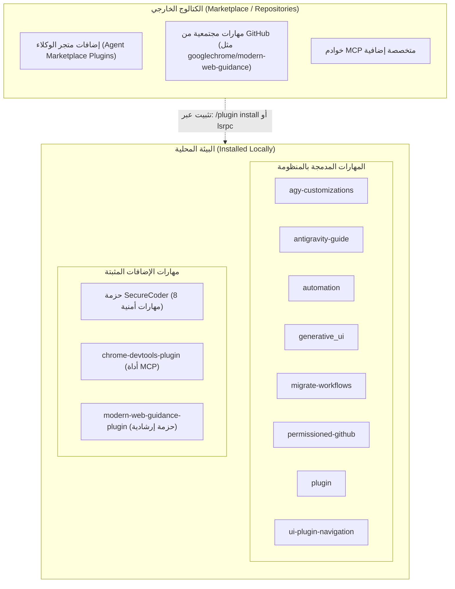

Ran search for SKILL.md files
Checked task Search for SKILL.md files
Analyzed SKILL.md:L1-100
Ran inspect skill directories
Ran inspect config and antigravity folders
Checked task Inspect config and antigravity folders
Checked task Inspect config and antigravity folders
Checked task Inspect config and antigravity folders
Analyzed SKILL.md:L1-100
Ran check Antigravity environment variables
Analyzed SKILL.md:L100-250
Ran query Language Server GetAllPlugins · Exited with code 1
Ran call GetAllPlugins via RestMethod · Exited with code 1
Ran run GetAllPlugins with single-quoted script · Exited with code 1
Created query_plugins.ps1
Ran run query_plugins.ps1
Checked task Run query_plugins.ps1
Created inventory_skills.ps1
Ran run inventory_skills.ps1
Ran inspect config plugins content
Ran read plugin.json files
Ran check modern-web-guidance-plugin details
Ran read securecoder plugin.json
Ran check loose user skill paths
Created dump_details.ps1
Ran run dump_details.ps1
Ran check permissioned-github SKILL.md
Ran check securecoder skills preview · Exited with code 1
Checked task Check securecoder skills preview
Ran read all_skills.json formatted · Exited with code 1
Analyzed all_skills.json:L1-116

أجريت فحصاً وجرداً شاملاً وكاملاً لجميع المهارات (`Skills`) في البيئة الحالية (محلياً وفي بيئة تشغيل وكيل Antigravity ومحرك Antigravity IDE)، وفقاً لقيود القراءة فقط دون تعديل أو تثبيت.

---

### 1. تصنيف مصادر المهارات في البيئة الحالية

1. **المهارات المدمجة بالمنظومة (System Skills):**
   * متوفرة افتراضياً ضمن منصة Antigravity في المسار:
     `C:/Users/Majed/.gemini/antigravity/builtin/skills/`
   * توجد نسخة جزئية مكررة في محرك بيئة التطوير `antigravity-ide` في:
     `C:/Users/Majed/.gemini/antigravity-ide/builtin/skills/`
2. **مهارات المستخدم (User Skills):**
   * المسار المعياري المخصص لها: `~/.gemini/config/skills/`
   * **الحالة الحالية:** لا توجد مهارات فردية منشأة على مستوى المستخدم حالياً (المسار غير متوفر).
3. **مهارات المشروع (Project Skills):**
   * المسار المعياري لاكتشاف مهارات المشروع: `.agents/skills/` أو `.agent/skills/` في جذر المستودع.
   * **الحالة الحالية:** لا توجد مهارات وكيل مخصصة للمشروع داخل مستودع `personal_advisor_ai_v2` حالياً.
   > [!NOTE]
   > يحتوي المستودع على وثائق نطاق استشاري وتطبيقي لتطبيق أندرويد (مثل `GOVERNING_DOMAIN_SKILL_DEFINITIONS_AR.md`)، وهي مهارات منطق استشاري خاص بالتطبيق وليست مهارات وكيل تطوير برمجي (Agent Skills).
4. **مهارات الإضافات (Plugin Skills):**
   * إضافات مثبتة تتضمن مهارات مستقلة (`SKILL.md`) مثل إضافة `Google.securecoder.securecoder` في:
     `C:/Users/Majed/.gemini/antigravity-ide/plugins/Google.securecoder.securecoder/skills/`
   * إضافات مثبتة تعمل كخوادم أدوات MCP أو إرشادات دون ملف مهارة منفرد في:
     `C:/Users/Majed/.gemini/config/plugins/` (`chrome-devtools-plugin` و `modern-web-guidance-plugin`).

---

### 2. جدول الجرد الشامل للمهارات المحلية (Local Inventory)

| م | اسم المهارة (`name`) | المصدر والمسار | الوصف الوظيفي والمهام | مجالات الاستخدام | الحالة |
|---|---|---|---|---|---|
| 1 | **agy-customizations** | [SKILL.md](file:///C:/Users/Majed/.gemini/antigravity/builtin/skills/agy-customizations/SKILL.md) | دليل ونظام تخصيصات وكيل Antigravity، يوضح آليات الاكتشاف، أولوية التحميل، وطريقة بناء المهارات والقواعد والإضافات والـ MCP. | حوكمة الوكيل، بناء الإضافات والقواعد المخصصة. | **مثبتة ومدمجة** (Active) |
| 2 | **antigravity-guide** | [SKILL.md](file:///C:/Users/Majed/.gemini/antigravity/builtin/skills/antigravity_guide/SKILL.md) | الدليل الشامل وخريطة الموقع لمنظومة Google Antigravity بالكامل (CLI، IDE، 2.0، SDK، والأوامر السريعة). | المساعدة العامة والتوجيه داخل منصة AGY. | **مثبتة ومدمجة** (Active) |
| 3 | **automation** | [SKILL.md](file:///C:/Users/Majed/.gemini/antigravity/builtin/skills/automation/SKILL.md) | تصميم وإنشاء المهام المؤتمتة المجدولة (Cron Background Sidecars) وتشغيل جلسات وكيل جديدة بانتظام. | الأتمتة المجدولة، الفحص الدوري للمشاريع. | **مثبتة ومدمجة** (Active) |
| 4 | **generative_ui** | [SKILL.md](file:///C:/Users/Majed/.gemini/antigravity/builtin/skills/generative_ui/SKILL.md) | توليد واجهات تفاعلية وودجات HTML ورسومات بيانية حية داخل المحادثة أو كملفات Artifacts مستقلة. | تصور البيانات، بناء نماذج أولية تفاعلية. | **مثبتة ومدمجة** (Active) |
| 5 | **migrate-workflows** | [SKILL.md](file:///C:/Users/Majed/.gemini/antigravity/builtin/skills/migrate-workflows/SKILL.md) | ترحيل مسارات العمل القديمة (Legacy Workflows) تلقائياً إلى بنية المهارات الحديثة `SKILL.md` مع الأرشفة الآمنة. | التحديث المعماري للوكلاء وترقية المشاريع. | **مثبتة ومدمجة** (Active) |
| 6 | **permissioned-github** | [SKILL.md](file:///C:/Users/Majed/.gemini/antigravity/builtin/skills/permissioned-github/SKILL.md) | حوكمة التفاعل مع GitHub عبر أداتي `gh` و `git` وإدارة طلبات الصلاحية وقيود البيئة. | إدارة مستودعات الأكواد والتفرعات وعمليات الرفع. | **مثبتة ومدمجة** (Active) |
| 7 | **plugin** | [SKILL.md](file:///C:/Users/Majed/.gemini/antigravity/builtin/skills/plugin/SKILL.md) | إدارة دورة حياة الإضافات (تفعيل، تعطيل، حذف، إنشاء حزم مجمعة تضم مهارات، قواعد، ووكلاء). | إدارة بيئة التطوير، حزم الإضافات، تكامل MCP. | **مثبتة ومدمجة** (Active) |
| 8 | **ui-plugin-navigation** | [SKILL.md](file:///C:/Users/Majed/.gemini/antigravity/builtin/skills/ui-plugin-navigation/SKILL.md) | اكتشاف لوحات الإضافات في واجهة المستخدم (UI Panels) وإظهار أزرار سريعة لفتحها في الشريط الجانبي. | تجربة المستخدم وتسهيل الوصول للوحات IDE. | **مثبتة ومدمجة** (Active) |
| 9 | **determine-threat-model** | [SKILL.md](file:///C:/Users/Majed/.gemini/antigravity-ide/plugins/Google.securecoder.securecoder/skills/determine_threat_model/SKILL.md) | بناء نموذج تهديد أمني (Threat Model) للمستودع وتحديد نقاط الدخول وحدود الثقة ومسارات البيانات الحساسة. | الأمن السيبراني، مراجعة معمارية النظم. | **مثبتة بإضافة** (`securecoder`) |
| 10 | **scan_dependencies** | [SKILL.md](file:///C:/Users/Majed/.gemini/antigravity-ide/plugins/Google.securecoder.securecoder/skills/scan_dependencies/SKILL.md) | فحص أمني إلزامي للاعتماديات والحزم الخارجية قبل استيرادها لمنع الثغرات وسلاسل الإمداد الخبيثة. | إدارة الاعتماديات والمكتبات الخارجية بأمان. | **مثبتة بإضافة** (`securecoder`) |
| 11 | **run-security-scanner** | [SKILL.md](file:///C:/Users/Majed/.gemini/antigravity-ide/plugins/Google.securecoder.securecoder/skills/run_security_scanner/SKILL.md) | تشغيل الماسح الأمني (مثل Wiz CLI أو الفاحص المدمج) لاكتشاف ثغرات الكود (XSS, SQLi, Secrets, CWEs). | الفحص الأمني الثابت (SAST) للأكواد. | **مثبتة بإضافة** (`securecoder`) |
| 12 | **create-security-implementation-plan** | [SKILL.md](file:///C:/Users/Majed/.gemini/antigravity-ide/plugins/Google.securecoder.securecoder/skills/create_security_implementation_plan/SKILL.md) | إنشاء خطة تحقق وتنفيذ أمنية قبل توليد الكود الجديد أو لمعالجة ثغرة محددة. | التخطيط لمعالجة الثغرات والبرمجة الآمنة. | **مثبتة بإضافة** (`securecoder`) |
| 13 | **mandatory-secure-web-skills** | [SKILL.md](file:///C:/Users/Majed/.gemini/antigravity-ide/plugins/Google.securecoder.securecoder/skills/securecoder_generation/SKILL.md) | فرض قواعد البرمجة الآمنة الإلزامية لتطبيقات الويب (التحقق من المدخلات، قواعد البيانات، وإدارة الجلسات). | كتابة الأكواد الآمنة لتطبيقات الويب والواجهات. | **مثبتة بإضافة** (`securecoder`) |
| 14 | **run-poc** | [SKILL.md](file:///C:/Users/Majed/.gemini/antigravity-ide/plugins/Google.securecoder.securecoder/skills/run_poc/SKILL.md) | بناء نموذج إثبات مفهوم (Proof of Concept) لاختبار فعالية الإصلاح الأمني والتأكد من انغلاق الثغرة. | الاختبارات الأمنية والتحقق التجريبي من الإصلاح. | **مثبتة بإضافة** (`securecoder`) |
| 15 | **generate-security-audit-report** | [SKILL.md](file:///C:/Users/Majed/.gemini/antigravity-ide/plugins/Google.securecoder.securecoder/skills/generate_security_audit_report/SKILL.md) | إنشاء تقرير تدقيق أمني شامل يوثق كافة الثغرات المكتشفة والمعالجة في الجلسة كـ Walkthrough Artifact. | التوثيق والتدقيق الأمني والامتثال. | **مثبتة بإضافة** (`securecoder`) |
| 16 | **securecoder-persona** | [SKILL.md](file:///C:/Users/Majed/.gemini/antigravity-ide/plugins/Google.securecoder.securecoder/skills/securecoder_persona/SKILL.md) | تشغيل شخصية وسياق مهندس أمن البرمجيات المتخصص لتنفيذ إصلاحات الثغرات المجمعة في IDE. | معالجة الثغرات التلقائية (Fix All with Agent). | **مثبتة بإضافة** (`securecoder`) |

---

### 3. التمييز بين المهارات المثبتة محلياً والمهارات في الكتالوج الخارجي

* **المهارات المثبتة محلياً (Local):** جاهزة ومكتشفة فوراً في الجلسة، وتقع ملفاتها إما داخل نواة المنصة (`.gemini/antigravity/builtin/skills`) أو داخل الإضافات المثبتة بملف `plugin.json`.
* **الكتالوج الخارجي (External Catalog):** مهارات وحزم برمجية معلنة في متجر الوكلاء (Marketplace) أو على GitHub، تتطلب تنزيل وتثبيت مسبق عبر أمر التثبيت الخاص بالمتجر (`lsrpc InstallCustomization`)، ولا يمكن للوكيل استخدامها إلا بعد تثبيتها محلياً وتفعيلها.

---

### 4. المهارات المتداخلة والمتكررة (Overlaps & Redundancies)

1. **تكرار الملفات في مسارات النظام:**
   * توجد نسخ مكررة من ثلاث مهارات مدمجة: `agy-customizations` و `antigravity-guide` و `permissioned-github`، حيث توجد نسخة في مسار النواة `~/.gemini/antigravity/builtin/skills` ونسخة في محرك المحرر `~/.gemini/antigravity-ide/builtin/skills`.
2. **التداخل المعرفي بين أدلة الاستخدام:**
   * **`antigravity-guide` مقابل `agy-customizations`:** كلاهما يشرح منظومة Antigravity والتخصيصات، إلا أن الأولى تركز على سياق المنصة العامة والـ CLI، بينما الثانية متخصصة بالبنية الداخلية لملفات التهيئة (`SKILL.md`, `rules`, `mcp`).
3. **التداخل في خط الأنابيب الأمني (SecureCoder Pipeline):**
   * المهارات `determine-threat-model` و `run-security-scanner` و `create-security-implementation-plan` و `generate-security-audit-report` تمثل في جوهرها مراحل متسلسلة لعملية واحدة (Security Review Pipeline)، وتم تفكيكها إلى 8 مهارات فرعية متقاربة جداً في السياق.
   * `mandatory-secure-web-skills` تتقاطع في قواعدها الصارمة مع التوجيهات الموجودة داخل `securecoder-persona`.

---

### 5. المهارات المقترحة حسب مجالات العمل الهندسي

#### أ. مشاريع تطوير البرمجيات (Software Development)
1. **`permissioned-github`:** لإدارة فروع الأكواد، وطلبات الدمج (PRs)، والتفاعل الآمن مع مستودعات Git.
2. **`modern-web-guidance-plugin`:** لضمان استخدام أحدث معايير الويب المعتمدة من المتصفحات وتجنب الأنماط القديمة.
3. **`chrome-devtools-plugin`:** لاختبارات الواجهات والأداء وتصحيح أخطاء المتصفح عبر Puppeteer و Lighthouse.

#### ب. تصميم الأنظمة والمعمارية (System Design & Architecture)
1. **`generative_ui`:** مفيدة جداً لتوليد مخططات معمارية تفاعلية، ولوحات محاكاة للتدفقات، وعرضها فوراً للمطورين.
2. **`determine-threat-model`:** أساسية في مرحلة التصميم لتحديد حدود الثقة (Trust Boundaries)، مسارات البيانات الحساسة، وتقييم المخاطر المعمارية مبكراً.

#### ج. المراجعة الأمنية (Security Review)
1. **`run-security-scanner`:** للكشف الآلي عن الثغرات الشائعة (CWEs, Secrets, Injections).
2. **`scan_dependencies`:** مهارة إلزامية لمنع هجمات سلاسل التوريد والتحقق من سلامة أي مكتبة جديدة قبل اعتمادها.
3. **`mandatory-secure-web-skills`:** تضمن كتابة كود محصن ضد ثغرات معالجة البيانات والمدخلات.

#### د. الاختبارات والتحقق (Testing & Verification)
1. **`run-poc`:** للتحقق العملي من أن الإصلاحات الأمنية قد أغلقت الثغرة فعلياً عبر سيناريو استغلالي اختباري.
2. **`chrome-devtools-plugin`:** لتنفيذ اختبارات مؤتمتة من البداية للنهاية (E2E testing) وتحليل الأداء واستجابة الواجهات.
3. **`generate-security-audit-report`:** لتوثيق نتائج الاختبارات ومراجعات الجودة والامتثال في تقارير جاهزة.

#### هـ. حوكمة الوكلاء والتشغيل الآلي (Agent Governance & Orchestration)
1. **`agy-customizations`:** المرجع الأساسي لفرض هرمية القواعد، أولويات التحميل، ومنع تعارض السلوكيات.
2. **`plugin`:** إدارة تشغيل وتعطيل الأدوات، وضمان عدم تفعيل أي إضافات دون سيطرة وحوكمة واضحة.
3. **`automation`:** لحوكمة وتنظيم الجلسات والمهام المجدولة ذاتياً (Sidecars / Cron) بطريقة منضبطة ومحددة الصلاحيات.
