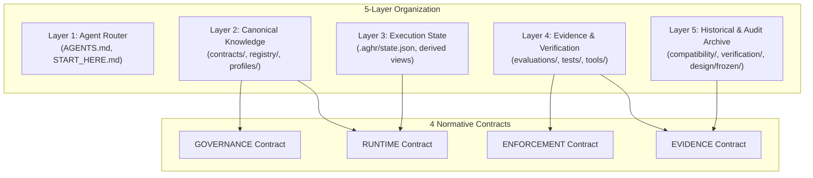

# Context Routing and Budget Report — AGHR Candidate 1.2.0

> **Authority:** Technical measurement of context footprint, progressive disclosure pathways, and retrieval boundaries.  
> **Tool:** Standard library heuristic analyzer in `tools/check_package.py`.

---

## 1. Executive Summary: Before vs. After Footprint

| Scenario / Scope | Baseline 1.1.0 (Unrouted) | Candidate 1.2.0 (Progressive Disclosure) | Optimization Impact |
|---|---|---|---|
| **Blind Directory Ingestion** | > 600,000 tokens (full package) | Blocked by explicit router directives | ~99.8% reduction in accidental context load |
| **Layer 1 Bootstrap Router (`AGENTS.md`)** | ~1,200 tokens (unstructured) | **~792 tokens** (3,167 chars, 31 lines) | Structured task matrix; strictly < 1,000 tokens |
| **Combined Bootstrap Navigation (`AGENTS` + `START_HERE` + `CONTENTS`)** | ~4,800 tokens (scattered) | **~3,330 tokens** (all 3 files combined) | Target advisory range (1,500–2,500 for entry router) |
| **Routine Surgical Edit Task** | ~4,800 tokens + task files | **~792 tokens** + active task files | Fast, clean session bootstrap |
| **Heavy Historical Archives (`compatibility/`, `verification/`, `design/frozen/`)** | Exposed to crawling crawlers | **Quarantined as `ON_DEMAND_AUDIT`** | Accessible only during formal audits |

---

## 2. Quantitative Footprint Breakdown (Candidate 1.2.0)

Data generated automatically by `tools/check_package.py`:

```json
{
  "id": "CONTEXT_BUDGET",
  "advisory_status": "PASS",
  "agents_md_tokens_est": 792,
  "bootstrap_total_tokens_est": 3330,
  "advisory_target_range": "1500-2500 tokens",
  "estimation_method": "CHAR_COUNT_DIV_4_HEURISTIC",
  "details": {
    "AGENTS.md": {
      "bytes": 3167,
      "chars": 3167,
      "words": 436,
      "lines": 31,
      "tokens_est": 792
    },
    "START_HERE.md": {
      "bytes": 5002,
      "chars": 5000,
      "words": 618,
      "lines": 51,
      "tokens_est": 1250
    },
    "CONTENTS.md": {
      "bytes": 5171,
      "chars": 5153,
      "words": 682,
      "lines": 60,
      "tokens_est": 1288
    }
  }
}
```

---

## 3. The 5-Layer Retrieval Model and Core Contract Alignment

The 5-layer classification organizes information retrieval efficiently while preserving AGHR's 4 normative contracts:



1. **Layer 1 (Agent Instructions / Router):**
   - *Files:* `AGENTS.md`, `START_HERE.md`.
   - *Budget:* Strictly < 1,000 tokens for `AGENTS.md`.
   - *Policy:* Provides the Task-Based Entry Matrix to route the agent directly to the minimal necessary documentation.
2. **Layer 2 (Canonical Knowledge):**
   - *Files:* `contracts/`, `registry/RULES.json`, `sources/`, `profiles/`, `CHARTER.md`.
   - *Retrieval:* Consulted on-demand when a task involves policy, architecture, or rule reconciliation.
3. **Layer 3 (Execution State):**
   - *Files:* `.aghr/state.json`, `.aghr/project.json`.
   - *Policy:* Single source of truth. Prose summaries (`CURRENT.md`, `HANDOFF.md`) are derived point-in-time snapshots.
4. **Layer 4 (Evidence & Verification):**
   - *Files:* `tools/`, `tests/`, `evaluations/`.
   - *Policy:* Consulted during preflight and testing.
5. **Layer 5 (Historical & Audit Archive):**
   - *Files:* `compatibility/`, `verification/`, `design/frozen/`.
   - *Classification:* `ON_DEMAND_AUDIT`. Fully preserved for traceability, strictly excluded from routine prompts.

---

## 4. Measurement Methodology and Documented Limits

- **Measurement Tool:** Standard library Python heuristic implemented in `tools/check_package.py`. Does not introduce Node.js or third-party tokenizers.
- **Ratio:** 1 token ≈ 4 characters across bilingual text, Markdown formatting, and JSON structures.
- **Limits:** Actual token consumption varies across specific model tokenizers (OpenAI cl100k_base / o200k_base, Anthropic Claude tokenizer, Google Gemini tokenizer). This heuristic serves as an advisory engineering baseline, never as an excuse to truncate mandatory governance rules.
