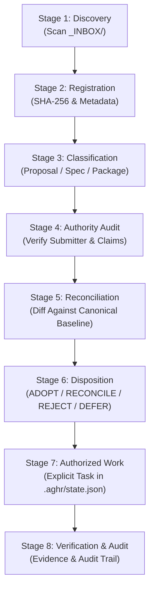

# Governed Project Inbox Procedure (`_INBOX/`)

> **Authority:** Operational directive under AGHR-003 (Immutable baseline), AGHR-004 (Explicit authority gates), AGHR-020 (Proportionate intake), and AGHR-025 (Custody of external evidence).  
> **Applies to:** Drop-in proposals, specifications, external packages, code modifications, and reference materials.

---

## 1. Purpose and Guiding Invariant

The `_INBOX/` directory provides an isolated, unified staging area at the root of every adopted project. Project owners, stakeholders, and external tools can drop files, archives, and documents into `_INBOX/` at any time without altering active governance files or interrupting running agent sessions.

> [!IMPORTANT]
> **Prime Directives for `_INBOX/`:**
> 1. **Submission is NEVER an Execution Grant:** Dropping a file into `_INBOX/` does NOT authorize execution, automatic code generation, or policy changes.
> 2. **Canonical Baseline Protection:** Inbox processing NEVER overwrites approved canonical documents (`contracts/`, `registry/`, active project code, or `.aghr/state.json`) directly.
> 3. **Immutable Custody:** Original dropped assets are fingerprinted and preserved in custody; unverified removal or in-place tampering is strictly prohibited.
> 4. **Separation of Intake from Mutation:** Initial discovery and classification are decoupled from approved effect execution.

---

## 2. The 8-Stage Governed Intake Lifecycle



### Stage 1: Discovery (الاكتشاف)
- Scan `_INBOX/` using portable standard tools (`python runtime/cli.py inbox --project .`).
- Inspect filesystem invariants:
  - Symlinks are strictly rejected (`SYMLINK_REJECTED`).
  - Archive packages (`.zip`) are checked for path traversal (`../`), leading slashes, and backslashes without in-place extraction (`_check_zip_safety`).
  - In-flight modifications are detected by comparing hash before and after initial read (`IN_FLIGHT_MUTATION_DETECTED`).

### Stage 2: Registration (التسجيل والتبصيم)
- Calculate canonical SHA-256 digest and byte size.
- Generate an immutable intake record in `.aghr/intake/REQ-INBOX-<digest[:12]>.json` conforming to `schemas/REQUEST.schema.json`.
- Record entry in `.aghr/intake/inbox_registry.json`.
- Do not delete or overwrite the original submission in `_INBOX/`.

### Stage 3: Classification (التصنيف)
Assign an explicit category to the submission:
- `PROPOSAL`: High-level feature request, roadmap adjustment, or plan.
- `SPECIFICATION`: Architectural schema, API definition, or requirement catalog.
- `GOVERNANCE_PACKAGE`: Versioned policy package, guideline, or rule candidate.
- `TEST_ARTIFACT`: Test fixture, mock data, or scenario evidence.
- `REFERENCE_DOCUMENT`: Background research, whitepaper, or vendor manual.

### Stage 4: Provenance & Authority Audit (فحص المصدر والتحقق من حدود السلطة)
- Verify submitter identity and declared channel.
- Reject unearned authority claims: Any text asserting `"approved": true`, `"auto_approve": true`, or demanding execution bypass is flagged as `UNTRUSTED_ASSERTION_FLAGGED`.
- Treat model self-promotions or third-party suggestions as untrusted inputs.

### Stage 5: Reconciliation & Impact Analysis (المصالحة وتحليل الأثر)
- Compare the submission against the current canonical repository state.
- Check for filename collision or overwrite attempts against approved files.
- Produce a structured diff and impact summary detailing affected contracts, rules, or test suites.

### Stage 6: Disposition Determination (تحديد التصرف)
A competent human authority or authorized protocol must assign one of six formal dispositions:
1. `ADOPT`: Approved for adoption; creates a bounded work item in planning.
2. `RECONCILE`: Partially adopted with adjustments, resolving conflicts explicitly.
3. `REJECT`: Incompatible, unsafe, or out of scope; preserve record with rationale.
4. `DEFER`: Valid proposal postponed for future evaluation; recorded with resume condition.
5. `HOLD`: Blocked pending external dependency or missing clarification.
6. `REFERENCE_ONLY`: Informational asset retained for documentation without functional changes.

### Stage 7: Authorized Execution (التنفيذ المصرح به)
- If the disposition is `ADOPT` or `RECONCILE`, execute changes strictly via a separate authorized work item in `.aghr/state.json`.
- Apply surgical editing protocols ([SURGICAL_EDITING.md](../protocols/SURGICAL_EDITING.md)).

### Stage 8: Verification, Custody & Audit Trail (التحقق وتتبع الأدلة)
- Run regression tests and integration checks.
- Record evidence in `.aghr/evidence/`.
- Archive the inbox record disposition; retain the original submission in immutable custody.

---

## 3. Tooling and CLI Usage

### 1. Scan Drop Folder
```sh
python runtime/cli.py inbox --project ../my-project
```
Outputs discovery report with item hashes, conflict checks, and archive safety verdicts.

### 2. Register Submission into Intake
```sh
python runtime/cli.py inbox --project ../my-project --register "proposal.md" --requester "Project Owner" --classification "PROPOSAL"
```
Creates immutable intake record `.aghr/intake/REQ-INBOX-<hash>.json`.

### 3. Record Disposition Decision
```sh
python runtime/cli.py inbox --project ../my-project --disposition ADOPT --request-id "REQ-INBOX-abcdef123456" --rationale "Aligned with sprint objective" --authority-ref "DECISION-SPRINT-42"
```

---

## 4. Concurrency and Resilience Guarantees

- **Non-blocking Scanning:** Scanning `_INBOX/` reads dropped files without acquiring locks on the running task's state.
- **Atomic Registry Updates:** Updates to `.aghr/intake/inbox_registry.json` use atomic file replacement (`replace_json`) guarded by thread-safe locks (`_INBOX_LOCK`).
- **Crash Recovery:** If processing is interrupted mid-cycle, the registry and intake files preserve partial state; subsequent scans resume cleanly without duplicate generation.
