# Final Proposal: AGHR Governance Studio (Aligned with AGHR 1.0.0-rc.3)

## 1. Review of the Proposal

### 1.1 Strengths (To Be Preserved)
| # | Point | Why it is correct |
|---|---|---|
| 1 | **Reusing the existing React/Vite/Node.js foundation** | A practical decision that avoids rewriting and leverages existing assets. |
| 2 | **Python tools via a defined subprocess runner** | Ensures the actual `aghr` CLI is used without duplicating logic in Node.js. |
| 3 | **"Change Package" as the central unit of work** | Aligns perfectly with §12 of rc.3 (separating evidence from state) and §16 (meta-governance). |
| 4 | **Approval tied to a specific version + re-evaluation on change** | Solves the "stale approval on new content" problem. A valuable addition not explicitly detailed in rc.3. |
| 5 | **Server-side authorization checks per operation (OWASP)** | Correct and aligns with §10 (declaration vs. enforcement). |
| 6 | **Separating "Availability / Qualification / Usage" in the Skill Card** | Accurately reflects §7.1 and §7.3 of rc.3. |
| 7 | **Separating Instruction Governance Level from Skill Governance Level** | Aligns with the skill-specific note in §13 of rc.3. |
| 8 | **Separating reporting accuracy from discovery quality measurement** | Aligns with §7.2 of rc.3, extending it with a measurement dimension. |
| 9 | **7 phases with clear exit criteria** | More precise than a generic 5-phase plan, specifically isolating "Single Instruction Cycle" and "Single Capability Cycle". |

### 1.2 Gaps vs. rc.3 (To Be Closed)
| # | Gap | Location in rc.3 | Correction |
|---|---|---|---|
| 1 | Proposal references `1.0.0-rc.2` | Introduction | Update to `1.0.0-rc.3 (Consolidated)`. |
| 2 | Uses `HOST_ACTIVATED` | §7.1 defines `HOST_SIGNAL` (optional) | Replace terminology. |
| 3 | Treats `UNKNOWN_SKILL` as a single concept | §7.2 splits into `UNKNOWN_ID`, `NO_SKILL_MATCH`, `DISCOVERY_UNAVAILABLE` | Update state model. |
| 4 | Omits `authority.level` | §3.1 and §5.2 (New in rc.3) | Add as a mandatory field in the instruction editor. |
| 5 | Omits `impact.evidence` | §6.1 (`assumed`/`benchmark`/`repo-measured`) | Display as a badge on every item. |
| 6 | Does not explicitly mention `runtime_evidence/{task_id}.jsonl` | §12.2 (Specific schema) | Add a dedicated "Runtime Evidence" screen. |
| 7 | Does not mention `PRIN-007` as mandatory for L1+ | §9.2 and §14.2 | Enforce check during the generation path. |
| 8 | Omits `skillQualification` with `contentHash` | §7.4 | Add this field to the Skill Card. |
| 9 | Omits resource limits for `eval`/`qualify` | Operational necessity | Adopt the previous review's recommendation (timeout + memory limits). |
| 10 | Does not separate 100% honesty checks from 95% behavioral tolerance | §11.1 (rc.3) | Display them as two distinct metrics. |

### 1.3 Decisions to be Finalized (From §6 of the proposal)
The proposal lists 7 decisions. My stance on each, mapped to rc.3:

| Issue | rc.3 Ruling | Studio Decision |
|---|---|---|
| `HOST_ACTIVATED` vs. Execution | `HOST_SIGNAL` is optional; `NOT_OBSERVABLE` is valid. | Display as an optional column; execution and verification have independent evidence. |
| `UNKNOWN_SKILL` | Three distinct states. | Three distinct colored badges; `NO_SKILL_MATCH` is not an error. |
| Recording new authorization with CI ownership | `runtime_evidence/` first, then CI publishes. | "Runtime Evidence" screen is strictly separate from "Published State". |
| Language scope | Rendering only; never filters rules. | Display a "Translation unavailable" warning instead of hiding the item. |
| Multilingual discovery metric | Separate reporting accuracy from choice quality. | Two distinct metrics in the Metrics dashboard. |
| Receiving `INBOX/new-app/` | Not explicitly in rc.3. | Define folder ingestion contracts before Phase 1. |
| Enabling writes | Static value must be replaced by identity + permission + proposal. | Bind writes to a specific Change Package + server-side verification. |

**Conclusion:** The proposal is **architecturally sound and ready for adoption**, pending the 10 updates to align with rc.3 and the addition of the "Runtime Evidence" screen.

---

## 2. Final AGHR Governance Studio Proposal (rc.3 Aligned)

### 2.1 Identity and Commitment to the Specification
**AGHR Governance Studio** is a local-first environment for managing the complete agent governance lifecycle, strictly compliant with **AGHR 1.0.0-rc.3 (Consolidated)**.

**Mandatory Architectural Commitments** (Derived from rc.3):
| Commitment | Source in rc.3 | Implementation in Studio |
|---|---|---|
| **Separation of the 4 Layers** | §1.1 | Each screen belongs to one layer; authority is never mixed with execution. |
| **CI is the sole writer of `state.json`** | §12.1 | The Studio **never** writes to `state.json`. |
| **Runtime evidence is separate** | §12.2 | `.aghr/runtime_evidence/{task_id}.jsonl` is managed by the Studio in read/format mode only. |
| **Language does not filter rules** | §5.3 | Items are always displayed; translation is optional. |
| **`authority.level` is mandatory for MUST/MUST_NOT** | §3.1, §5.2 | Required field in the instruction editor. |
| **`impact.evidence` is visible** | §6.1 | Badge on every item: `assumed` / `benchmark` / `repo-measured`. |
| **`HOST_SIGNAL` is optional** | §7.1 | Optional column in the Skill Card. |
| **Three distinct discovery states** | §7.2 | `UNKNOWN_ID` / `NO_SKILL_MATCH` / `DISCOVERY_UNAVAILABLE` with distinct colors. |
| **`PRIN-007` in every AGENTS.md at L1+** | §9.2 | Mandatory check in "Generation & Preview". |
| **Qualification per (host, version, scope, contentHash)** | §7.4 | Four distinct keys displayed in the Skill Card. |
| **100% honesty checks separate from 95% behavioral** | §11.1 | Two distinct metrics in the dashboard. |
| **Strict resource limits** | Operational recommendation | Timeout + memory limits on `eval`/`qualify` subprocesses. |

---

### 2.2 Product Model (Updated for rc.3)
Four interconnected elements, each reflecting a layer from rc.3:

| Element | rc.3 Layer | Manages | New rc.3 Fields |
|---|---|---|---|
| **Instructions** | Layer 1 — Governance Authority | kind, force, severity, **authority (with level)**, scope, enforcement, exceptions | `authority.level`, `impact.evidence`, `mergeEffect`, `gate` |
| **Capabilities & Skills** | Layer 2 — Guidance | source, function, permissions, conflicts, qualification, usage | `skillQualification` with `contentHash`, `hostVersion`, `scope` |
| **Project & Host** | Layer 3 — Execution Controls | tech stack, config, adoption level, host, host version | Separate L-levels for instructions vs. skills |
| **Changes & Evidence** | Layer 4 — Evidence | previous state, proposed, diff, checks, approvals, next state | `runtime_evidence/` strictly separated from `state.json` |

**Workflow (Updated):**

```mermaid
flowchart LR
    A["Source: Document, Lesson, or Request"] --> B["Classification + Reference Match<br/>(authority.level, force, severity)"]
    B --> C["Proposal in Isolated Space<br/>(draft + proposed YAML)"]
    C --> D["Checks: validate + lint + skill-states<br/>+ generate + preview diff"]
    D --> E["Review + Authorized Decision<br/>(tied to specific version_hash)"]
    E --> F["Export: patch / signed commit<br/>(No writing to state.json)"]
    F --> G["CI: Publishes approved state<br/>+ merges runtime_evidence"]
    G --> H["Studio: Displays actual state<br/>+ operational evidence"]
```


---

### 2.3 Data Model (SQLite — Updated)

```sql
-- Workspaces (AGHR Packages)
CREATE TABLE workspaces (
  id TEXT PRIMARY KEY,
  name TEXT NOT NULL,
  package_path TEXT NOT NULL,
  package_version TEXT,                 -- read from aghr.json
  schema_version TEXT,                  -- rc.3 = "1.2"
  package_signature_verified INTEGER,   -- from cosign
  created_at TEXT NOT NULL,
  last_scanned_at TEXT
);

-- Target projects
CREATE TABLE target_projects (
  id TEXT PRIMARY KEY,
  workspace_id TEXT REFERENCES workspaces(id),
  name TEXT NOT NULL,
  path TEXT NOT NULL,
  detected_profile TEXT,
  instruction_level TEXT,                -- L0..L4 for instructions (§13)
  skill_level TEXT,                      -- L0..L4 for skills (§13)
  git_remote TEXT,
  git_branch TEXT,
  host TEXT,                             -- codex | gemini-cli | antigravity | claude-code
  host_version TEXT,
  last_scanned_at TEXT
);

-- Instruction items index (cache — NEVER written back to files)
CREATE TABLE instruction_items_cache (
  workspace_id TEXT,
  item_id TEXT,
  kind TEXT,
  force TEXT,
  severity TEXT,
  authority_level TEXT,                  -- NEW rc.3: enterprise|organization|project|component
  authority_owner TEXT,
  authority_status TEXT,
  priority_tier TEXT,                    -- P0-Safety|P0-Integrity|P1-Reasoning|P2-Quality|P3-Presentation
  impact_band TEXT,
  impact_evidence TEXT,                  -- assumed|benchmark|repo-measured (NEW rc.3)
  next_review TEXT,
  source_path TEXT,
  content_hash TEXT,
  indexed_at TEXT,
  PRIMARY KEY (workspace_id, item_id, content_hash)
);

-- Capability items
CREATE TABLE capability_items_cache (
  workspace_id TEXT,
  item_id TEXT,
  skill_id TEXT,
  source TEXT,                           -- system|user|project|extension|catalog|aghr
  function TEXT,                         -- routing|design|implementation|security|verification|learning
  permissions_read TEXT,                 -- JSON array
  permissions_write TEXT,                -- JSON array
  permissions_network TEXT,              -- allow|deny
  permissions_secrets TEXT,              -- allow|deny
  conflicts_with TEXT,                   -- JSON array
  alternatives TEXT,                     -- JSON array
  content_hash TEXT,
  indexed_at TEXT,
  PRIMARY KEY (workspace_id, item_id, content_hash)
);

-- Skill qualification (Read-only from state.json + evidence)
CREATE TABLE skill_qualification_snapshot (
  workspace_id TEXT,
  skill_id TEXT,
  host TEXT,
  host_version TEXT,
  scope TEXT,
  status TEXT,                           -- QUALIFIED|NOT_RUN|NOT_OBSERVABLE|UNKNOWN|FAILED
  qualified_at TEXT,
  content_hash TEXT,
  evidence_json TEXT,
  read_at TEXT,
  PRIMARY KEY (workspace_id, skill_id, host, host_version, scope, content_hash)
);

-- Change packages (Central unit of work)
CREATE TABLE change_packages (
  id TEXT PRIMARY KEY,
  workspace_id TEXT REFERENCES workspaces(id),
  title TEXT NOT NULL,
  kind TEXT NOT NULL,                    -- CONSTRAINT|REQUIREMENT|...|CAPABILITY|EXCEPTION
  target_item_id TEXT,                   -- if modifying existing
  status TEXT NOT NULL,                  -- draft|validating|validated|in_review|approved|exported|closed
  source_ref TEXT,                       -- origin (document/lesson/request)
  source_hash TEXT,
  base_version TEXT,                     -- previous package version
  proposed_yaml TEXT NOT NULL,
  validation_result_json TEXT,
  lint_result_json TEXT,
  skill_state_result_json TEXT,
  preview_diff TEXT,
  impact_summary_json TEXT,              -- impact on Maturity/Compat/Consumers
  required_approvals_json TEXT,          -- {"governance-owner": true, "security-owner": false}
  version_hash TEXT,                     -- hash of proposed content — invalidates approvals on change
  created_by TEXT,
  created_at TEXT,
  updated_at TEXT
);

-- Approvals (Tied to a specific version)
CREATE TABLE change_package_approvals (
  package_id TEXT REFERENCES change_packages(id),
  role TEXT NOT NULL,
  approver TEXT NOT NULL,
  decision TEXT NOT NULL,                -- approve|reject
  approved_version_hash TEXT NOT NULL,   -- must match current version_hash
  reason TEXT,
  at TEXT NOT NULL,
  PRIMARY KEY (package_id, role, approver, approved_version_hash)
);

-- Runtime evidence (Read-only from .aghr/runtime_evidence/)
CREATE TABLE runtime_evidence_events (
  id INTEGER PRIMARY KEY AUTOINCREMENT,
  workspace_id TEXT,
  target_project_id TEXT,
  task_id TEXT NOT NULL,
  event_type TEXT NOT NULL,              -- selected|loaded|executed|verified|blocked|discovery_outcome
  skill_id TEXT,
  payload_json TEXT NOT NULL,
  recorded_at TEXT NOT NULL,
  source TEXT                            -- agent|host|ci
);

-- Verification runs
CREATE TABLE verification_runs (
  id TEXT PRIMARY KEY,
  workspace_id TEXT,
  command TEXT NOT NULL,                 -- validate|generate-check|lint|skill-states|eval|qualify
  args_json TEXT,
  status TEXT NOT NULL,                  -- running|passed|failed|suspicious|errored|resource_limit_exceeded
  exit_code INTEGER,
  started_at TEXT NOT NULL,
  finished_at TEXT,
  duration_ms INTEGER,
  summary_json TEXT,
  raw_output TEXT
);

-- Audit log
CREATE TABLE audit_events (
  id INTEGER PRIMARY KEY AUTOINCREMENT,
  at TEXT NOT NULL,
  actor TEXT NOT NULL,
  simulated_role TEXT,
  event_type TEXT NOT NULL,              -- pkg.create|pkg.approve|apply.export|verify.run|...
  workspace_id TEXT,
  payload_json TEXT
);
```
**Governing Rule:** Any table ending in `_cache` or `_snapshot` is **derived and read-only**. It is never written to by the Studio. The source of truth remains the files on disk and `state.json` (written by CI).

---

### 2.4 Screens (Updated for rc.3)

| # | Screen | Layer | Function | rc.3 Features Displayed |
|---|---|---|---|---|
| 1 | **Project Dashboard** | Layer 1 + 3 | Dual adoption levels + risks | Separate `instruction_level` + `skill_level` (§13) |
| 2 | **Instructions Registry** | Layer 1 | Search/filter/edit instructions | `authority.level`, `impact.evidence`, `mergeEffect`, `gate` |
| 3 | **Instruction Detail** | Layer 1 | Full item card | 8 dimensions + relations + verification history + last eval |
| 4 | **Capabilities & Hosts** | Layer 2 | Skill inventory + qualification | `skillQualification` with 4 keys + `contentHash` |
| 5 | **Skill Detail** | Layer 2 | Full skill card | Availability/Qualification/Usage in 3 axes (§7.1, §7.3) |
| 6 | **Profiles & Scope** | Layer 2 | Project selections | `scope.paths`, `scope.languages` (display only), `scope.appliesToAgents` |
| 7 | **Generation & Preview** | Layer 2 | Preview `AGENTS.md` and outputs | Byte budget, compression reasons, `PRIN-007` check |
| 8 | **Verification & Evidence** | Layer 4 | Run checks + view results | validate/generate-check/lint/skill-states/eval/qualify + SARIF |
| 9 | **Runtime Evidence** *(New)* | Layer 4 | View `.aghr/runtime_evidence/` | `SELECTED/LOADED/EXECUTED/VERIFIED/HOST_SIGNAL/NOT_OBSERVABLE/BLOCKED/UNKNOWN_ID/NO_SKILL_MATCH/DISCOVERY_UNAVAILABLE` |
| 10 | **Change Packages** | Layer 4 | List/edit/review | `version_hash` + approval binding |
| 11 | **Change Package Detail** | Layer 4 | diff + checks + approvals + export | Separation of "Proposed" from "Published" |
| 12 | **Intake & Learning** | Layer 4 | Ingest documents and lessons | Routing to `governed-learning` |
| 13 | **Audit & Reports** | Layer 4 | Full log + export | SARIF/JSON/MD reports |
| 14 | **Metrics** | Layer 4 | §17 Indicators | 100% honesty vs ≥95% behavioral (separated) |
| 15 | **Settings** | Layer 3 | Workspaces, roles, signing, host config | GPG fallback + resource limits |

**Core Design Principle:** Every screen declares in its header which of the four layers it serves. This prevents mixing "display", "execution", "authority", and "evidence".

---

### 2.5 Key Interaction Details (Updated)

#### 2.5.1 Instruction Editor — Enforces `authority.level`
The editor displays fields based on item kind, force, and severity, deriving conditions from `item.schema.json` (rc.3 §3.3):
- `INFORMATIVE`/`MAY`: `id`, `kind`, `force`, `severity`, `scope`, `rule`
- `SHOULD`/`SHOULD_NOT`: + `authority.owner`, `rationale`
- `MUST`: + **`authority.level` (Mandatory)**, `verification`
- `MUST_NOT` + `critical|high`: + `approvedBy`, technical/human enforcement, `evalFixtures`, `mergeEffect`, `gate`
- Any item referencing a `CAPABILITY`: + `skillQualification` record

**Mandatory Behavior:** If the user selects `force: MUST` but omits `authority.level`, an immediate error appears, suggesting the project's default level.

#### 2.5.2 Skill Card — 3 Axes + 4 Qualification Keys
1. **Availability:** `EXISTS` (on disk) → `DISCOVERED` (session) → `QUALIFIED` (for host).
2. **Qualification:** `status` + `qualifiedAt` + `evidence` + **`contentHash`** + **`hostVersion`** + **`scope`**.
3. **Task Usage:** `SELECTED` → `LOADED` → `EXECUTED` → `VERIFIED` + `HOST_SIGNAL` (optional) or `NOT_OBSERVABLE`.

**Mandatory Behavior:** If `contentHash` or `hostVersion` changes, a red "Qualification Expired — Re-qualification Required" badge appears, and the skill cannot be selected for P0 tasks.

#### 2.5.3 Runtime Evidence Screen — Independent View
Displays events from `.aghr/runtime_evidence/{task_id}.jsonl` (rc.3 §12.2) chronologically:
- **Default Filter:** Show `BLOCKED`, `UNKNOWN_ID`, `DISCOVERY_UNAVAILABLE`, `EXECUTED_FAILED` first (require attention).
- **Linkage:** Every event links to the `task_id` visible in the open PR.
- **"Submit to CI" Button:** Generates a PR draft including the evidence file alongside code changes, for CI to evaluate and merge into `state.json`.
- **No Writing:** This screen is for reading and formatting only.

#### 2.5.4 Project Dashboard — Dual Levels
Displays:
- **Instruction Governance Level:** L0–L4 per §13.
- **Skill Governance Level:** L0–L4 separately, with a divergence warning if they mismatch.
- **Clickable Indicators:** e.g., "3 P0 capabilities need qualification on current host", "2 P0 items with `impact.evidence: assumed` for >60 days", "2 exceptions expiring in 14 days".

---

### 2.6 Change and Approval Path (Updated)

The **Change Package** is the central unit of work:

```yaml
change_package:
  id: CP-2026-0042
  title: "Add SEC-008: no shell expansion in agent commands"
  kind: CONSTRAINT
  target_item_id: null                  # new creation
  source:
    type: document | lesson | request
    ref: "INBOX/security-review-2026-10.md"
    hash: "sha256:..."
  base:
    package_version: "1.0.0-rc.3"
    base_item_ids: []                   # items that might be affected
  proposal:
    yaml: |
      id: SEC-008
      kind: CONSTRAINT
      force: MUST_NOT
      severity: critical
      authority:
        level: enterprise               # MANDATORY
        source: policies/security/shell.yaml
        owner: security-owner
        approvedBy: governance-board
        status: active
        effectiveFrom: 2026-11-01
      # ... remaining fields
    version_hash: "sha256:..."          # invalidates approvals on change
  checks:
    validate: { status: passed, at: "..." }
    lint: { status: passed, at: "..." }
    generate_check: { status: passed, at: "...", byte_delta: "+142B" }
    skill_states: { status: not_applicable }
    eval: { status: pending, fixtures_required: ["evals/fixtures/instruction/SEC-008/"] }
  impact:
    on_authority: "adds enterprise-level constraint"
    on_compatibility: "no conflict with existing items"
    on_consumers: ["services/payments/**", "services/auth/**"]
  approvals:
    - role: governance-owner
      approver: "alice"
      decision: approve
      approved_version_hash: "sha256:..."  # MUST match proposal.version_hash
      at: "2026-10-21T18:30:00Z"
  export:
    format: patch | commit_signed | commit_unsigned
    patch_path: ".governance/studio/drafts/CP-2026-0042.patch"
```

**Core Rules:**
1. **Approval is tied to `version_hash`.** If the proposal changes (even one character), all prior approvals are automatically invalidated and require re-approval.
2. **`state.json` is never written by the Studio.** Export creates a patch or commit on a new branch. CI merges after checks pass.
3. **`runtime_evidence` is attached to the PR** if the change resulted from an agent session. CI evaluates it before adopting `state.json`.
4. **`mergeEffect: blocking` requires `gate.required: true` to actually exist** — the Studio verifies this via `aghr doctor` before allowing export.

---

### 2.7 Technical Architecture (Updated)

**Architectural Decision:** Reuse the existing React/Vite/Node.js foundation, with an independent Python adaptation layer.

```text
src/                                    # Existing Frontend — Expanded
  features/
    studio-shell/                       # Global shell + status bar
    governance-items/                   # Screens 2, 3
    capabilities/                       # Screens 4, 5
    profiles/                           # Screen 6
    generation/                         # Screen 7
    verification/                       # Screen 8
    runtime-evidence/                   # Screen 9 (New)
    change-review/                      # Screens 10, 11
    intake-learning/                    # Screen 12
    audit-reports/                      # Screen 13
    metrics/                            # Screen 14
    settings/                           # Screen 15
  i18n/                                 # ar + en

server/                                 # Node.js — Existing
  studio/
    routes/                             # REST endpoints
    contracts/                          # OpenAPI + JSON Schema
    services/                           # Studio logic (NO AGHR logic)
    package-adapters/                   # Bridge to aghr CLI (Python)
    job-runner/                         # subprocess with timeout + memory limit
    auth/                               # per-request authorization
    evidence-reader/                    # reads .aghr/runtime_evidence/ (read-only)

aghr/                                   # Python — Imported or invoked
  # validate, lint, generate, check, eval, qualify (via subprocess)

.governance/
  studio/
    drafts/                             # change package drafts
    jobs/                               # job runner logs
    cache/                              # derived indexes (rebuildable)
```

**Responsibility Distribution (Matches rc.3 §1.1):**
| Component | Layer | Responsibility |
|---|---|---|
| **AGHR Package** | Layer 1 | Schemas, policies, templates, validation/generation rules |
| **Studio (Frontend + Node)** | Layer 2 | Display, structured editing, diffing, workflow orchestration |
| **Host** | Layer 3 | Discovering skills, loading them, executing tools, emitting signals |
| **CI** | Layer 3 + 4 | Approved checks, publishing `state.json`, merging `runtime_evidence` |
| **Owner/Reviewers** | Layer 1 | Acceptance decisions, exceptions, releases |

**Strict Integration Rule:** The job-runner invokes `aghr` via subprocess *only*. **No duplication of validation logic in Node.js.** Any discrepancy between Studio validation and CI validation is a critical bug to be fixed immediately.

---

### 2.8 Execution Plan (7 Phases, Updated)

| Phase | Duration | Deliverable | Exit Criterion |
|---|---:|---|---|
| **0 — Contract Finalization** | 1 week | `aghr.json` v1.2, §6 decisions resolved, `contracts/` updated, SQLite schema | All ambiguities documented; `state.json` is strictly read-only in Studio |
| **1 — Specialized Browsing** | 2 weeks | Screens 2, 3, 4, 5 connected to a real package | Every item linked to source; `authority.level` visible; `impact.evidence` visible |
| **2 — Single Instruction Cycle** | 2 weeks | Author SEC-001 → validate → generate → preview diff (Screens 2, 3, 7, 10, 11) | Reject invalid YAML; generation ≤32 KiB; `PRIN-007` present; `version_hash` invalidates approvals |
| **3 — Single Capability Cycle** | 2 weeks | CAPABILITY + qualification + documented usage (Screens 4, 5, 8, 9) | Pass 8 scenarios (§11.2) + 7 honesty checks; `NOT_OBSERVABLE` displayed; `BLOCKED` ≠ `NO_SKILL_MATCH` |
| **4 — Governed Change** | 2 weeks | Draft → review → approval → export patch/commit (Screens 10, 11, 13) | Reject invalid auth; reject stale approvals; reject `AGENTS.md` drift |
| **5 — Pilot Project** | 2 weeks | Adopt L2 (instructions) + L3 (P0 skills) on two projects (small + production) | Actual evidence linked to versions; qualification gaps logged; `runtime_evidence` attached to PR |
| **6 — Operational Refinement** | 1 week | Lessons, reports, scheduled checks, Metrics (Screens 12, 13, 14) | Lesson → classified proposal → decision path; valid SARIF report; two separate metrics (100% vs ≥95%) |

**Total Estimated Time:** 12 weeks.
**Recommended First Deliverable:** Instruction Registry + Skill Card, connected to a complete cycle for instruction `SEC-001` and one capability. This tests the data model, generation, evidence, and decision flow early. **I fully agree with this approach.**

---

### 2.9 Acceptance Criteria (Updated for rc.3)

**Functional:**
- [ ] Every instruction and capability is traceable to its source and version.
- [ ] `authority.level` is visible and filterable on every `MUST`/`MUST_NOT` item.
- [ ] `impact.evidence` is visible on every item, with distinct colors per category.
- [ ] Language **never hides** an item; translation is optional with an "unavailable" badge.
- [ ] Validation is consistent between the editor and `aghr` (no discrepancies).
- [ ] Generation is ≤ `budgetBytes` per target, with explicit failure on P0 overflow.
- [ ] `PRIN-007` is present in every `AGENTS.md` at L1+.
- [ ] `task_criteria` is consumed in verification (not merely accepted).
- [ ] `BLOCKED` is distinct from `NO_SKILL_MATCH`, `UNKNOWN_ID`, and `DISCOVERY_UNAVAILABLE`.
10. [ ] `NOT_OBSERVABLE` is displayed as a valid state, not an error.
- [ ] `HOST_SIGNAL` is never fabricated.
- [ ] Qualification is invalidated upon change to: `host`, `hostVersion`, `scope`, or `contentHash`.
- [ ] Approval is tied to `version_hash`; any proposal change invalidates it.
- [ ] `state.json` is unwritable by the Studio (regression test).
- [ ] `runtime_evidence` is displayed and attachable to a PR, but never directly merged into `state.json`.
- [ ] `mergeEffect: blocking` requires an existing `gate.required: true` (verified via `aghr doctor`).
- [ ] Declared adoption controls are actually enforced (no false claims).
- [ ] UI paths work in Arabic and English in isolated Microsoft Edge.
- [ ] Local test results are separated from host qualification, independent review, and release acceptance.
- [ ] 100% honesty checks are separated from ≥95% behavioral tolerance (two distinct metrics).
- [ ] `eval`/`qualify` are governed by timeout + memory limits; `resource_limit_exceeded` state exists.

**Non-Functional:**
- [ ] Cold start < 3 seconds.
- [ ] Indexing 500 items < 5 seconds.
- [ ] In-process `validate` < 2 seconds.
- [ ] File watcher is constrained (debounce + extension filtering + exclusion of `node_modules`, `.git`, `__pycache__`).
- [ ] GPG signing is optional with a fallback and visible warning.
- [ ] Every write operation (patch/commit) is preceded by a diff preview.
- [ ] Server-side authorization on every request, bound to project + action + change.
- [ ] No command injection via job-runner (fixed command allowlist).
- [ ] E2E tests (Playwright) cover critical paths.

---

### 2.10 Risks and Mitigation

| Risk | Probability | Impact | Mitigation |
|---|---|---|---|
| Drift between Studio and CI | Medium | High | Same `aghr` via job-runner; E2E comparison; no validation logic in Node.js |
| Accidental `state.json` write | Low | Critical | Code-level protection + regression test + review |
| Complexity of 15 screens slows delivery | Medium | Medium | Phases 1–3 cover only 8 screens; the rest in 4–6 |
| Slow `eval`/`qualify` | Medium | Medium | WS streaming + strict limits + background execution |
| User expects "automatic apply" | High | Medium | Explicit UX: Apply = local patch/commit, not deployment |
| Job-runner resource exhaustion | Medium | Medium | `resource` limits + timeout + queue |
| Upgrading rc.3 → rc.4 during development | Low | Medium | Schema version pinned in `aghr.json`; compatibility check on workspace open |

---

### 2.11 Final Decision

| Dimension | Verdict |
|---|---|
| **Submitted Proposal** | Fully adopted with 10 updates to align with rc.3 |
| **Technical Architecture (React/Vite/Node + Python adapter)** | Adopted — practical and leverages existing assets |
| **Central "Change Package" Model** | Adopted — aligns with §12 and §16 in rc.3 |
| **Approval tied to `version_hash`** | Adopted — a correct addition beyond rc.3 |
| **7 Phases with Exit Criteria** | Adopted — more precise than 5 phases |
| **15 Screens** | Adopted, with "Runtime Evidence" separated as an independent screen |
| **`authority.level` in Editor** | **Mandatory** — new in rc.3 |
| **Three distinct discovery states** | **Mandatory** — new in rc.3 |
| **`HOST_SIGNAL` is optional** | **Mandatory** — new in rc.3 |
| **`impact.evidence` is visible** | **Mandatory** — new in rc.3 |

**Immediate Next Step:** Phase 0 (1 week) — Finalize contracts, resolve the 7 decisions from §6, and update `contracts/` and the SQLite schema. Following this, Phase 1 will prove the architecture at minimal cost via the Instruction Registry and Skill Card screens on a real `SEC-001` + `CAPABILITY` package.

**Success Criterion for Week 1:** `aghr-studio` opens, displays all AGHR rc.3 items with `authority.level` and `impact.evidence` visible, and the Skill Card displays the three axes with the four qualification keys — **without writing anything to disk.**
